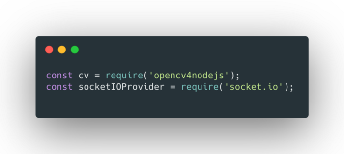
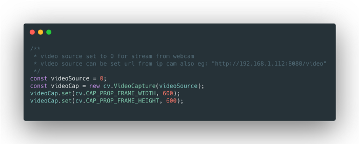
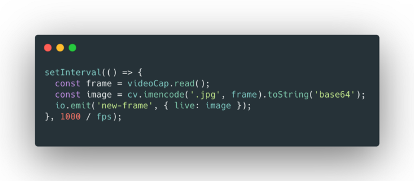
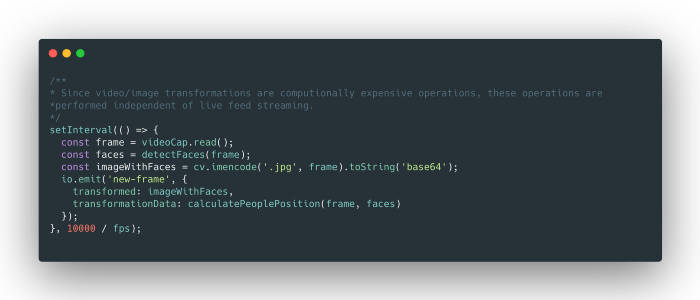
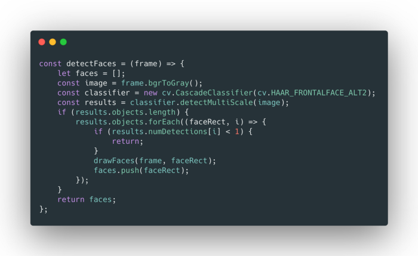
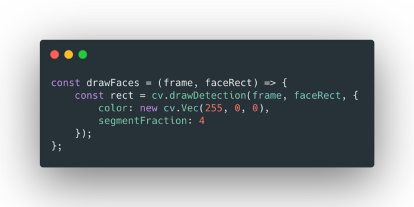
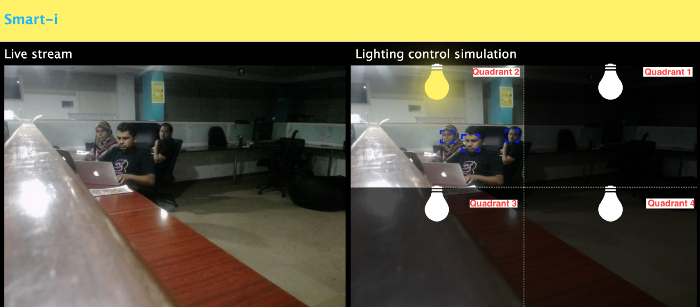

# Automating lights with Computer Vision & NodeJS

## A smart Computer Vision and NodeJS based solution that turns off the lights when not in use, and saves power.

Photo by [Henry McIntosh](https://unsplash.com/@henrymcintosh?utm_source=unsplash&utm_medium=referral&utm_content=creditCopyText) on [Unsplash](https://unsplash.com/@henrymcintosh?utm_source=unsplash&utm_medium=referral&utm_content=creditCopyText)

# **The Challenge**

It is common to see visuals in homes and offices with illuminated spaces having few people or none in the near vicinity.

Apart from costing more, this kind of illumination also has a negative impact on the environment. We’re increasing dependency on our limited, non-renewable sources of energy to generate electricity, that is often wasted.

While our energy usage at home is nominal, in offices, the usage is a lot more. Hence, the negative impact on the environment and the cost is a lot more. This necessitates positive action from our end.

When putting up signs of “Please turn off lights before leaving” has little or no impact, the magnitude of loss is bigger, considering the number of lights, area covered and other factors. It is not feasible to have someone deal with the issue of over-illumination by simply turning the lights off every single time. Human memory is fickle and cannot be relied upon.

Let’s understand the impact of a single light bulb. A 10-watt bulb consumes 0.01 kW of electricity per hour(kWh). Let’s assume the cost of 1 kWh is 12 cents. Then every 10-watt bulb that is lit up when not needed, will cost 0.12 cents per hour.

I will leave it to your basic arithmetic skills to figure the total cost across an office by multiplying the number of lights to the above number.

# So how do we address this?

While there are a lot of smart control and automation solutions available in the market, most solutions require additional hardware to be set up at regular intervals and leads to additional maintenance costs.

Is there a better way of dealing with this challenge?

All office spaces have a camera/s set up to monitor the area. My colleagues and I brainstormed ways to deal with this through minimal investment. Then came the eureka moment!

Why not use these cameras that capture the different frames, to automatically turn off the lights?

# Our response

The solution is to express our intention of saving energy through the eyes of a computer — through **Computer Vision**.

So what exactly is Computer Vision?

> “Computer Vision, often abbreviated as CV, is defined as a field of study that seeks to develop techniques to help computers ‘see’ and understand the content of digital images such as photographs and videos.”
>
> — Jason Brownlee, in his [article](https://machinelearningmastery.com/what-is-computer-vision/) on machine learning.

To illustrate, just like an eco-friendly person, who looks out for illuminated rooms or spaces, that are unoccupied, to turn off lights, our system will be programmed to do this automatically. The system will look into the incoming stream from the camera, which is essentially the field of vision of the camera. Each captured frame is divided into 4 quadrants. And if there are no people in a particular quadrant, the lights belonging to that quadrant will be turned off.

This solution is implemented with [opencv4Nodejs](https://github.com/justadudewhohacks/opencv4nodejs#readme), which is a Node.js wrapper for popular open-source Computer Vision library [OpenCV](https://opencv.org/). Along with [socket.io](https://socket.io/) and [express](https://expressjs.com/) for rendering a web app to display a live stream of video and to simulate the turning on and off of lights.

# Steps to implement

1. Import required libraries.

2. Start capturing video feed from the camera.

3. Read feed and stream it to the web app at a regular frame rate.

4. Read feed at an interval greater than that of the live stream for determining user presence.

5. Detect people using any of the OpenCV classifiers. In this solution, the “HAAR Frontal face classifier” is being used. The detected face positions relative to the frame are stored for later usage.

6. Mark faces on to the frame, for visualizing detection.

7. Identify people’s position relative to the frame, to decide which quadrant they are in so that only those sections are lit up. Identified results are then sent to the web app for lighting simulation. Bulb color is changed to simulate which quadrant to light up.

Since people are present in Quadrant 2, the system lights up only quadrant 2

# Conclusion

This is one of the many examples to show how technology can be used for the betterment of the planet, by saving energy. You can also learn how to solve a common workplace challenge through this simple implementation.

Refer to the source code for the above-explained solution:

[## Mudassir-23/opencv-nodejs-energy-saver

### opencv & nodejs based energy saving solution. Contribute to Mudassir-23/opencv-nodejs-energy-saver development by…

#### github.com](https://github.com/Mudassir-23/opencv-nodejs-energy-saver)

Also check out the [boilerplate](https://github.com/Mudassir-23/opencv4nodejs-express-websockets) code for opencv4nodejs, express, and socket.io based apps.

This solution can be extended beyond just simulation.

You can use the established socket connection to the express app and from the received binary data for each quadrant. You can decide in which quadrant physical lights are to be turned on or off through relays! ⚡️
