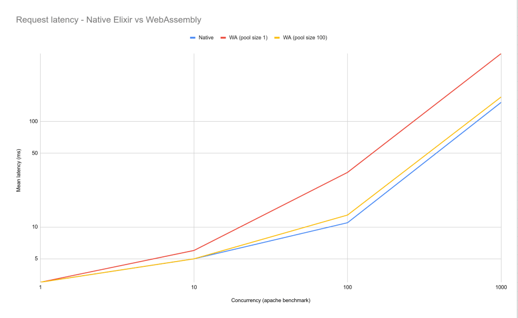

# Planetary Scale Rust and Golang by embedding WebAssembly in Elixir

Dec 5
・8 min read

*This blog post was heavily inspired by the [Lunatic project](https://github.com/lunatic-lang/lunatic) and bkolobara’s blog post [“Writing Rust the Elixir Way”](https://dev.to/bkolobara/writing-rust-the-elixir-way-2lm8).*

Compiling languages to WebAssembly is the next great-leap forward in software. With portable binaries that safely run in a sandbox, WASM makes it simple to embed multiple guest languages in a host language. Combining these excellent executional qualities of WebAssembly with Elixir’s fault-tolerance and distributed nature, has massive potential. Elixir’s powerful messaging system layered on top of its supervisor-trees for monitoring processes provides a robust framework for a global network of interconnected WebAssembly actors.

## The project

To investigate embedding WebAssembly inside of Elixir, I built a toy serverless function platform for executing WebAssembly code. Put simply, you upload a .wasm file and then call a function inside by going to a url. The project is meant to investigate the overheads involved with running WebAssembly. To this end, a series of rudimentary benchmarks were done on the project and are included at the end.

The finished code is here:

### Distributed WebAssembly VM

# Assemblex

This is an toy WebAssembly Serverless Function deployment system. With Assemblex, you can deploy WebAssembly binaries across nodes and hot reload new code across the network easily.

Assemblex programs follow the [WaPC protocol](https://github.com/wapc). Current Languages supported are:

- Rust
- Golang
- AssemblyScript
- Zig

# Try it out

```
# Clone repo and all submodules
git clone --recurse-submodules -j4 git://github.com/hansonkd/assemblex.git
cd assemblex
# Start one node in one terminaal
iex --name a@127.0.0.1 -S mix phx.server
# Start another node in a different terminal
PORT=4001 iex --name b@127.0.0.1 -S mix phx.server
# Build and release the WASM binary on first node
cd rust-wasm-hello-world/
cargo build --release
curl -F 'wasm=@target/wasm32-unknown-unknown/release/hello_world.wasm' http://localhost:4000/deploy
# Watch Node A's Terminal until it says its deployed and try to call the Wasm Function:
echo "$(curl --no-progress-meter http://localhost:4000/call/hello_world)"
# Wait about 15seconds for the wasm to propagate to the other node. Watch Node B's terminal
```

…

[View on GitHub](https://github.com/hansonkd/assemblex)

## WaPC

WebAssembly by itself is rather restrictive: only allowing number types to be passed back and forth between the host. The host is responsible for reading the raw memory of the WebAssembly VM to extract strings. [Web Assembly Procedure Calls](https://github.com/wapc) aim to create a consistent interface across languages to pass binary data. Rustler is used to safely embed the WaPC runtime inside Elixir. WaPC currently supports Rust, Golang, AssemblyScript and Zig.

## Concurrency

The standard WaPC runtime has one major restriction which does not mesh well with the Elixir universe; it operates synchronously. Every VM you spin up needs to have its own separate thread. It works if you have a small amount of workers running, but in Elixir you can be serving thousands of requests at once, which in our case each request needs its own VM. This [blog post](https://dev.to/bkolobara/writing-rust-the-elixir-way-2lm8) about adding preemptive scheduling to WasmTime inspired me to transform the WaPC runtime into an asynchronous scheduler. The current scheduler is not as advanced as Lunatic, yielding only on host callbacks, but it does allow you to recursively call the WaPC module without deadlocking. Adding preemptive calls should be as simple as running the Lunatic normalizer over the Wasm as the “yield” host callback has already been added.

## Lasp

Every distributed system needs a backbone and ours is [Lasp-Lang](https://lasp-lang.readme.io/), a self-described “comprehensive programming system for planetary scale Elixir and Erlang applications”. We're going to depend on lasp for one main thing: a conflict-free, in-memory, eventually-consistent CRDT store. Nodes auto-configure and network themselves together and deploy our Wasm binary in just a few lines of code. Lasp is special because the networking backend uses partisan, which orchestrates a loosely connected network of nodes. Unlike regular erlang, each node does not automatically connect to all of the other nodes. Partisan works by intelligently composing the edges of the graph to maximize resiliency while minimizing overhead. The result is a self-configuring network capable of hosting hundreds or even thousands of nodes.

## Phoenix

Elixirs Phoenix framework is used to provide a scalable HTTP interface to our app.

# Running the Distributed Service

The service consists of 3 main things, deployment, supervision and execution.

## Deployment

Lasp exposes a KV store that is eventually consistent across all nodes. Deployment is as simple as setting the key that will hold the Wasm binary and letting lasp do its thing and synchronize the value across all nodes. We will then update the version counter to signal the supervisor task to hotswap the new binary on the executor.

```
defmodule AssemblexWeb.PageController do
  ...
  def deploy(conn, %{"wasm" => upload}) do
    bytes = File.read!(upload.path)
    WapcSupervisor.deploy(bytes)
    text(conn, "Ok. Deploy Queued")
  end
end

...

defmodule Assemblex.WapcSupervisor do
  ...

  def deploy(new_code) do
    :lasp.update({"app-wasm", :lwwregister}, {:set, :erlang.unique_integer([:monotonic, :positive]), new_code}, self)
    :lasp.update({"app-version", :state_gcounter}, :increment, self)
  end

  ...
end
```

Then to initiate the deploy, just upload the .wasm to the deploy endpoint and let lasp do the rest.

```
curl -F 'wasm=@hello_world.wasm' http://localhost:4000/deploy
```

## Supervision

Our app needs to know when to update itself. Lasp includes a “monotonic read” function that blocks until the value is at least that big. We will use the function to block until it changes to a value bigger than than one bigger of the current version. After that, the binary is loaded, the new thread started and registered with the local `ProcessRegistry` while the old process is shut down, unregistered and the loop starts again.

```
defmodule Assemblex.WapcSupervisor do
  use Task

  def start_link(arg) do
    Task.start_link(__MODULE__, :run, [arg])
  end

  def run(arg) do
    loop({0, nil})
  end

  defp loop({version, sender}) do
    :lasp.read({"app-version", :state_gcounter}, {:value, version + 1})
    {:ok, new_code} = :lasp.query({"app-wasm", :lwwregister})
    {:ok, pid} = WapcExecutor.spawn(new_code)
    ProcessRegistry.add(pid)
    if sender != nil do
      ProcessRegistry.remove(sender)
      Process.exit(sender, :normal)
    end
    loop({version + 1, pid})
  end

  ...
end
```

## Execution

A Phoenix Controller gives our entry point into executing the code. We will pull one process off of the `ProcessRegistry` and send it to the `WapcExecutor`. A new VM will spin up, call the guest function and return the bytes.

```
defmodule AssemblexWeb.PageController do
  ...
  def call_wasm(conn, %{"function" => function} ) do
    {:ok, body, conn} = Plug.Conn.read_body(conn)
    resp = WapcExecutor.call(ProcessRegistry.get_process(), function, body)
    case resp do
        {:ok, resp_body} -> conn |> put_resp_content_type("application/octet-stream") |> send_resp(200, resp_body)
        {:error, err} -> conn |> put_status(500) |> text(inspect(err))
    end
  end
  ...
end
```

Another important part of execution is keeping a pool of warmed VMs ready to fire. We use a `SyncChannel` with a bound and utilize the concept described in this [blog post](https://golangbot.com/buffered-channels-worker-pools/) for golang. The effect of using this programming pattern is we have an elastic resource pool. If no VM is in the pool, we will create a new one. If more than the channel’s bound exist and there is no demand, the instances will be discarded. All of this is done for us automatically with `sync_channel`

```
let bound = 100; // The number of instances you want to keep warm if there is no demand.
let (pool_return, pool_get) = sync_channel(100);

// Take a VM from the pool
match pool_get.try_recv() {
    Ok(instance) => {
        // Use the pre-warmed instance
    },
    Err(_) => {
        // Create  anew instance.
    }
}

// Return the VM to the pool
pool_return.try_send(instance.clone());
```

Of course, wasm wouldn’t be much use if it couldn’t call into the host. The `WapcImport` `GenServer` adds functionality so wasm apps can call Elixir functions.

```
defmodule Assemblex.WapcImports do
  use GenServer

  @impl true
  def init(opts) do
    {:ok, nil}
  end

  @impl true
  def handle_info({:invoke_callback, ".", "host", "do_work", payload, ref} = msg, state) do
    Task.start(fn ->
        # Do Work async so we dont block other calls.
        res = "<Some work result>"
        ExWapc.receive_callback_result(ref, true, res)
    end)

    {:noreply, state}
  end

  def handle_info({:invoke_callback, _bs, _ns, _func, _payload, ref} = msg, state) do
    ExWapc.receive_callback_result(ref, false, "No function found.")
    {:noreply, state}
  end
end
```

## Try it for yourself

Finally, you can see how it works for yourself! All the code is available to try on your own at the Assemblex [github repository](https://github.com/hansonkd/assemblex/). To get started with a multi-node setup, try the following:

```
# Clone repo and all submodules
git clone --recurse-submodules -j4 git://github.com/hansonkd/assemblex.git
cd assemblex

# Ensure a Start a redis sever is running
redis-server

# Start one node in one terminaal
iex --name a@127.0.0.1 -S mix phx.server
# Start another node in a different terminal
PORT=4001 iex --name b@127.0.0.1 -S mix phx.server

# Build and release the WASM binary on first node
cd rust-wasm-hello-world/
cargo build --release
curl -F 'wasm=@target/wasm32-unknown-unknown/release/hello_world.wasm' http://localhost:4000/deploy

# Watch Node A's Terminal until it says its deployed and try to call the Wasm Function:
echo "$(curl --no-progress-meter http://localhost:4000/call/hello_world)"

# Wait about 15seconds for the wasm to propagate to the other node. Watch Node B's terminal and for the message saying it was deployed.

# Call Node B to see the new code:
echo "$(curl --no-progress-meter http://localhost:4001/call/hello_world)"

# Spinning up new nodes should automatically connect and download the wasm app
PORT=4002 iex --name c@127.0.0.1 -S mix phx.server
```

# Analysis

Obviously there is a lot of potential for unwanted overhead, so it is important to understand the trade-offs of running WebAssembly. In addition to the WebAssembly VM overhead, the erlang NIF interface has overhead of its own to consider. Pre-warmed VMs help a lot for reducing the penalty for calling and once you are inside the WebAssembly code it executes almost as fast as native code. Taking these things into consideration, lets take a look at some benchmarks.

In order to test the code, we will look at calling Elixir -> WebAssembly and have the WebAssembly function call back into Elixir. For these benchmarks we will query Redis 3 times and then concatenate the values together. In addition, we will monitor the performance of the same operation in native elixir. These benchmarks will use the following rust code compiled to WebAssembly and the WapcImport function as follows:

```
extern crate wapc_guest as guest;

use guest::prelude::*;

#[no_mangle]
pub extern "C" fn wapc_init() {
  register_function("hello_world", hello_world);
}

fn hello_world(_msg: &[u8]) -> CallResult {
    let mut res = host_call("host", "redis", "GET", b"some_key1")?;
    res.extend(host_call("host", "redis", "GET", b"some_key2")?);
    res.extend(host_call("host", "redis", "GET", b"some_key3")?);
    Ok(res)
}
```

```
defmodule Assemblex.WapcImports do
  use GenServer

  @impl true
  def init(opts) do
    {:ok, _} = Redix.command(:redix, ["SET", "some_key1", "0"])
    {:ok, _} = Redix.command(:redix, ["SET", "some_key2", String.duplicate("a", 50)])
    {:ok, _} = Redix.command(:redix, ["SET", "some_key3", String.duplicate("b", 500)])
    {:ok, nil}
  end

  @impl true
  def handle_info({:invoke_callback, "host", "redis", "GET", payload, ref} = msg, conn) do
    Task.start(fn ->
        {:ok, res} = Redix.command(:redix, ["GET", payload])
        ExWapc.receive_callback_result(ref, true, res)
    end)

    {:noreply, conn}
  end

  def handle_info({:invoke_callback, _bs, _ns, _func, _payload, ref} = msg, conn) do
    ExWapc.receive_callback_result(ref, false, "No function found.")
    {:noreply, conn}
  end
end
```

```
defmodule AssemblexWeb.PageController do
  use AssemblexWeb, :controller
  ...
  def native(conn, _) do
    {:ok, res} = Redix.command(:redix, ["GET", "some_key1"])
    {:ok, res2} = Redix.command(:redix, ["GET", "some_key2"])
    {:ok, res3} = Redix.command(:redix, ["GET", "some_key3"])

    conn |> put_resp_content_type("application/octet-stream") |> send_resp(200, res <> res2 <> res3)
  end
  ...
end
```

We will test 2 pool sizes: 100 and 1. Using multiple pool sizes will give us some data about the trade-offs and advantages to using more pre-warmed instances. A poolsize of 0 easily timeouts so it is excluded.

Running these benchmarks with apache-benchmark using varying concurrency values yields the following graph (both axes are logarithmic scale):

[](https://res.cloudinary.com/practicaldev/image/fetch/s--9y2UTUM7--/c_limit%2Cf_auto%2Cfl_progressive%2Cq_auto%2Cw_880/https://dev-to-uploads.s3.amazonaws.com/i/0fui4ugq65oi5y1993ip.png)

  
[](https://res.cloudinary.com/practicaldev/image/fetch/s--zlYVM3-L--/c_limit%2Cf_auto%2Cfl_progressive%2Cq_auto%2Cw_880/https://dev-to-uploads.s3.amazonaws.com/i/x2qzx5kvpq4cuvfi649k.png)

So with an adequate pool size, WebAssembly looks like a viable competitor to Elixir! There is still memory issues to consider (running all those VMs and allocating all that linear memory adds up when you have many concurrent requests. Maybe we should add a limit to the number of VMs being run at once.

# Whats Next?

Currently the only host functionality we expose is through the `WapcImports` `GenServer`. In the future with WASI, we will have a full standard library at our disposal, including networking in the WebAssembly module. It would also be nice to implement the preemptive yields from the lunatic project and have the ability to put limits on the guest VM’s memory usage. Integrating a distributed supervisor like [hord](https://github.com/derekkraan/horde) lets you easily distribute long-lived WebAssembly actors across your network and the network will automatically reboot and move them if they unexpectedly die.

Right now Assemblex is a toy project. However, even as a toy, we were able to implement some pretty incredible things. Multi-node deploys, a network capable of supporting hundreds of nodes, hot-reloading, and the beginnings of a robust WebAssembly execution framework. In order to get further however, it needs a lot more work, refactoring and love.

In this post we used Rust for WebAssembly, but we could have easily used WaPC’s Golang library. You can imagine extending the project to allow multiple wasm applications to be deployed on the same Elixir instance. There is an entire world of distributed and asynchronous Elixir libraries ready to be integrated and offer their functionality to their Golang and Rust guests.

If you are interested in the ideas presented here, please feel free to reach out to me at [me@khanson.io](https://dev.to/hansonkd/planetary-scale-rust-and-golang-by-embedding-webassembly-in-elixir-45cmmailto:me@khanson.io) and I would be happy to discuss.
