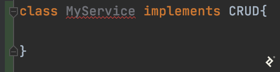
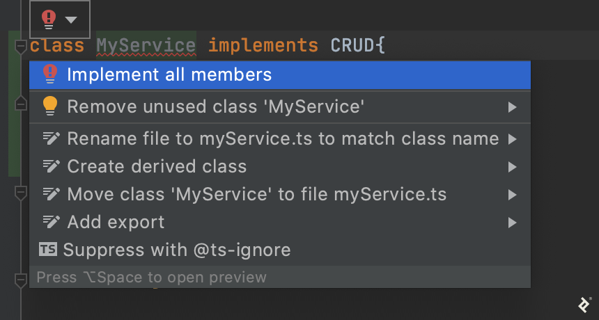
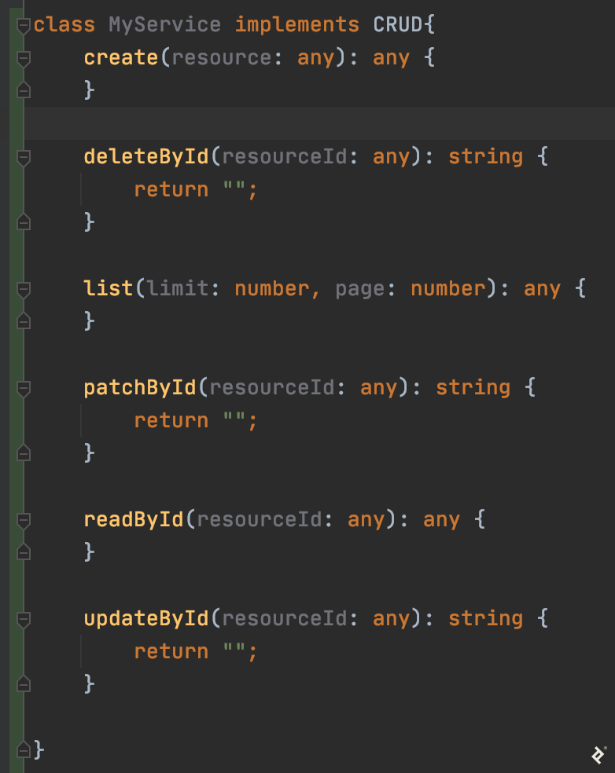

# Building a Node.js/TypeScript REST API, Part 2: Models, Middleware, and Services

[Marcos Henrique da Silva](https://www.toptal.com/resume/marcos-henrique-da-silva)

Marcos has 17+ years in IT and development. His passions include REST architecture, Agile development methodology, and JS.

In [the first article](https://www.toptal.com/express-js/nodejs-typescript-rest-api-pt-1) of our REST API series, we covered how to use npm to create a back end from scratch, add dependencies like [TypeScript](https://www.toptal.com/typescript), use the `debug` module built into Node.js, build an Express.js project structure, and log runtime events flexibly with Winston. If you’re comfortable with those concepts already, simply clone [this](https://github.com/makinhs/toptal-rest-series/tree/toptal-article-01), switch to the `toptal-article-01` branch with `git checkout`, and read on.

## [REST API](https://www.toptal.com/rest-api) Services, Middleware, Controllers, and Models

As promised, we’ll now get into details about these modules:

- **Services** that make our code cleaner by encapsulating business logic operations into functions that middleware and controllers can call.
- **Middleware** that will validate prerequisite conditions before Express.js calls the appropriate controller function.
- **Controllers** that use services to process the request before finally sending a response to the requester.
- **Models** that describe our data and aid in compile-time checks.

We will also add a *very* rudimentary database that is in no way suitable for production. (Its only purpose is to make this tutorial easier to follow, paving the way for our next article to delve into database connection and integration with MongoDB and Mongoose.)

## Hands-on: First Steps with DAOs, DTOs, and Our Temporary Database

For this part of our tutorial, our database won’t even use files. It will simply keep user data in an array, which means the data evaporates whenever we quit Node.js. It will support only the most basic **create, read, update, and delete** (CRUD) operations.

We are going to use two concepts here:

- Data *access* objects (DAOs)
- Data *transfer* objects (DTOs)

That one-letter difference between acronyms is essential: A DAO is responsible for connecting to a defined database and performing CRUD operations; a DTO is an object that holds the raw data that the DAO will send to—and receive from—the database.

In other words, DTOs are objects that conform to data model types, and DAOs are the services that use them.

While DTOs can get more complicated—representing nested database entities, for example—in this article, a single DTO instance will correspond to a single database row.

### Why DTOs?

Using DTOs to have our TypeScript objects conform to our data models helps maintain architectural consistency, as we’ll see in the section on services below. But there’s a crucial caveat: Neither DTOs nor TypeScript itself promise any sort of automatic user input validation, since that would have to occur at runtime. When our code receives user input at an endpoint in our API, that input may:

- Have extra fields
- Be missing required fields (i.e., those not suffixed with `?`)
- Have fields in which the data is not the type we specified in our model using TypeScript

TypeScript (and the JavaScript it gets transpiled to) [won’t magically check this](https://blog.logrocket.com/dynamic-type-validation-in-typescript/) for us, so it is important to not forget these validations, especially when opening your API to the public. Packages like [ajv](https://www.npmjs.com/package/ajv) can help with this but normally work by defining models in a library-specific schema object rather than native TypeScript. (Mongoose, discussed in the next article, will play a similar role in this project.)

You might be thinking, “Is it really best to use both DAOs and DTOs, instead of something simpler?” Enterprise developer Gunther Popp [offers an answer](https://guntherpopp.blogspot.com/2010/09/to-dto-or-not-to-dto.html); you’ll want to avoid DTOs in most smaller real-world Express.js/TypeScript projects unless you can reasonably expect to scale in the medium term.

But even if you aren’t about to use them in production, this example project is a worthwhile opportunity on the road to mastering TypeScript API architecture. It’s a great way to practice working with DTOs to see how they compare to a more basic approach when adding components and models.

### Our User REST API Model at the TypeScript Level

First we will define a DTO for our user. Let’s create a folder called `dto` inside the `users` folder, and create a file there called `users.model.ts` containing the following:

```
export interface UsersDto {
    id: string;
    email: string;
    password: string;
    firstName?: string;
    lastName?: string;
    permissionLevel?: number;
}
```

We’re saying that every time we model a user, regardless of the database, it should have an ID, password, and email, and optionally a first and last name. These requirements can change based on the business requirements of a given project.

Now, let’s create the in-memory temporary database. Let’s create a folder called `daos` inside the `users` folder, and add a file named `users.dao.ts`.

First, we want to import the `UsersDto` that we created:

```
import {UsersDto} from "../dto/users.model";
```

Now, to handle our user IDs, let’s add the shortid library (using the terminal):

```
npm i --save shortid
npm i --save-dev @types/shortid
```

Back in `users.dao.ts`, we’ll import shortid:

```
import shortid from 'shortid';
import debug from 'debug';
const log: debug.IDebugger = debug('app:in-memory-dao');
```

We can now create a class called `UsersDao`, which will look like this:

```
class UsersDao {
    private static instance: UsersDao;
    users: Array<UsersDto> = [];

    constructor() {
        log('Created new instance of UsersDao');
    }

    static getInstance(): UsersDao {
        if (!UsersDao.instance) {
            UsersDao.instance = new UsersDao();
        }
        return UsersDao.instance;
    }
}

export default UsersDao.getInstance();
```

Using the [singleton pattern](https://blog.fullstacktraining.com/singleton-pattern-in-typescript/), this class will always provide the same instance—and, critically, the same `users` array—when we import it in other files. For that, we declare two things:

1. The `static` variable, `instance`, to hold a single object of the `UsersDao` class.
2. The `static getInstance()` function, which will first create a new `UsersDao` (if needed) and return the current instance.

We will see this working when we use this class further on in this article.

Now we are going to add the basic CRUD operations to the class as functions. The **create** function will look like this:

```
async addUser(user: UsersDto) {
    user.id = shortid.generate();
    this.users.push(user);
    return user.id;
}
```

**Read** will come in two flavors, “read all resources” and “read one by ID.” They’re coded like this:

```
async getUsers() {
    return this.users;
}

async getUserById(userId: string) {
    return this.users.find((user: { id: string; }) => user.id === userId);
}
```

Likewise, **update** will mean either overwriting the complete object (as a `PUT`) or just parts of the object (as a `PATCH`):

```
async putUserById(user: UsersDto) {
    const objIndex = this.users.findIndex((obj: { id: string; }) => obj.id === user.id);
    this.users.splice(objIndex, 1, user);
    return `${user.id} updated via put`;
}

async patchUserById(user: UsersDto) {
    const objIndex = this.users.findIndex((obj: { id: string; }) => obj.id === user.id);
    let currentUser = this.users[objIndex];
    const allowedPatchFields = ["password", "firstName", "lastName", "permissionLevel"];
    for (let field of allowedPatchFields) {
        if (field in user) {
            // @ts-ignore
            currentUser[field] = user[field];
        }
    }
    this.users.splice(objIndex, 1, currentUser);
    return `${user.id} patched`;
}
```

As mentioned earlier, despite our `UsersDto` declaration in these function signatures, TypeScript provides no runtime type checking. This means that:

- `putUserById()` has a bug. It will let API consumers store values for fields that are not part of the model defined by our DTO.
- `patchUserById()` depends on a duplicate list of field names that must be kept in sync with the model. Without this, it would have to use the object being updated for this list. That would mean it would silently ignore values for fields that are part of the DTO-defined model but hadn’t been saved to before for this particular object instance.

But both these scenarios will be handled correctly at the database level in the next article.

The last operation, to **delete** a resource, will look like this:

```
async removeUserById(userId: string) {
    const objIndex = this.users.findIndex((obj: { id: string; }) => obj.id === userId);
    this.users.splice(objIndex, 1);
    return `${userId} removed`;
}
```

As a bonus, knowing that a precondition to create a user is to validate if the user email is not duplicated, let’s add a “get user by email” function now:

```
async getUserByEmail(email: string) {
    const objIndex = this.users.findIndex((obj: { email: string; }) => obj.email === email);
    let currentUser = this.users[objIndex];
    if (currentUser) {
        return currentUser;
    } else {
        return null;
    }
}
```

*Note: In a real-world scenario, you will probably connect to a database using a preexisting library, such as [Mongoose](https://mongoosejs.com/) or [Sequelize](https://sequelize.org/), which will abstract all the basic operations that you might need. Because of this, we are not going into the details of the functions implemented above.*

## Our REST API Services Layer

Now that we have a basic, in-memory DAO, we can create a service that will call the CRUD functions. Since CRUD functions are something that every service that will connect to a database will need to have, we are going to create a `CRUD` interface that contains the methods we want to implement every time we want to implement a new service.

Nowadays, the IDEs that we work with have code generation features to add the functions we are implementing, reducing the amount of repetitive code we need to write.

A quick example using the [WebStorm IDE](https://www.jetbrains.com/webstorm/):

[](https://bs-uploads.toptal.io/blackfish-uploads/uploaded_file/file/512371/image-1611676646939-f485116d0d449cef9d5b316f22e0057d.png)

The IDE highlights the MyService class name and suggests the following options:

[](https://bs-uploads.toptal.io/blackfish-uploads/uploaded_file/file/512373/image-1611676646943-9326ff5a9f38fad8f883eac6801b31fb.png)

The “Implement all members” option instantly scaffolds the functions needed to conform to the `CRUD` interface:

[](https://bs-uploads.toptal.io/blackfish-uploads/uploaded_file/file/512372/image-1611676646945-ca6efdc77bedd72bfa9b900599ebc525.png)

That all said, let’s first create our TypeScript interface, called `CRUD`. At our `common` folder, let’s create a folder called `interfaces` and add `crud.interface.ts` with the following:

```
export interface CRUD {
    list: (limit: number, page: number) => Promise<any>,
    create: (resource: any) => Promise<any>,
    updateById: (resourceId: any) => Promise<string>,
    readById: (resourceId: any) => Promise<any>,
    deleteById: (resourceId: any) => Promise<string>,
    patchById: (resourceId: any) => Promise<string>,
}
```

With that done, lets create a `services` folder within the `users` folder and add the `users.service.ts` file there, starting with:

```
import usersDao from '../daos/users.dao';
import {CRUD} from "../../common/interfaces/crud.interface";
import {UsersDto} from "../dto/users.model";

class UsersService implements CRUD {
    private static instance: UsersService;

    static getInstance(): UsersService {
        if (!UsersService.instance) {
            UsersService.instance = new UsersService();
        }
        return UsersService.instance;
    }

    async create(resource: UsersDto) {
        return await usersDao.addUser(resource);
    }

    async deleteById(resourceId: string) {
        return await usersDao.removeUserById(resourceId);
    };

    async list(limit: number, page: number) { // limit and page are ignored until we upgrade our DAO
        return await usersDao.getUsers();
    };

    async patchById(resource: UsersDto) {
        return await usersDao.patchUserById(resource)
    };

    async readById(resourceId: string) {
        return await usersDao.getUserById(resourceId);
    };

    async updateById(resource: UsersDto) {
        return await usersDao.putUserById(resource);
    };

    async getUserByEmail(email: string) {
        return UsersDao.getUserByEmail(email);

    }
}

export default UsersService.getInstance();
```

Our first step is to import our in-memory DAO:

```
import usersDao from '../daos/users.dao';
```

The name `usersDao` could be anything when we import it. But since we are already receiving an instance of the class, we’ll use the same name converted to camel case, as if it would be something like `const usersDao = new UsersDao()`.

After importing our interface dependency and the TypeScript type of our DTO, it’s time to implement `UsersService` as a service singleton, the same pattern we used with our DAO.

All the `CRUD` functions now just call the `usersDao` and its own respective functions. When it comes time to replace the DAO, we won’t have to make changes anywhere else in the project, not even in this file where the DAO functions are called.

For example, we won’t have to track down every call to `list()` and check its context before replacing it. That’s the advantage of having this layer of separation, at the cost of the small amount of initial boilerplate you see above.

*Note: Our use of `async` for the service functions may seem pointless. For now, it is: All of these functions just immediately return their values, without any internal use of `Promise`s or `await`. This is solely to prepare our codebase for services that will use `async`. Likewise, below, you’ll see that all calls to these functions use `await`.*

Having our DAO and services ready, let’s go back to the user controller.

## Building Our REST API Controller

As we said above, the idea behind controllers is to separate the route configuration from the code that finally processes a route request. That means that all validations should be done before our request reaches the controller. The controller only needs to know what to do with the actual request because if the request made it that far, then we know it turned out to be valid. The controller will then call the respective service of each request that it will be handling.

Before we start, we’ll need to install a library for securely hashing the user password:

```
npm i --save argon2
```

Let’s start by creating a folder called `controllers` inside the `users` controller folder and creating a file called `users.controller.ts` in it:

```
// we import express to add types to the request/response objects from our controller functions
import express from 'express';

// we import our newly created user services
import usersService from '../services/users.service';

// we import the argon2 library for password hashing
import argon2 from 'argon2';

// we use debug with a custom context as described in Part 1
import debug from 'debug';

const log: debug.IDebugger = debug('app:users-controller');

class UsersController {
    private static instance: UsersController;

    // this will be a controller singleton (same pattern as before)
    static getInstance(): UsersController {
        if (!UsersController.instance) {
            UsersController.instance = new UsersController();
        }
        return UsersController.instance;
    }

    async listUsers(req: express.Request, res: express.Response) {
        const users = await usersService.list(100, 0);
        res.status(200).send(users);
    }

    async getUserById(req: express.Request, res: express.Response) {
        const user = await usersService.readById(req.params.userId);
        res.status(200).send(user);
    }

    async createUser(req: express.Request, res: express.Response) {
        req.body.password = await argon2.hash(req.body.password);
        const userId = await usersService.create(req.body);
        res.status(201).send({id: userId});
    }

    async patch(req: express.Request, res: express.Response) {
        if(req.body.password){
            req.body.password = await argon2.hash(req.body.password);
        }
        log(await usersService.patchById(req.body));
        res.status(204).send(``);
    }

    async put(req: express.Request, res: express.Response) {
        req.body.password = await argon2.hash(req.body.password);
        log(await usersService.updateById({id: req.params.userId, ...req.body}));
        res.status(204).send(``);
    }

    async removeUser(req: express.Request, res: express.Response) {
        log(await usersService.deleteById(req.params.userId));
        res.status(204).send(``);
    }
}

export default UsersController.getInstance();
```

With our user controller done, we’re ready to code the other module that depends on our example REST API object model and service: our user middleware.

## Node.js REST Middleware with Express.js

What can we do with Express.js middleware? Validations are a great fit, for one. Let’s add some basic validations to act as gatekeepers for requests before they make it to our user controller:

- Ensure the presence of user fields such as `email` and `password` as required to create or update a user
- Ensure a given email isn’t in use already
- Check that we’re not changing the `email` field after creation (since we’re using that as the primary user-facing ID for simplicity)
- Validate whether a given user exists

To make these validations to work with Express.js, we will need to translate them into functions that follow the Express.js pattern of flow control using `next()`, as [described](https://www.toptal.com/express-js/nodejs-typescript-rest-api-pt-1#configuring-the-expressjs-routes-of-the-users-endpoints) in the previous article. We’ll need a new file, `users/middleware/users.middleware.ts`:

```
import express from 'express';
import userService from '../services/users.service';

class UsersMiddleware {
    private static instance: UsersMiddleware;

    static getInstance() {
        if (!UsersMiddleware.instance) {
            UsersMiddleware.instance = new UsersMiddleware();
        }
        return UsersMiddleware.instance;
    }
}

export default UsersMiddleware.getInstance();
```

With the familiar singleton boilerplate out of the way, let’s add some of our middleware functions to the class body:

```
async validateRequiredUserBodyFields(req: express.Request, res: express.Response, next: express.NextFunction) {
    if (req.body && req.body.email && req.body.password) {
        next();
    } else {
        res.status(400).send({error: `Missing required fields: email and/or password`});
    }
}

async validateSameEmailDoesntExist(req: express.Request, res: express.Response, next: express.NextFunction) {
    const user = await userService.getByEmail(req.body.email);
    if (user) {
        res.status(400).send({error: `User email already exists`});
    } else {
        next();
    }
}

async validateSameEmailBelongToSameUser(req: express.Request, res: express.Response, next: express.NextFunction) {
    const user = await userService.getUserByEmail(req.body.email);
    if (user && user.id === req.params.userId) {
        next();
    } else {
        res.status(400).send({error: `Invalid email`});
    }
}

async validatePatchEmail(req: express.Request, res: express.Response, next: express.NextFunction) {
    if (req.body.email) {
        UsersMiddleware.getInstance().validateSameEmailBelongToSameUser(req, res, next);
    } else {
        next();
    }
}

async validateUserExists(req: express.Request, res: express.Response, next: express.NextFunction) {
    const user = await userService.readById(req.params.userId);
    if (user) {
        next();
    } else {
        res.status(404).send({error: `User ${req.params.userId} not found`});
    }
}
```

To make an easy way for our API consumers to make further requests about a newly added user, we are going to add a helper function that will extract the `userId` from the request parameters—coming in from the request URL itself—and add it to the request body, where the rest of the user data resides.

The idea here is to be able to simply use the full body request when we would like to update user information, without worrying about getting the ID from the parameters every time. Instead, it’s taken care of in just one spot, the middleware. The function will look like this:

```
async extractUserId(req: express.Request, res: express.Response, next: express.NextFunction) {
    req.body.id = req.params.userId;
    next();
}
```

Besides the logic, the main difference between the middleware and the controller is that now we are using the `next()` function to pass control along a chain of configured functions until it arrives at the final destination, which in our case is the controller.

## Putting it All Together: Refactoring Our Routes

Now that we have implemented all the new aspects of our project architecture, let’s go back to the `users.routes.config.ts` file we [defined](https://www.toptal.com/express-js/nodejs-typescript-rest-api-pt-1#a-common-routes-file-in-typescript) in the previous article. It will call our middleware and our controllers, both of which rely on our user service, which in turn requires our user model.

The final file will be as simple as this:

```
import {CommonRoutesConfig} from '../common/common.routes.config';
import UsersController from './controllers/users.controller';
import UsersMiddleware from './middleware/users.middleware';
import express from 'express';

export class UsersRoutes extends CommonRoutesConfig {
    constructor(app: express.Application) {
        super(app, 'UsersRoutes');
    }

    configureRoutes() {
        this.app.route(`/users`)
            .get(UsersController.listUsers)
            .post(
                UsersMiddleware.validateRequiredUserBodyFields,
                UsersMiddleware.validateSameEmailDoesntExist,
                UsersController.createUser);

        this.app.param(`userId`, UsersMiddleware.extractUserId);
        this.app.route(`/users/:userId`)
            .all(UsersMiddleware.validateUserExists)
            .get(UsersController.getUserById)
            .delete(UsersController.removeUser);

        this.app.put(`/users/:userId`,[
            UsersMiddleware.validateRequiredUserBodyFields,
            UsersMiddleware.validateSameEmailBelongToSameUser,
            UsersController.put
        ]);

        this.app.patch(`/users/:userId`, [
            UsersMiddleware.validatePatchEmail,
            UsersController.patch
        ]);

        return this.app;
    }
}
```

Here, we’ve redefined our routes by adding middleware to validate our business logic and the appropriate controller functions to process the request if everything is valid. We’ve also used the `.param()` function from Express.js to extract the `userId`.

At the `.all()` function, we are passing our `validateUserExists` function from `UsersMiddleware` to be called before any `GET`, `PUT`, `PATCH`, or `DELETE` can go through on the endpoint `/users/:userId`. This means `validateUserExists` doesn’t need to be in the additional function arrays we pass to `.put()` or `.patch()`—it will get called before the functions specified there.

We’ve leveraged the inherent reusability of middleware here in another way, too. By passing `UsersMiddleware.validateRequiredUserBodyFields` to be used in both `POST` and `PUT` contexts, we’re elegantly recombining it with other middleware functions.

*Disclaimers: We only cover basic validations in this article. In a real-world project, you will need to think about and find all the restrictions you need to code. For the sake of simplicity, we are also assuming that a user cannot change their email.*

## Testing Our Express/TypeScript REST API

We can now compile and run our Node.js app. Once it’s running, we’re ready to test our API routes using a REST client such as Postman or cURL.

Let’s first try to get our users:

```
curl --location --request GET 'localhost:3000/users' \
--header 'Content-Type: application/json'
```

At this point, we will have an empty array as a response, which is accurate. Now we can try to create the first user resource with this:

```
curl --location --request POST 'localhost:3000/users' \
--header 'Content-Type: application/json'
```

Note that now our [Node.js](https://www.toptal.com/nodejs) app will send back an error from our middleware:

```
{
   "error": "Missing required fields email and password"
}
```

To fix it, let’s send a *valid* request to post to `/users` resource:

```
curl --location --request POST 'localhost:3000/users' \
--header 'Content-Type: application/json' \
--data-raw '{
   "email": "marcos.henrique@toptal.com",
   "password": "sup3rS3cr3tPassw0rd!23"
}'
```

This time, we should see something like the following:

```
{
    "id": "ksVnfnPVW"
}
```

This `id` is the identifier of the newly created user and will be different on your machine. To make the remaining testing statements easier, you can run this command with the one you get (assuming you’re using a Linux-like environment):

```
REST_API_EXAMPLE_ID="put_your_id_here"
```

We can now see the response we get from making a `GET` request using the above variable:

```
curl --location --request GET "localhost:3000/users/$REST_API_EXAMPLE_ID" \
--header 'Content-Type: application/json'
```

We can now also update the entire resource with the following `PUT` request:

```
curl --location --request PUT "localhost:3000/users/$REST_API_EXAMPLE_ID" \
--header 'Content-Type: application/json' \
--data-raw '{
    "email": "marcos.henrique@toptal.com",
    "password": "sup3rS3cr3tPassw0rd!23",
    "firstName": "Marcos",
    "lastName": "Silva",
    "permissionLevel": 8
}'
```

We can also test that our validation works by changing the email address, which should result in an error.

Note that when using a `PUT` to a resource ID, we, as API consumers, need to send the entire object if we want to conform to the standard REST pattern. That means that if we want to update just the `lastName` field, but using our `PUT` endpoint, we will be forced to send the entire object to be updated. It would be easier to use a `PATCH` request since there it’s still within standard REST constraints to send just the `lastName` field:

```
curl --location --request PATCH "localhost:3000/users/$REST_API_EXAMPLE_ID" \
--header 'Content-Type: application/json' \
--data-raw '{
    "lastName": "Faraco"
}'
```

Recall that in our own codebase, it’s our route configuration that enforces this distinction between `PUT` and `PATCH` using the middleware functions we added in this article.

Getting the user list again as we did above, we should see our created user with its fields updated:

```
[
  {
    "id": "ksVnfnPVW",
    "email": "marcos.henrique@toptal.com",
    "password": "$argon2i$v=19$m=4096,t=3,p=1$ZWXdiTgb922OvkNAdh9acA$XUXsOHaRN4uVg5ltIwwO+SPLxvb9uhOKcxoLER1e/mM",
    "firstName": "Marcos",
    "lastName": "Faraco",
    "permissionLevel": 8
  }
]
```

Finally, we can test deleting the user with this:

```
curl --location --request DELETE "localhost:3000/users/$REST_API_EXAMPLE_ID" \
--header 'Content-Type: application/json'
```

Getting the user list again, we should see that the deleted user is no longer present.

With that, we have all the CRUD operations for the `users` resource working.

## Node.js/TypeScript REST API

In this part of the series, we further explored key steps in building a REST API using Express.js. We split our code to support services, middleware, controllers, and models. Each of their functions has a specific role, whether it’s validation, logical operations, or processing valid requests and responding to them.

We also created a very simple way to store data, with the express (pardon the pun) purpose of allowing some testing at this point, then being replaced with something more practical in the next part of our series.

Besides building an API with simplicity in mind—with the sparing use of singletons, for example—there are several steps to take to make it easier to maintain, more scalable, and secure. In our next article, we’ll cover:

- Replacing the in-memory database with MongoDB, then using Mongoose to simplify the coding process
- Adding a security layer and control access in a stateless approach with JWT
- Configuring automated testing to allow our application to scale

You can find the final code from this article [here](https://github.com/makinhs/toptal-rest-series/tree/toptal-article-02).
