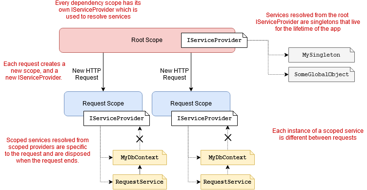
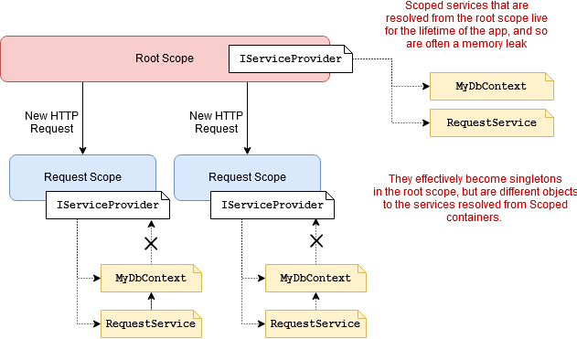
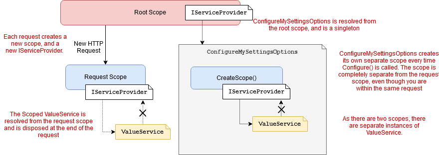

# The dangers and gotchas of using scoped services in IConfigureOptions

The [configuration system in ASP.NET Core](https://docs.microsoft.com/en-gb/aspnet/core/fundamentals/configuration/?view=aspnetcore-2.1) allows you to load key-value pairs from a wide variety of sources such as JSON files, Environment Variables, or Azure KeyVault. The recommended way to consume those key-value pairs is to use strongly-typed classes [using the Options pattern](https://docs.microsoft.com/en-gb/aspnet/core/fundamentals/configuration/options?view=aspnetcore-2.1).

In this post I look at some of the problems you can run into with strong-typed settings. In particular, I show how you can run into lifetime issues and captive dependencies if your configuration depends on other services, via the `IConfigureOptions<>` mechanism.

I start by providing a brief overview of strongly-typed configuration in ASP.NET Core and the difference between `IOptions<>` and `IOptionsSnapshot<>`. I then describe how you can inject services when building your strongly-typed settings using `IConfigureOptions<>`. Finally, I look at what happens if you try to use Scoped services with `IConfigureOptions<>`, the problems you can run into, and how to work around them.

> **tl;dr**; If you need to use Scoped services inside `IConfigureOptions<>`, create a new scope using `IServiceProvider.CreateScope()` and resolve the service directly. Be aware that the service lives in its own scope, separate from the main scope associated with the request.

## Strongly-typed settings in ASP.NET Core

The most common approach to using strongly-typed settings in ASP.NET Core is to bind you key-value pair configuration values to a POCO object `T` in the `ConfigureServices()` method of `Startup`. Alternatively, you can provide a configuration `Action<T>` for your settings class `T`. When an instance of your settings class `T` is requested, ASP.NET Core will apply each of the configuration steps in turn:

```
public void ConfigureServices(IServiceCollection services)
{
    // Bind MySettings to configuration section "MyConfig"
    services.Configure<MySettings>(Configuration.GetSection("MyConfig")); 

    // Configure MySettings using an Action<>
    services.Configure<MySettings>(options => 
    {
        options.MyValue = "Some value"
    }); 
}
```

To access the configured `MySettings` object in your classes, you inject an instance of `IOptions<MySettings>` or `IOptionsSnapshot<MySettings>` into the constructor of the class that depends on them. The configured settings object itself is available on the `Value` property:

```
public class ValuesController
{
    private readonly MySettings _settings;
    public ValuesController(IOptions<MySettings> settings)
    {
        _settings = settings.Value; //access the settings
    }

    [HttpGet]
    public string Get() => _settings.MyValue;
}
```

It's important to note that *order matters* when configuring options. When you inject an `IOptions<MySettings>` or `IOptionsSnapshot<MySettings>` in your app, each configuration method runs sequentially. So for the `ConfigureServices()` method shown previously, the `MySettings` object would first be bound to the `MyConfig` configuration section, and then the `Action<>` would be executed, overwriting the value of `MyValue`.

## The difference between `IOptions<>` and `IOptionsSnapshot<>`

In the previous example I showed an example of injecting an `IOptions<T>` instance into a controller. The other way of accessing your settings is to inject an `IOptionsSnapshot<T>`. As well as providing access to the configured strongly-typed options `<T>`, this interface provides several additional features compared to `IOptions<T>`:

- Access to *named options*.
- Changes to the underlying `IConfiguration` object are honoured.
- Has a Scoped lifecycle (`IOption<>`s have a Singleton lifecycle).

### Named options

I discussed named options [in my previous post](https://andrewlock.net/using-multiple-instances-of-strongly-typed-settings-with-named-options-in-net-core-2-x/). Named options allow you to register multiple instances of a strongly-typed settings class (e.g. `MySettings`), each with a different `string` name, for example:

```
public void ConfigureServices(IServiceCollection services)
{
    services.Configure<MySettings>("Alice", Configuration.GetSection("AliceSettings")); 
    services.Configure<MySettings>("Bob", Configuration.GetSection("BobSettings")); 
    // Configure the default "unnamed" settings
    services.Configure<MySettings>(Configuration.GetSection("AliceSettings"));
}
```

You can then use `IOptionsSnapshot<T>` to retrieve these named options using the `Get()` method:

```
public ValuesController(IOptionsSnapshot<MySettings> settings)
{
    var aliceSettings = settings.Get("Alice"); // get the Alice settings
    var bobSettings = settings.Get("Bob"); // get the Bob settings
    var mySettings = settings.Value; // get the default, unnamed, settings
}
```

### Reloading strongly typed configuration with IOptionsSnapshot

One of the most common uses of `IOptionSnapshot<>` is to enable automatic configuration reloading, without having to restart the application. Some configuration providers, most notably the file-providers that load settings from JSON files etc, will automatically update the underlying key-value pairs that make up and `IConfiguration` object when the configuration file changes.

The `MySettings`settings object associated with an `IOptions<MySettings>` instance won't change when you update the underlying configuration file. The values are fixed the first time you access the `IOptions<T>.Value` property.

`IOptionsSnapshot<T>` works differently. `IOptionsSnapshot<T>` re-runs the configuration steps for your strongly-typed settings objects *once per request* when the instance is requested. So if a configuration file changes (and hence the underlying `IConfiguration` changes), the properties of the `IOptionsSnapshot.Value` instance will reflect those changes on the next request.

> I discussed reloading of configuration values in more detail [in a previous post](https://andrewlock.net/reloading-strongly-typed-options-in-asp-net-core-1-1-0/).

Related to this, the `IOptionsSnapshot<T>` has a Scoped lifecycle, so for a single request you will use the same `IOptionsSnapshot<T>` instance throughout your application. That means the strongly-typed configuration objects (e.g. `MySettings`) are constant *within* a given request, but may vary *between* requests.

> Note: As the strongly-typed settings are re-built with every request, and the binding relies on reflection under the hood, you should bear performance in mind. There is currently [an open issue on GitHub](https://github.com/aspnet/Configuration/issues/604) to investigate performance.

I'll come back to the different lifecycles for `IOptions<>` and `IOptionsSnapshot<>` later, as well as the implications. First, I'll describe another common question around strongly-typed settings - how can you use additional services to configure them?

## Using services during options configuration

Configuring strongly-typed options with the `Configure<>()` extension method is very common. However, [sometimes you need additional services to configure your strongly-typed settings](https://andrewlock.net/accessing-services-when-configuring-mvcoptions-in-asp-net-core/). For example, imagine that configuring your `MySettings` class requires loading values from the database using EF Core, or performing some complex operation that is encapsulated in a `CalculatorService`. You can't access services you've registered in `ConfigureServices()` from inside `ConfigureServices()` itself, so you can't use the `Configure<>()` method directly:

```
public void ConfigureServices(IServiceCollection services)
{
    // register our helper service
    services.AddSingleton<CalculatorService>();

    // Want to set MySettings based on values from the CalculatorService
    services.Configure<MySettings>(settings => 
    {
        // No easy/safe way of accessing CalculatorService here!
    }); 
}
```

Instead of calling `Configure<MySettings>`, you can create a simple class to handle the configuration for you. This class should implement `IConfigureOptions<MySettings>` and can use dependency injection to inject dependencies that you registered in `ConfigureServices`:

```
public class ConfigureMySettingsOptions : IConfigureOptions<MySettings>
{
    private readonly CalculatorService _calculator;
    public ConfigureMySettingsOptions(CalculatorService calculator)
    {
        _calculator = calculator;
    }

    public void Configure(MySettings options)
    {
        options.MyValue = _someService.DoComplexCalcaultion();
    }
}
```

All that remains is to register the `IConfigureOptions<>` instance (and its dependencies) in `Startup.ConfigureServices()`:

```
public void ConfigureServices(IServiceCollection services)
{
    // You can combine Configure with IConfigureOptions
    services.Configure<MySettings>(Configuration.GetSection("MyConfig")); 

    // Register the IConfigureOptions instance
    services.AddSingleton<IConfigureOptions<MySettings>, ConfigureMySettingsOptions>();

    // Add the dependencies
    services.AddSingleton<CalculatorService>();
}
```

When you inject an instance of `IOptions<MySettings>` into your controller, the `MySettings` instance will be configured based on the configuration section `"MyConfig"`, followed by the configuration applied in `ConfigureMySettingsOptions` using the `CalculatorService`.

Using `IConfigureOptions<T>` makes it trivial to use other services and dependencies when configuring strongly-typed options. Where things get tricky is if you need to use scoped dependencies, like an EF Core `DbContext`.

## A slight detour: scoped dependencies in the ASP.NET Core DI container

In order to understand the issue of using scoped dependencies in `IConfigureOptions<>` we need to take a short detour to look at how the DI container resolves instances of services. For now I'm only going to think about Singleton and Scoped services, and will leave out Transient services.

Every ASP.NET Core application has a "root" `IServiceProvider`. This is used to resolve Singleton services.

In addition to the root `IServiceProvider` it's also possible to create a new *scope*. A scope (implemented as `IServiceScope`) has its own `IServiceProvider`. You can resolve Scoped services from the scoped `IServiceProvider`; when the scope is disposed, all disposable services created by the container will also be disposed.

In ASP.NET Core, a new scope is created for each request. That means all the Scoped services for a given request are resolved from the same container, so the same instance of a Scoped service is used everywhere for a given request. At the end of the request, the scope is disposed, along with all the resolved services. Each request gets a new scope, so the Scoped services are isolated from one another.



In addition to the automatic scopes created each request, it's possible to create a new scope manually, using `IServiceProvider.CreateScope()`. You can use this to safely resolve Scoped services outside the context of a request, for example after you've configured your application, but before you call `IWebHost.Run()`. This can be useful when you need [to do things like run EF Core migrations, for example](https://wildermuth.com/2018/01/10/Re-thinking-Running-Migrations-and-Seeding-in-ASP-NET-Core-2-0).

But why would you need to create a scope outside the context of a request? Couldn't you just resolve the necessary dependencies directly from the root `IServiceProvider`?

While that's technically possible, doing so is essentially a memory leak, as the Scoped services are not disposed, and effectively become Singletons! This is sometimes [called a "captive dependency"](http://blog.ploeh.dk/2014/06/02/captive-dependency/). By default, the ASP.NET Core framework checks for this error when running in the `Development` environment, and throws an `InvalidOperationException` at runtime. In `Production` the guard rails are off, and you'll likely just get buggy behaviour.



Which brings us to the problem at hand - using Scoped services with `IConfigureOptions<T>` when you are configuring strongly-typed settings.

## Scoped dependencies and IConfigureOptions: Here be dragons

Lets consider a relatively common scenario: I want to load some of the configuration for my strongly-typed `MySettings` object from a database using EF Core. As we're using EF Core, we'll need to use the `DbContext`, which is a Scoped service. To simplify things slightly further for this demo, we'll imagine that the logic for loading from the database is encapsulated in a service, `ValueService`:

```
public class ValueService
{
    private readonly Guid _val = Guid.NewGuid();

    // Return a fixed Guid for the lifetime of the service
    public Guid GetValue() => _val; 
}
```

We'll imagine that the `GetValue()` method fetches some configuration from the database, and we want to set that value on a `MySettings` object. In our app, we might be using `IOptions<>` or `IOptionsSnapshot<>`, we're not sure yet.

As we need to use the `ValueService` to configure the strongly-typed settings `MySettings`, we know we'll need to use an `IConfigureOptions<>` implementation, which we'll call `ConfigureMySettingsOptions`. Initially, we have two questions:

- What lifecycle should we use to register the `ConfigureMySettingsOptions` instance?
- How should we resolve the Scoped `ValueService` inside the `ConfigureMySettingsOptions` instance?

I'll explore the various possibilities in the following sections, showing basic implementations, and the implications of choosing each one.

For demonstration purposes, I'll create a simple Controller that returns the value set for `IOptions<MySettings>`:

```
public class ValuesController
{
    private readonly IOptions<MySettings> _settings;
    public ValuesController(IOptions<MySettings> settings)
    {
        _settings = settings;
    }

    [HttpGet]
    public string Get()
    {
        return $"The value is: {_settings.Value.MyValue}";
    }
}
```

### 1. Registering `IConfigureOptions<>` as Scoped, and injecting Scoped services

The first option, and probably the easiest option on the face of it, is to inject the Scoped `ValueService` directly into the `ConfigureMySettingsOptions` instance:

> **Warning** Don't use this code! It causes a captive dependency / `InvalidOperationException`!

```
public class ConfigureMySettings : IConfigureOptions<MySettings>
{
    // Directly inject the Scoped service
    private readonly ValueService _service;
    public ConfigureMySettings(ValueService service)
    {
        _service = service;
    }

    public void Configure(MySettings options)
    {
        // Use the scoped service to set the value
        options.MyValue = _service.GetValue();
    }
}
```

As we're injecting a Scoped service into `ConfigureMySettingsOptions` we *must* register `ConfigureMySettingsOptions` as a Scoped service - we can't register it as a Singleton service as we'd have a captive dependency issue:

```
services.AddScoped<ValueService>();
services.AddScoped<IConfigureOptions<MySettings>, ConfigureMySettings>();
```

Unfortunately, if we call our test `ValuesController`, we still get an `InvalidOperationException`, despite our best efforts:

```
System.InvalidOperationException: Cannot consume scoped service 'Microsoft.Extensions.Options.IConfigureOptions`1[MySettings]' from singleton 'Microsoft.Extensions.Options.IOptions`1[MySettings]'.
```

The problem is that `IOptions<>` instances are registered as Singletons and take all of the registered `IConfigureOptions<>` instances as dependencies. As we've registered our `IConfigureOptions<>` as a Scoped service, we have a captive dependency problem, so in the `Development` environment, ASP.NET Core throws an `Exception` to warn us. Back to the drawing board.

### 2. Registering `IConfigureOptions<>` as Scoped, injecting Scoped services, and using `IOptionsSnapshot<>`

One workaround to the captive dependency issue is to avoid using the Singleton `IOptions<T>` altogether. As I [discussed earlier](https://andrewlock.net/the-dangers-and-gotchas-of-using-scoped-services-when-configuring-options-in-asp-net-core/#the-difference-between-ioptions-and-ioptionssnapshot), `IOptionsSnapshot<T>` is registered as a Scoped service, rather than a Singleton. If we change our `ValuesController` to use `IOptionsSnapshot<>` instead:

```
public class ValuesController
{
    private readonly IOptionsSnapshot<MySettings> _settings;
    public ValuesController(IOptionsSnapshot<MySettings> settings)
    {
        _settings = settings;
    }

    [HttpGet]
    public string Get()
    {
        return $"The value is: '{_settings.Value.MyValue}'";
    }
}
```

then running the application doesn't cause a captive dependency, and we can hit the API multiple times:

```
> curl http://localhost:5000/api/Values
The value is: 'eadf7bc2-250a-43b8-94b4-31a276533c68'

> curl http://localhost:5000/api/Values
The value is: '5daf0dda-a9b7-40e6-b4b8-2ed69559a4d9'
```

One point to note is that the value of `MySettings.MyValue` changes with every request. That's because we're re-building the `MySettings` object each request, and fetching a new Scoped instance of `ValueService` with each request.

Depending on your app, the approach of injecting Scoped services directly into `IConfigureOptions<>` and using `IOptionsSnapshot<>` *might* be ok. Especially if you were going to use `IOptionsSnapshot<>` anyway to track configuration changes.

Personally, I don't think that's a great idea - it would just take someone who's unfamiliar with the restriction to use `IOptions<>`, and they'll get unexpected `InvalidOperaionException`s, or worse, captive dependencies in a `Production` environment!

This solution is even more unattractive if you don't actually need the change-tracking features of`IOptionsSnapshot` (and associated performance impact). In that case, you'll want to look behind door number 3…

### 3. Creating a new scope in IConfigureOptions

The alternative to directly injecting a `ValueService` into `ConfigureMySettingsOptions` is to manually create a new scope, and to resolve the `ValueService` instance directly from the `IServiceProvider`:

```
public class ConfigureMySettings : IConfigureOptions<MySettings>
{
    // Inject the IoC provider
    private readonly IServiceProvider _provider;
    public ConfigureMySettings(IServiceProvider provider)
    {
        _provider = provider;
    }

    public void Configure(MySettings options)
    {
        // Create a new scope
        using(var scope = _provider.CreateScope())
        {
            // Resolve the Scoped service
            var service = scope.ServiceProvider.GetService<ValueService>();
            options.MyValue = service.GetValue();
        }
    }
}
```

Inject the "root" `IServiceProvider` into the constructor of your `IConfigureOptions<>` class, and call `CreateScope()` inside the `Configure()` method. This allows you to resolve the Scoped service, even though `ConfigureMySettingsOptions` is registered as a Singleton (or Transient):

```
services.AddScoped<ValueService>();
services.AddSingleton<IConfigureOptions<MySettings>, ConfigureMySettings>();
```

Now you can inject `IOptions<MySettings>` into your `ValuesController` without fear of captive dependencies. On the first request to `ValuesController`, `ConfigureMySettings.Configure()` is invoked which creates a new scope, resolves the scoped service, sets the value of `MyScopedValue`, and then disposes the scope (thanks to the `using` statement). On subsequent requests, the same `MySettings` object is returned, so it always has the same value:

```
> curl http://localhost:5000/api/Values
The value is: '5380796b-75e3-4b21-8b96-74afedccda28'

> curl http://localhost:5000/api/Values
The value is: '5380796b-75e3-4b21-8b96-74afedccda28'
```

In contrast, if you inject `IOptionsSnapshot<MySettings>` into `ValuesController`, `MySettings` is re-bound every request, and `ConfigureMySettings.Configure()` is invoked on every request. That gives you a new value every time:

```
> curl http://localhost:5000/api/Values
The value is: 'b4bb050a-0f53-44a3-a3fc-9451136e78db'

> curl http://localhost:5000/api/Values
The value is: 'a3675eab-8f9a-4472-b0af-bc2f34c65bdb'
```

Generally speaking, this gives you the best of both worlds - you can use both `IOptions<>` and `IOptionsSnapshot<>` as appropriate, and you don't have any captive dependency issues. There's just one caveat to watch out for…

#### Watch your scopes

You registered `ValueService` as a Scoped service, so ASP.NET Core uses the *same instance* of `ValueService` to satisfy all requests for a `ValueService` *within a given scope*. In almost all cases, that means all instances of a Scoped service for a given request are the same.

However…

Our solution to the captive dependency problem was to *create a new scope*. Even when we're building a Scoped object, e.g. an instance of `IOptionsSnapshot<>`, we *always* create a new Scope inside `ConfigureMySettingsOptions`. Consequently, you will have two different instances of `ValueService` for a given request:

- The `ValueService` instance associated with the scope we created in `ConfigureMySettingsOptions`.
- The `ValueService` instance associated with the request's scope.



One way to visualise the issue is to inject `ValueService` directly into the controller, and compare its `GetValue()` with the value set on `MySettings.MyValue`:

```
public class ValuesController
{
    private readonly ValueService _service;
    private readonly IOptionsSnapshot<MySettings> _settings;
    public ValuesController(IOptionsSnapshot<MySettings> settings, ValueService service)
    {
        _settings = settings;
        _service = service;
    }

    [HttpGet]
    public string Get()
    {
        return 
            $"MySettings.MyValue: '{_settings.Value.MyValue}'\n" + 
            $"ValueService:       '{_service.GetValue()}' ";
    }
}
```

For each request, the value of `_service.GetValue()` is different to `MySettings.MyValue`, because the `ValueService` used to set `MySettings.MyValue` was a different instance that the one used in the rest of the request:

```
> curl http://localhost:5000/api/Values
MySettings.MyValue: '64f92cb4-d825-4e85-9c43-cf47217b6f33'
ValueService:       'af6d77fc-db08-4f4d-b120-18a952b910d0'

> curl http://localhost:5000/api/Values
MySettings.MyValue: 'ed2b9930-53d8-4055-bc69-04307dd4f0f8'
ValueService:       '1d0d8920-bfc0-4616-9c41-996834e0e242'
```

So is this something to worry about?

Generally, I don't think so. Strongly-typed settings are typically that, just settings and configuration. I think it would be unusual to be in a situation where being in a different scope matters, but its worth bearing in mind.

One possible scenario I could imagine is where you're using a `DbContext` in your `IConfigureOptions<>` instance. Given you're creating the `DbContext` out of the usual request scope, the `DbContext` wouldn't be subject to any session management services for handling `SaveChanges()`, or committing and rolling back transactions for example. But then, writing to the database in the `IConfigureOptions.Configure()` method seems like a bad idea anyway, so you're probably trying to force a square peg into a round hole at that point!

In this post I provided an overview of how to use strongly-typed settings with ASP.NET Core. In particular, I highlighted how `IOptions<>` is registered as Singleton service, while `IOptionsSnapshot<>` is registered as a Scoped service. It's important to bear that difference in mind when using `IConfigureOptions<>` with Scoped services to configure your strongly-typed settings.

If you need to use Scoped services when implementing `IConfigureOptions<>`, you should inject an `IServiceProvider` into your class, and manually create a new scope to resolve the services. Don't inject the services directly into your `IConfigureOptions<>` instance as you will end up with a captive dependency.

When using this approach you should be aware that the scope created in `IConfigureOptions<>` is distinct from the scope associated with the request. Consequently, any services you resolve from it will be different instances to those resolved in the rest of your application
