# How to Craft the Perfect Daily Schedule

Schedule your energy, not your time. And don’t forget to take breaks.

Illustration by [Erick M. Ramos](https://www.instagram.com/erickmramos/)

## If you made it this far…

Chances are you’ll like our other stuff too!

Sign up for our biweekly newsletter and we’ll send you our Greatest Hits.

I’ve always been a productivity optimizer. It’s a bit of a hobby of mine to [gather data about my productivity](https://blog.doist.com/quantified-self-apps/) in order to track progress, spot patterns, and uncover areas for improvement.

Most tweaks are small, incremental improvements to my day, but every once in a while I learn something that completely upends the way I approach my daily schedule. Reading Daniel Pink’s book, [*When: The Scientific Secrets of Perfect Timing*](https://www.danpink.com/books/when/), was one of those eureka moments.

Not everyone has the luxury of setting their own schedules, but even if you work a traditional 9-to-5 job, there are ways you can time your tasks to get more out of your work hours. Here’s how I applied the science of timing to optimize my own daily schedule, getting more done, and creating more balance in my life at the same time.

## How your biological rhythms impact your productivity

In *When*, Pink explores a growing body of research on the impact timing has on our decisions, actions, and reactions. Those impacts range from the small to the concerning to the utterly life-changing. To give you an idea:

- Judges ruled in favor of prisoners about 65% of the time early in the day, but by late morning that rate dropped to nearly 0, regardless of the facts of the case.
- CEOs were more likely to use negative and irritable words on earnings calls held in the afternoon than those held in the morning regardless of the underlying numbers.
- In healthcare settings, workers were less likely to wash their hands and doctors were more likely to prescribe unnecessary antibiotics in the afternoon, and endoscopists found half as many polyps in afternoon colonoscopies as they do in morning ones.

So what does that have to do with your quest to craft the perfect daily schedule? Studies suggest that the time of day you choose to do a task accounts for 20% of the variance in performance. All else being equal, you’ll perform 20% worse on a task in the afternoon than you will on the same exact task in the morning (unless you’re a night owl—more on that later).

As Pink puts it, “Timing isn’t everything, but it’s a big thing.”

His book covers the ideal timing for a variety of life events from getting a colonoscopy to getting married, but there are two main topics relevant to optimizing your daily schedule for greater productivity: **Time of the day** and **taking breaks**.

## Time of the day

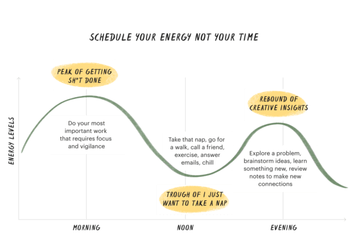

Eighty percent of the population experiences a common pattern of energy and mood fluctuations throughout the day: Energy and mood tend to rise in the morning, go down in the afternoon, and rise again slightly in the late afternoon or evening. Those people are called morning larks or third birds.

The other twenty percent of people are night owls. They experience the same pattern but in reverse and shifted later in the day: Energy and mood tend to be moderately high in the early afternoon, low in the early evening, and highest in the late evening and into the early morning.

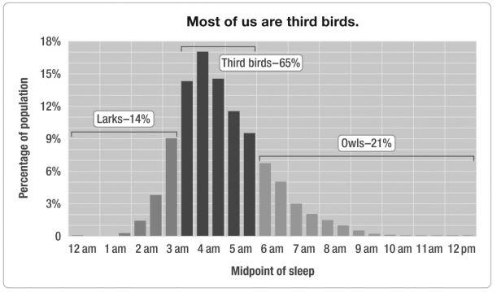

Third birds experience the same energy pattern as morning larks, just shifted back 1-3 hours. Graphic from [When: The Scientific Secrets of Perfect Timing](https://www.danpink.com/books/when/)

Pink refers to these stages of the day as peak, trough, and rebound, and they’re fundamental to optimizing your daily schedule for maximum productivity.

### Peak time

Peak time is when your energy and focus are at their highest. This is when you’ll perform best on analytical work that requires focus and vigilance. If you’re a programmer, work through a complex coding challenge that requires concentration. If you’re a writer, it’s the best time to sit down to write or edit your work.

Don’t let mundane tasks sneak into your peak time. As much as possible, protect your peak time for high impact tasks and [deep work](https://blog.doist.com/deep-work/) that requires a large amount of focus.

### Trough time

Trough time is when your energy is the lowest. You feel mentally and/or physically tired and unfocused. You find yourself staring at your computer screen for minutes on end without actually getting anything done. Morning larks might call this the afternoon slump.

Trying to stay focused on important tasks during your trough time is a recipe for frustration and will only deepen your [mental fatigue](https://blog.doist.com/mental-fatigue/). It’s a great time to do things that need to be done but aren’t a core part of your work. The kinds of tasks that are graded pass/fail – either you did them or you didn’t do them – where quality doesn’t matter, such as processing email or submitting expense reports. It’s also a great time to take a break, get outside, grab coffee with a friend, or just give in and take a power nap (more on that later).

### Rebound time

Rebound time is when your energy and attention aren’t at their peak, but you can still focus. You might not feel as mentally alert as you do during your peak, but you don’t feel like you’re trudging through mental molasses either.

Research shows that people are at their most creative during their rebound time. Instead of just doing the same kind of work you’d do during your peak time but slower and a little bit worse, consider switching gears to tasks that require insight and creativity. Using the same example as we used for peak time: If you’re a writer, this is a good time to brainstorm topics, think through a particularly tricky section or chapter, or review your notes to spark new ideas. If you’re a programmer, use this time to explore that problem you haven’t been able to find a solution for, read up on the latest technologies in your field, or spend time on a side project to learn something new.

### Matching your tasks to your energy

This energy pattern explains why the world’s most accomplished violinists get in a lot of practice in the morning, take the afternoon off, and then practice a little more in the evenings. They’re taking advantage of their highest energy hours. Instead of slogging through their lowest energy hours, they take a break to recharge and come back fresher in the evening.

You can do something similar with your own daily schedule.

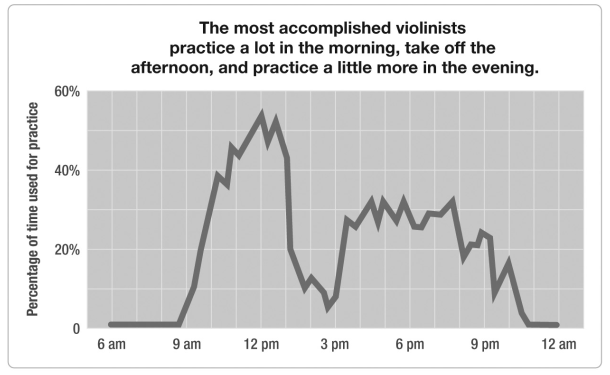

Graphic from [When: The Scientific Secrets of Perfect Timing](https://www.danpink.com/books/when/)

When you start thinking about your schedule in terms of your energy — peak, trough, and rebound — rather than your time, it becomes clear that not all hours are created equal. An hour of your peak time is worth more than an hour of your trough time. This knowledge should provide you with the right framework to answer these questions:

- Boss: Can we schedule a meeting for tomorrow at 9am?
- Yourself: Should I reply to this email now?
- Coworker: Let’s schedule a brainstorming session. What time is best for you?

You can start [blocking off your peak hours](https://todoist.com/productivity-methods/time-blocking) for your most important work instead of filling them with meetings and having to slog through your trough hours. When your tasks match your energy level, it feels like you’re sailing with the wind instead of against it.

## Taking breaks

The second key point that Pink drives home is when to not work. As someone who tries to squeeze as much out of my time as possible, I was skeptical of the connection between breaks and productivity.

However, [research consistently shows](https://www.psychologytoday.com/us/blog/changepower/201704/how-do-work-breaks-help-your-brain-5-surprising-answers) that breaks help to restore focus and motivation, consolidate memory and learning, and boost creativity. Incorporating breaks into your daily schedule is one of the most effective ways to boost productivity, even more so if you need to do important things on your trough time when alertness and focus are in short supply.

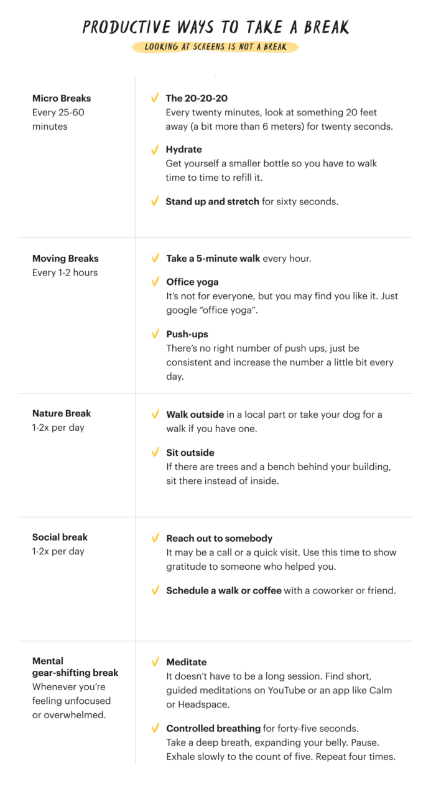

If your goal is greater productivity and mental alertness, there are right and wrong ways to take breaks. Pink breaks down the types of breaks that will give you the best bang for your buck into five categories:

**Micro breaks**: Give your eyes and body some rest.

- **The 20-20-20**: Every 20 minutes, look at something 20 feet away (a bit more than six meters) for 20 seconds.
- **Hydrate**: Get yourself a smaller water bottle so you have to get up and walk from time to time to refill it.
- **Stand up and stretch** for 60 seconds.

**Moving breaks**: A great way to counteract the [negative impacts of sitting](https://www.health.harvard.edu/pain/the-dangers-of-sitting).

- **Take a five-minute walk** every hour.
- **Office yoga**: It’s not for everyone, but if it’s for you, just search for “office yoga”.
- **Push-ups**: There’s no right number of push-ups, just stop, drop, and do as many as you have the energy for.

**Nature break**: Walking in nature has many [positive impacts on the brain](https://www.nationalgeographic.com/magazine/2016/01/call-to-wild/).

- **Walk outside** in a local park or take your dog for a walk if you have one.
- **Go outside** if there are trees and a bench nearby.

**Social break:** Social connection is [positively associated with health and productivity](https://healthsolutions.fitbit.com/blog/why-social-connectedness-is-key-to-employee-health-and-productivity/).

- **Reach out to somebody**: It may be email, call, or a quick visit. Use this time to show gratitude to someone who helped you. It will be nice for the person and also restorative for you.
- **Schedule a walk** or coffee with a colleague who you enjoy talking with.

**Mental gear-shifting breaks:** A way to get back on for when you’re feeling overwhelmed, unfocused, or unproductive.

- **Meditate:** It doesn’t have to be a long session; [UCLA](http://marc.ucla.edu/mindful-meditations) offers guided meditations as short as three minutes.
- **Controlled breathing** for 45 seconds. Take a deep breath, expanding your belly. Pause. Exhale slowly to the count of five. Repeat four times. This technique [improves stress levels and sharpens your thinking](https://www.nytimes.com/2016/11/09/well/mind/breathe-exhale-repeat-the-benefits-of-controlled-breathing.html).

As a rule of thumb, screen-free breaks are more mentally refreshing than screen-full ones. The more you can mentally disengage from work, the more restorative the break will be.

### Make naps your productivity superpower

There’s one type of break that deserves special attention: naps. Not everyone has the luxury to take a nap during the workday, but those who can should seriously consider it. A daily nap — taken the right way at the right time — can be a powerful way to slingshot your way out of your energy trough and set yourself up for an even more productive rebound.

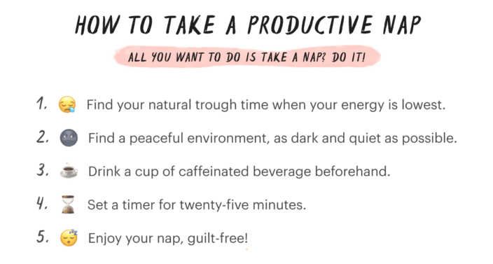

Here are some tips to plan for the perfect nap:

1. **Find your trough time:** It will happen at more or less the same time every day, so find the time when your energy is at its lowest value and make it naptime.
2. **Find a peaceful environment**, as dark and quiet as possible.
3. **Drink a cup of caffeinated beverage beforehand**: Caffeine takes about 25 minutes to enter your bloodstream, so you’ll start feeling the effects just as it’s time to wake up.
4. **Set a timer for about 25 minutes**: Between 20 and 30 minutes seems to be the perfect amount of time. If you sleep more than 30 minutes, there’s a good chance you’ll wake up feeling sluggish because your body was getting ready for a longer, deeper sleep session. If you sleep less than twenty minutes, you probably won’t get the full advantages of the nap.
5. **Enjoy your daily naptime**, guilt-free!

Long story short, if all you feel like doing during your trough is taking a nap, go ahead and schedule it into your day!

## Finding your own peak, trough, and rebound times

It’s great to get inspired by others’ daily routines, but the truth is: no biological rhythm is the same. You’ll need to do some detective work to discover your own energy profile.

Pink includes a handy [Daily When Tracker](https://www.danpink.com/wp-content/uploads/2018/01/time-sheet.pdf) in his book to help you track your energy levels and find your energy profile.

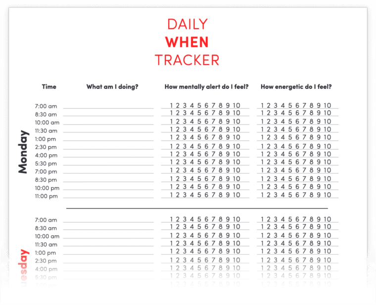

Download the [Daily When Tracker](https://www.danpink.com/wp-content/uploads/2018/01/time-sheet.pdf)

Just set a timer for every 90 minutes. When the timer goes off, put a mark in one of the numbers 1 to 10 to reflect how energetic and/or mentally alert you feel.

I decided to print mine and track my energy and attention for one week. From the results, you can see that my patterns match up pretty closely to the one at the beginning of this article. That means I’m a “third bird” with my peak mental alertness between 8 am and noon followed by a trough between 1p m and 4 pm and a rebound between 5:30pm and 8:30pm.

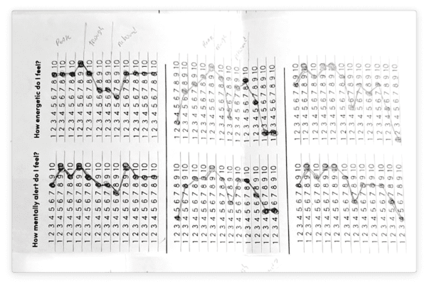

I tracked my energy levels for a week.

You may think you already know when you’re most alert, but I’d encourage you to take a week and do the When tracker for yourself. What you find may reaffirm what you already know, but you may learn something new about yourself in the process.

If nothing else, I found it a valuable reminder to pay attention to the way my body feels throughout the day and to recognize what each stage feels like physically and mentally so I know when to stay focused and when it’s time to step away.

## Crafting your daily schedule with Todoist

So you’ve now tracked your energy levels and mental alertness for at least a week. You know the rough daily pattern of your peak, trough, and rebound. You may have also gained some valuable awareness in how your body actually feels during each stage of the day, so you know when it might be time to switch gears throughout the day. Now it’s time to put this self-knowledge to work.

### Categorize your tasks with labels

The first step is to start categorizing your tasks by the energy level they require. Here’s a quick reference list for the categorization:

- **Peak**: Analytical work that requires focus and vigilance.
- **Rebound**: Insight work that requires focus and creativity.
- **Trough**: Work that doesn’t require focus or attention but still needs to be done.

I use the [Todoist labels](https://todoist.com/help/articles/introduction-to-labels) “peak”, “rebound”, and “trough” to categorize my tasks. Some people use “high energy” and “low energy” labels. If you’re a visual person, you could even use emoji for labels: , , and , for example.

I recommend using different colors for each label to make them stand out on your task list.

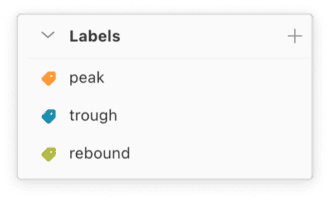

Create a label for each energy level.

To add the right label to a task simply type @ into the task field to pull up a list of all your labels. Keep typing the label name to narrow down the results.

You’ll now be able to click on a label or search for it in the Quick Find bar to pull up a list of all the associated tasks across all your projects.

### Set up custom filters for each energy level

I recommend setting up [custom filters](https://todoist.com/help/articles/introduction-to-filters) to narrow your view down to just your tasks that are due today. For example, the filter query ***@peak & (today | overdue)*** will show you all your “peak” tasks that are overdue or due today.

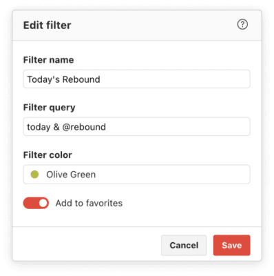

Create a “Today” [filter view](https://todoist.com/help/articles/introduction-to-filters) for each energy level.

You can use similar queries to set up filters for today’s trough and rebound tasks too. You can add these filters to your [favorites](https://todoist.com/help/articles/add-a-project,-label-or-filter-to-favorites) so you can easily access them throughout the day.

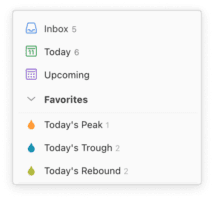

Add your energy filters to [favorites](https://todoist.com/help/articles/add-a-project,-label-or-filter-to-favorites) for easy access.

Then it’s simply a matter of pulling up the right filter for your current energy level and getting to work!

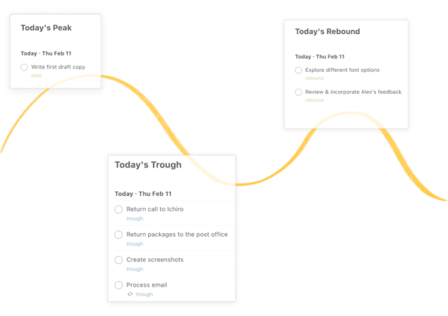

Click on the filter view to match your energy level.

### Schedule your breaks

Don’t forget to add breaks to your schedule to periodically refresh your energy and focus. Create a separate Breaks project and create tasks for breaks like you would any other important work. For example, I have a [recurring task](https://todoist.com/help/articles/set-a-recurring-due-date) scheduled to *Walk outside with the dog every workday at 2pm @trough* to remind myself to walk away from work during my trough time and get outside.

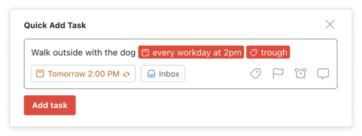

Schedule your breaks with a [recurring task](https://todoist.com/help/articles/set-a-recurring-due-date).

Remember that breaks are there because they will help you to be more productive and healthy. Prioritize them the same way you would any important task, then enjoy them guilt-free.

### Consider day theming

Taking it a step further, you may want to extend your energy tracking over several weeks. What patterns do you see? Are there certain days of the week your energy levels are consistently higher or lower than others? Is there a day of the week you feel more or less focused? More or less creative?

If so, you may find [day theming](https://todoist.com/productivity-methods/time-blocking#day-theming) a productive approach. For example, doing the bulk of your analytical work at the start of the week, concentrating most of your meetings on Thursdays, or ending the week with creative and/or learning tasks on Fridays.

If you’re interested in trying it out, the [free Skillshare course by productivity expert Mike Vardy](https://www.skillshare.com/classes/Productivity-Habits-That-Stick-Using-Time-Theming/1216959000) may be helpful. He walks you through setting up a day theming system, including detailed examples using both paper and Todoist.

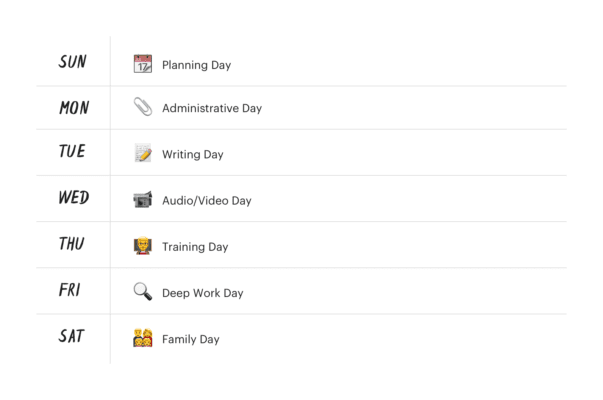

Track your energy levels over several weeks to spot weekly patterns, then [theme your days](https://todoist.com/productivity-methods/time-blocking#day-theming) accordingly.

## Daily schedules for different chronotypes

It’s easiest to understand a new concept when you see it in action.

### A “third bird” daily schedule

As you saw from my daily When tracker, I’m a third bird.

**6:00 am**: The best scenario of a good day of work for me starts early when everyone else in my house is sleeping. I select my **Peak today** filter and check the task with the highest priority. We take an [async-first approach to communication](https://blog.doist.com/asynchronous-communication/) at Doist, so I can usually rely on 2 solid hours of uninterrupted work before someone wakes up and my family routine starts.

**9:00-10:00 am**: I get back to work. Because of the time zone difference between South America and Europe, I try to focus on things that need answers from my colleagues and other collaborative work. If I still have time to focus on my peak tasks for the day, I do another session of deep work before lunch.

**1:00 pm**: After lunch is my trough time, and I certainly feel it. That’s when I click my **Trough today** filter and use the time to read emails, answer all Twist threads I have, do code reviews and work on minor tasks that need to be done.

**3:00 pm**: I try to go for a walk with my dog every day around this time nowadays;it works well as a break for me. Most recently, I asked a friend who lives nearby to go for a 30-minute walk in the afternoon once a week for a moving, social, and nature break all at the same time.

**5:00 pm**: At this time, I start feeling energetic and alert again This is when I click my **Rebound today** filter, check my time tracker to be sure I’m not overworking, and do my best to start a focus session. This is the hardest one to pull off consistently because I usually have tasks that are almost the same as the ones I was doing during the peak time but things are much less predictable at home.

### A night owl’s daily schedule

Things are different for **night owls**, so I wanted to describe one of Doist’s most notorious night owls, our CTO, Gonçalo.

**12:00 pm**: In the best scenario, he wakes up around noon and gets ready for the day.

**1:00 pm**: Eats lunch.

**2:00 pm**: Gets to work, starting with his rebound tasks.

**4:00 PM**: Later in the afternoon, he transitions into his trough time, and uses this time to review Twist and email, attend meetings, unblock others, and so on.

**5:00-6:00 pm** He disconnects to run errands and spend quality time with his family.

**10:00 pm**: As most people are winding down, he feels his energy rising again and starts deep working. He works in the silence of the night until 3 AM, which is his **peak** time.

Of course, life can get in the way for night owls. Gonçalo isn’t able to maintain his optimal schedule and take his toddler to school every morning. So he optimizes for a night owl working within a more normal schedule: his mornings become his trough time, his afternoons a mix of peak and rebound time, and he squeezes a couple of hours of peak time in the evening. Gonçalo’s timing is different but the concept is the same.

## When life gets in the way

Life isn’t a controlled environment. Getting too attached to the “perfect” daily schedule makes us less resilient when unexpected things happen.

I’m a father of 8-month old twins. My life 10 months ago was very different than what it is now. I used to have my whole day planned so I could do my deep work early in the morning, use the late morning for discussions with teammates in different time zones, then come back to do more deep work in the afternoon. Now, my days and nights are much less predictable.

It’s frustrating when an unanticipated interruption takes over your peak time, but don’t let that frustration derail the rest of your day. Timing is a big thing, but it isn’t everything.

Here are some ways you can make your daily schedule more resilient:

### Building margin into your daily schedule

When you try to squeeze as much as possible into your day, your schedule is fragile. The smallest hiccup can cascade throughout your carefully laid plans leaving you constantly behind, stressed, and overwhelmed. Try to build buffer space—or “margin” —into your daily schedule.

Meetings are likely the least flexible thing on your schedule. The more you can limit them in the first place, the more margin you’ll have to manage unexpected events in your day. Audit your meetings, particularly your recurring ones. Do they fulfill a purpose? Could they be done asynchronously in writing instead? [Use this handy flowchart](https://blog.doist.com/meeting-vs-email/) to help you decide. For meetings that are necessary, try to schedule them outside of your peak hours or [day theme](https://todoist.com/productivity-methods/time-blocking) by scheduling them all on one day of the week.

Another way to build margin into your schedule is to shrink your definition of a productive day. Narrow down your peak tasks to a single Most Important Thing, also known as the [Eat the Frog](https://todoist.com/productivity-methods/eat-the-frog) method. Ask yourself, what’s the one thing I need to do to make this a productive day? It should be well-defined and achievable in 1-2 hours. When you hit your peak hours, do that one thing first. Most days, you’ll be able to complete more than just your one important thing, but if things go sideways you can still count the day a success.

### Working through your trough hours

You may perform better at certain times of day, but that doesn’t mean you can’t get anything done outside of them. If you have to do work that requires concentration during off-peak time, do your best to use restorative breaks to improve your energy and alertness. You may find it helpful to break down bigger tasks into smaller sub-tasks and use the [Pomodoro Technique](https://todoist.com/productivity-methods/pomodoro-technique): Work in 25-minute focused sprints followed by a 5-minute break. Every 4 sprints take a longer 30-minute break.

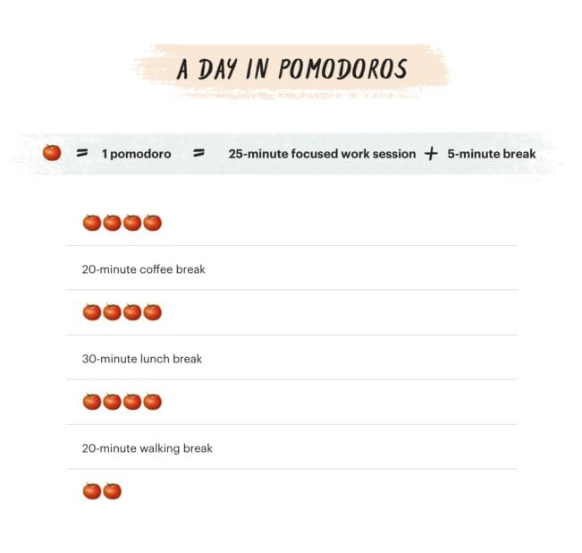

The [Pomodoro Technique](https://todoist.com/productivity-methods/pomodoro-technique) is a good way to work through your trough times if you have to.

When it comes to your daily schedule, don’t let perfect be the enemy of good.

---

Does the scheduling strategy Daniel Pink lays out in When really work? I collect a lot of data about my productivity so I was curious to see [what the numbers said](https://pothix.com/2019/). Was there any difference after 2019 when I started scheduling my energy?

I did see some small positive changes in my [RescueTime “productivity pulse”](https://help.rescuetime.com/article/61-the-productivity-report). My deep work hours (tracked manually in [Toggl](https://toggl.com/)) were a bit more consistent in 2019 compared to past years. The number of tasks I completed in Todoist doubled from [2017](https://pothix.com/2017/#-completed-tasks) and [2019](https://pothix.com/2019/#completed-tasks). None of this is definitive proof that scheduling my energy works, but they’re encouraging data points nevertheless.

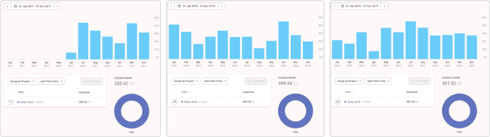

My deep work hours tracked manually in Toggl.

Despite my semi-obsessive self-tracking, the benefit that matters most to me isn’t captured in any of my charts. When I took a step back to understand the relationship between my productivity and my energy levels, I started working with my biological rhythms instead of struggling against them.

I began using my day to work hard when it was time to work hard and relax when I knew I wasn’t going to be productive anyway. Instead of forcing myself to keep working, I started going to the gym every day around 1pm. It felt great to have some time to myself in the middle of the day without the guilt of not being productive on “work time”. When I got back in the afternoon I felt more energetic and ready to do focused work again.

Reading *When* made me realize that feeling unproductive at times is an unavoidable part of being human. It gave me permission to rest and recharge to come back with greater focus and energy later. Most importantly, it freed me from feeling like there was one perfect schedule I should be conforming to and put the focus on what works best for me. I hope this guide can help do the same for you.
