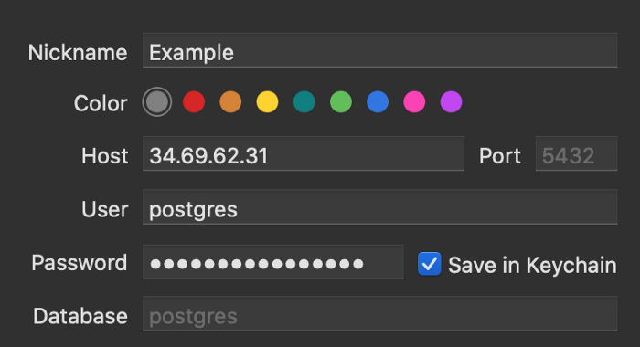

# Optimizing for Free Hosting — Elixir Deployments


Kubernetes (kidding) — Photo credit [Jp Valery](https://unsplash.com/@jpvalery?utm_source=unsplash&utm_medium=referral&utm_content=creditCopyText) on [Unsplash](https://unsplash.com/s/photos/burning-cash?utm_source=unsplash&utm_medium=referral&utm_content=creditCopyText)

## Another way to deploy Elixir apps

There are [A](https://alchemist.camp/articles/elixir-releases-deployment-render) [LOT](https://www.cogini.com/blog/best-practices-for-deploying-elixir-apps/) [of](https://hashrocket.com/blog/posts/automate-your-elixir-deployments-part-1-ansible) [different](https://hashrocket.com/blog/posts/automate-your-elixir-deployments-part-2-distillery-edeliver) [ways](https://dev.to/jonlunsford/deploying-elixir-1-of-3-building-releases-with-mix-1o4a) [to](https://blog.carbonfive.com/how-to-deploy-elixir-releases-with-ansible/) [deploy](https://blog.carbonfive.com/cross-platform-elixir-releases-with-docker/) [Elixir/Phoenix](https://www.digitalocean.com/community/tutorials/how-to-automate-elixir-phoenix-deployment-with-distillery-and-edeliver-on-ubuntu-16-04) [applications](https://cloud.google.com/community/tutorials/elixir-phoenix-on-kubernetes-google-container-engine). I want to fill a gap in the current literature: how do you deploy a Phoenix web app to a single Linux server optimizing for cost effectiveness, control, and simplicity, while using modern Elixir tools like releases to achieve zero-downtime deploys without hot code upgrading?

> I’m going to walk through a deployment strategy that can take you start-to-finish with a full-featured Phoenix web app running on a free-forever [Google Cloud Platform Compute Engine instance](https://cloud.google.com/free).

This setup is completely free, and when you have more traffic the cost of scaling on raw GCP instances is a lot cheaper than on platform-as-a-service offerings ([Heroku](https://hexdocs.pm/phoenix/heroku.html#content), [Gigalixir](https://hexdocs.pm/phoenix/gigalixir.html#content), [Render](https://render.com/docs/deploy-phoenix), etc). And, you’re in full control of the system so you don’t have to work around any fixed limitations. Scaling can be as simple as upgrading the specs of the instance when it can’t keep up anymore.

> My heretical belief is that the biggest risk to the reliability / availability of your app is developers changing code and running tasks, NOT the remote chance of hardware failure. Don’t be dumb — back up your database. But otherwise, the biggest way to reduce infrastructure-related downtime is keeping your server environment and deployment processes dead simple and **fast** so that devs won’t make mistakes and can restore things quickly when they do.

One of the great things about Elixir and Phoenix is that you can get [a LOT of milage out of very limited hardware](https://www.cogini.com/blog/benchmarking-phoenix-on-digital-ocean/), so there’s a good chance that your hosting with this strategy will stay free for a very long time, and incredibly cheap for even longer. And it will be wicked fast, reliable, and observable.

## What we’re optimizing for

- Absolutely 100% free to start, cheap to scale
- No Docker, Ansible, Distillery, or other build/deploy tools
- Single server setup
- Fault-tolerant at server level, e.g. if the server crashes or restarts the app will come back up automatically
- Secure (enough, this can be an infinite rabbit hole)
- *Fast* no-downtime deployments and rollbacks, without hot code reloading
- Full control and visibility, leveraging raw Linux built-in tools

## Free without the compromises (except your time of course)

I really like the level of control and flexibility that this approach provides. You’ll end up feeling a lot more comfortable with the raw basics of how your server runs and how to hook in and introspect when there are problems. It takes some time to set up, and there might be some new Linux skills that you’ll need to pick up along the way. This is a long guide, but stick with me and I think you’ll be really happy with the result! (or bookmark it and come back the next time you need to spin up a side project)

## Overview

> This is a quick outline of what we’ll be doing, so you can decide if it looks interesting before we get into the weeds.

1. Get a domain
2. Log into Google Cloud Platform and provision an F1-Micro Compute Engine instance
3. Make the IP address of the instance static
4. Add your SSH key to metadata in Compute Engine settings so you can connect to the instance
5. Set up an ssh alias on your dev machine so it’s easy to access the server
6. Enable swap memory on the instance
7. Install Erlang, Elixir, Node, and Postgres
8. Set a secure password for Postgres
9. Configure Postgres to allow remote connections
10. Connect to your remote Git repo where your project lives
11. Get your app secrets onto the server
12. Install Nginx + Certbot for SSL
13. Configure Nginx to reverse proxy requests to your app
14. Build a deployment shell script for some basic CI checks and allowing incremental release versions and no-downtime deployments
15. Create systemd services to ensure app starts up if server crashes and resets
16. Commit and push a change. Then deploy using a single command on your dev machine!
17. Attach to journald to watch logs
18. Bonus 1: Secure your data against the possibility of eventual hardware failure by creating another Google account with a free instance and set up automated backups using cron
19. Bonus 2: Rollback script

# The Details!

## 1 — Get a domain

If you want this whole thing to be *super free*, you can get a domain from [https://freenom.com](https://freenom.com/) and get a full-fledged domain with DNS and the works for free. The downside is that you’re limited to one of five super random top level domains (`.ml`, `.gq` etc), but it’s a great way to get the name you want before committing the cash to buy the `.com` version. Once you have a domain, go to the DNS settings page — we’ll be adding some records later on.

## 2 — Provision an F1-Micro Compute Engine instance

You can access the [Google Cloud Platform console](https://console.cloud.google.com/) using any Google account you own (typically a Gmail address). For the sake of separation (and security), I like to create a new gmail address with the name of my project in it so that the account is fully isolated (e.g. `damon.my.app@gmail.com`).

If you access the console with a new account, you may need to activate the free trial before it will let you do much. Go ahead and activate it, and put in a card if prompted. Don’t worry — you won’t be charged for this server even after the trial runs out.

Once you’re in the console, click on the top-left menu icon and then select *Compute Engine -> VM Instances*. If it’s your first time, it may take a minute to start. When it’s ready, click the “Create” button. Configure with the following options and then create:

```
Name: whatever you want  
Region: double check https://cloud.google.com/free to make sure the region you want is listed in the Compute Engine section  
Series: N1  
Machine Type: f1-micro  
Boot Disk:   
  Operating System: Ubuntu  
  Version: 20.04 LTS  
  Boot Disk Type: Standard persistent disk, 30GB  
Firewall: allow both HTTP and HTTPS traffic
```

## 3 — Make the IP address of the instance static

Click the triple lines icon in the top left to bring up the menu, then go to *VPC Network -> External IP addresses*. There should be a single row, belonging to the instance you just created. Change the **Type** from “ephemeral” to “static” and give it a name of your choosing. Copy the IP address (should look something like `34.69.61.31`), since you’ll need it in the next steps.

In the DNS settings for your domain, create `A` records for both `<your_domain>.com` and `www.<your_domain>.com` that point to that IP address.

## 4 — Add your SSH key

Click the triple lines icon again in the top left and go to *Compute Engine -> Metadata*. Click on the tab **SSH Keys**. Then click the “Add SSH Keys” button.

To get an SSH key from your dev machine to paste into the field, run `cat ~/.ssh/id_rsa.pub` in your local terminal. If you don’t get output, create an ssh key by following [these instructions](https://www.digitalocean.com/docs/droplets/how-to/add-ssh-keys/create-with-openssh/) and then run the command again and paste the result into the field in GCP and hit “Save”.

## 5 — Set up SSH alias

To connect to the server, we could run `ssh <IP Address from step 3>`, but it’s going to get tiresome to type in the IP all the time (especially if you have lots of these servers). So instead, we’ll set up an alias so that we can type in `ssh my_app` and have it connect automatically.

On your dev machine, enter `vim ~/.ssh/config` (which will create or open the file). Put the following code in the file, making sure that the first block goes at the very top before anything else already in there, and that the second block goes at the very bottom below anything else:

```
Host my_app  
 Hostname <IP address from step 3>  
 User <your local user name>Host *  
 AddKeysToAgent yes  
 UseKeychain yes  
 IdentityFile ~/.ssh/id_rsa
```

> Note: if you aren’t familiar with `vim`, just use the arrow keys to navigate and [learn how to switch between insert mode and command mode, and saving and exiting](https://coderwall.com/p/adv71w/basic-vim-commands-for-getting-started).

Replace the IP and user with your info and remove the comments. Save and quit, and now you should be able to connect to your server with the command `ssh my_app`. Nice! If you connect successfully to the instance, congrats! You’re now connected and in full control of your free server. If you didn’t connect successfully, you may need to look up how to add your ssh key to `ssh-agent`.

When you added your key to the metadata, a Linux user account was created on the server that matches the name of your local user account. This user has `sudo` privileges, isn’t the root user, and is passwordless (can only be accessed with the SSH keys in metadata), all of which make this user a pretty good choice for the user account responsible for deploying the app. Assuming you’re the only developer deploying code for now this setup is plenty secure, but as you add developers and complexity you might think about creating a dedicated user for deployment with more restricted permissions.

## 6 — Enable swap memory on the instance

This server is TINY — it only has .6GB of RAM. When you compile a Phoenix application on it for the first time on it, there’s a good chance that it will freeze up on you by running out of resources. But, since we get a 30GB spinner for free along with it, we can [safely enable swap memory](https://www.digitalocean.com/community/tutorials/how-to-add-swap-space-on-ubuntu-20-04) which will allow the server to push past the limit (albeit with slower memory) once it exceeds available RAM. To create 1GB of swap space, run the following on the server:

```
sudo fallocate -l 1G /swapfile
```

Next make sure the file can only be read by the root user:

```
sudo chmod 600 /swapfile
```

Next we’ll mark the file as swap:

```
sudo mkswap /swapfile
```

And enable it:

```
sudo swapon /swapfile
```

And make it permanent to survive restarts:

```
echo ‘/swapfile none swap sw 0 0’ | sudo tee -a /etc/fstab
```

To verify that it worked, run the handy command `top` which will give you a little dashboard of the resource consumption on the server. You should see a line like the following: `MiB Swap: 1024.0 total`. Press ctrl+c to exit.

There is a lot to learn about swap, and if you want to read more you can [start here](https://www.digitalocean.com/community/tutorials/how-to-add-swap-space-on-ubuntu-20-04). These commands and the default configuration that comes with them are fine for our purposes here.

## 7 — Install Erlang, Elixir, Node, and Postgres

In case these instructions get stale, follow the [official Elixir install guide for Ubuntu here](https://elixir-lang.org/install.html). Install Erlang and Elixir using the following:

```
wget https://packages.erlang-solutions.com/erlang-solutions_2.0_all.deb && sudo dpkg -i erlang-solutions_2.0_all.debsudo apt updatesudo apt install esl-erlangsudo apt install elixir
```

Now let’s get Node and NPM:

```
sudo apt install nodejs npm
```

And now Postgres:

```
sudo apt install postgresql postgresql-contrib
```

## 8 — Set a secure password for Postgres

Now that Postgres is installed, we’ll want to change the password to something secure. Later, we’ll be opening the database port on the server to the web (alert: security tradeoff!), so the password has to be rock solid. Generate a random password with a tool like [https://passwordsgenerator.net](https://passwordsgenerator.net/) and paste it into a safe place. Log into Postgres with the default postgres user:

```
sudo -u postgres psql
```

And update the password:

```
\password postgres(paste the password you generated and hit enter)(now put \q and hit enter to quit)
```

## 9 — Configure Postgres to allow remote connections

It’s often helpful to be able to access your database with a GUI on your development machine. I use [Postico](https://eggerapps.at/postico/), but [TablePlus](https://tableplus.com/) and [pgAdmin](https://www.pgadmin.org/) work great too. But before you can use one of these to connect to your database, you’ll need to adjust the firewall in GCP and alter some Postgres settings to open the database port (`5432`) to the outside world.

Back in the GCP console, open the navigation menu and go to *VPC network -> Firewall*. Click the “Create Firewall Rule” button up top. Alter the following settings and click “Create”:

```
Name: whatever you want, something like "database"  
Targets: All instances in the network  
Source IP Ranges: 0.0.0.0/0  
tcp: Check box, and enter 5432 in field
```

Security note: the more secure way to open the firewall is to restrict the `Targets` to just your instance so you don’t add instances later without remembering the port is open by default on all of them now. Also you could restrict the `Source IP Ranges` to just your own IP or the IP of a VPN that you can access, so that the port is only open to you (instead of the whole internet). However, if your Postgres password is secure and your database doesn’t hold extremely sensitive data, this configuration will probably be fine till you’re ready to really tighten security as you scale.

Now we’ll open up the Postgres server itself to allow connections beyond`localhost`. Find your `postgresql.conf` file by running:

```
sudo find / -name "postgresql.conf"
```

Mine is at `/etc/postgresql/12/main/postgresql.conf`

Open the file to edit it:

```
sudo vim <the file path you found>
```

Replace the line `listen_addresses = 'localhost'` with `listen_addresses = '*'`.

Find your `pg_hba.conf` file using `sudo find / -name "pg_hba.conf"` (mine is `/etc/postgresql/12/main/pg_hba.conf`) and open to edit:

```
sudo vim <the file path you found>
```

Add the following lines at the very end of the file:

```
host    all             all             0.0.0.0/0               md5  
host    all             all             ::/0                    md5
```

Now, restart postgres: `sudo systemctl restart postgresql`

Verify that you can connect with Postico or whatever app you use. Here’s an example of what it should look like. This will connect you to the `postgres` database which doesn’t have anything in it which is fine. Later, we’ll run `MIX_ENV=prod mix ecto.create` to actually create the DB for our app, and we’ll tweak these settings in Postico so we can connect to that specific database.



## 10 — Connect to your remote Git repo where your project lives

Finally, we’re ready to put some code on this server! I’ve created an [empty Phoenix repository](https://github.com/damonvjanis/empty-phoenix-app) on GitHub that you’re welcome to fork and follow along. There are only a few changes I made to the default stuff that `mix phx.new` generated, and you can see all of those changes in this tiny [pull request](https://github.com/damonvjanis/my_app/pull/1/files). It’s just a couple of tweaks to config, and ignoring secrets files. We’ll be creating some secrets files locally on our development machine, adding prod secrets to them, and then copying them up to our server in subsequent steps. Once you’ve forked the project, on your server run the following:

```
git clone https://github.com/<YOUR_GITHUB_USERNAME/my_app
```

> Note: your fork will be a public repo so there aren’t any authentication considerations, but if you’re using a private repo you’ll want to [generate an SSH key](https://www.digitalocean.com/docs/droplets/how-to/add-ssh-keys/create-with-openssh/) on the server and add it to your user account in GitHub, BitBucket, or wherever the repo lives. Then, make sure to run the `git clone` command using ssh, otherwise you’ll be prompted for account credentials every time you deploy and it’ll interrupt the smooth deployment process we’ll be setting up later.

Now, on your dev machine, open up the project (if you’re using the example repo fork just clone it locally) and create `config/prod.secret.exs`. We need some database credentials and some endpoint instructions to start the server with a dynamic port. You can use the following, but be sure to generate a `secret_key_base` and paste in your prod database password that you generated in step 8.

## 11 — Get your app secrets onto the server

The next step is to move the `prod.secret.exs` file that you just created up to the server, using `scp` (which stands for “secure copy”). It works just like the `ssh my_app` command that we use to connect to the server, but you specify a local path and a remote path and it will transfer files up to the server (or down *from* the server). Close the SSH session to the server by typing `exit`, and enter the following in your local shell:

```
scp config/prod.secret.exs my_app:~/my_app/config/
```

Now connect to the server again with `ssh my_app`, and cd into the `my_app` directory. Let’s make sure that our config between the app and database is successful by running the following:

```
MIX_ENV=prod mix deps.getMIX_ENV=prod mix ecto.create
```

It may take a few minutes to compile this first time, the VM is not very powerful. Once it’s done though, sweet! You’ve got a database. Make sure to update your Postico config with the database name, `my_app` in this case and make sure you can connect.

## 12 — Install Nginx + Certbot for SSL

You absolutely need to secure your website, using SSL. And, the LetsEncrypt project makes it free and painless to set up with the Certbot package.

It’s possible to get a [LetsEncrypt cert using only Elixir](https://www.theerlangelist.com/article/operating_via_development), eliminating the need to set up a web server to reverse proxy requests to the built-in Cowboy web server that Phoenix uses. I really love this concept of Elixir-only, but using that approach I couldn’t find a way to achieve zero downtime deployments on a single-server setup so we’ll fudge here and go the reverse proxy route.

> Our zero downtime deployment strategy is to spin up our app with the new version of the code, while the old version of the code is still running but on a separate port (`4000` or `4001`). Then, we reload the reverse proxy so that it starts directing requests to the port where the new code is running.

So instead of the pure Elixir approach, we’re going to use the extremely-fast web server Nginx to listen on port 80 and 443 and handle SSL concerns. Nginx will reverse-proxy requests to Cowboy on port `4000` and `4001` where our app will be listening. As a bonus, the Certbot package for LetsEncrypt makes it super easy to set up an SSL cert when you’re using Nginx. On your server, run the following:

```
sudo apt install nginx
```

This command installs Nginx and starts the server. If you visit `http://<your_domain>.com`, you should now see the default Nginx page. Nice! Now let’s open the Nginx site configuration:

```
sudo vim /etc/nginx/sites-available/default
```

Find the line `server_name: _;` and replace it with `server_name: <your_domain>.com www.<your_domain>.com`. Save and quit. This change allows Certbot to identify the correct domain when it attempts to create a certificate.

Next, let’s install Certbot (and the nginx extension for it):

```
sudo apt install certbot python3-certbot-nginx
```

And now let’s run it to create our SSL certificate:

```
sudo certbot --nginx -d <your_domain>.com -d www.<your_domain>.com
```

You’ll be prompted to enter your email address, agree to some terms, and share your email address (you don’t have to). If everything is successful, it’ll ask you to enter `1`or `2` to choose whether to redirect to HTTPS. Unless you have a reason not to, choose 2 . Next, let’s test to make sure the auto-renew works:

```
sudo certbot renew --dry-run
```

> If it works, it means that your certificate will renew automatically in the background every 90 days without any intervention, staying free and up-to-date forever without thought. Beautiful!

## 13 — Configure Nginx to reverse proxy requests to your app

As exciting as it is to see the Nginx default static page, what we *really* want is to see the \*Phoenix\* default static page . Let’s instruct Nginx to forward requests to port 4000, get Phoenix running, and make sure it all works. Open the Nginx site config file again:

```
sudo vim /etc/nginx/sites-available/default
```

Above the first `server { ...` block, put the following:

```
upstream phoenix {  
    server 127.0.0.1:4000;  
}
```

And then within the first `server { ...` block, find the `location / { ...` block and replace it completely with the following:

```
if ($host = www.<your_domain>.com) {  
  return 301 $scheme://<your_domain>.com$request_uri;  
}location /.well-known {  
  alias /var/www/.well-known;  
}location / {  
  allow all;  
  
# Proxy Headers  
  proxy_http_version 1.1;  
  proxy_set_header X-Forwarded-For $proxy_add_x_forwarded_for;  
  proxy_set_header Host $http_host;  
  proxy_set_header X-Cluster-Client-Ip $remote_addr;  
  
# WebSockets  
  proxy_set_header Upgrade $http_upgrade;  
  proxy_set_header Connection "upgrade";  # Proxies to whatever you set in the 'upstream phoenix {...' block  
  proxy_pass http://phoenix;  
}
```

Most of this reverse proxy config comes from [step 9 of this fantastic Digital Ocean guide](https://www.digitalocean.com/community/tutorials/how-to-automate-elixir-phoenix-deployment-with-distillery-and-edeliver-on-ubuntu-16-04#step-9-%E2%80%94-setting-up-a-reverse-proxy-on-the-production-server), and if you want more details you can explore them there. Let’s reload Nginx to update the config:

```
sudo systemctl reload nginx
```

Now, let’s get Phoenix up and running (don’t worry, more robust deployment is coming) and make sure that requests are proxying to it successfully:

```
# get the assets ready  
cd assets && npm install && cd ../  
npm run deploy --prefix ./assets  
MIX_ENV=prod mix phx.digest# run the app on port 4000  
PORT=4000 MIX_ENV=prod mix phx.server
```

Now visit `<your_domain>.com` and you should see the Phoenix page. Cool!

## 14 — Build a deployment shell script

Now that you have an app running on your custom domain, with a database and SSL, you could decide that it’s good enough and find a quick hack to keep it running, like running Phoenix in the background or manually deploying releases.

> I’m begging you though to stay with me and not try to take a shortcut, because you’ll end up wasting a lot of time fiddling with things. You’ll have to manually start and stop the system, think about database migrations, and you won’t get zero downtime deployments. It’s brittle and if the server ever restarts for required maintenance, your app won’t come back up by itself.

We’re going to use a simple but powerful tool as the main way to automate and streamline most of the deployment process: a lowly bash script. On the server, `cd` to your home directory (`cd ~/` or even just `cd`), and then create a `deploy.sh` file:

```
vim deploy.sh
```

> We’ll build this file section by section to explain what’s going on, and then I’ll drop the full thing at the end so it’s easy to copy, paste, and modify.

First, we’ll add a [shebang](https://linuxize.com/post/bash-shebang/) and [the](https://www.gnu.org/software/bash/manual/html_node/The-Set-Builtin.html) `set -e` [directive](https://www.gnu.org/software/bash/manual/html_node/The-Set-Builtin.html). The shebang tells the system to use the `bash` language to process the script, and the `set -e` directive tells the script to immediately exit if any of the commands in it fail (return a non-zero status).

```
#!/bin/bash  
set-e
```

Next, we’re going to add commands to navigate to the app project, get the latest version, and make sure dependencies are up to date:

```
# Update to latest version of code  
cd /home/<YOUR_USERNAME>/my_app  
git fetch  
git reset --hard origin/master  
MIX_ENV=prod mix deps.get
```

Next, we’ll add a couple of optional CI steps, like running tests or enforcing code style with [Credo](https://github.com/rrrene/credo). Even though it makes the build process a little slower, we’ll include the tests at least to make sure we can’t deploy code that’s breaking tests:

```
# Optional CI steps  
mix test  
# mix credo --strict (credo is not in example repo, commented out)
```

We’ve got a little problem though: with our secure database password in place on the server, `mix test` will fail because it won’t be able to connect. To fix this, let’s update the `mix test` line to say `CI=true mix test`, and then save and quit so we can get out of the server and back to our local environment. We need to make a couple of code changes locally to support running tests on the server with the prod DB password. First, we’ll create a file `config/test.secret.exs` with the following content:

Use `scp` to copy the `test.secret.exs` file up to the server like we did with the prod secrets file in step 11.

> If you’re using the example repo, this next code change has already been made so you can skip the next three paragraphs and get back to editing `deploy.sh`.

Otherwise, in your `config/test.exs` file, put the following at the very bottom, so that it pulls in the secret file only if the `CI` environment variable exists (like it does when the deploy script runs `CI=true mix test`):

```
if System.get_env("CI") do  
  import_config "test.secret.exs"  
end
```

Commit and push the change locally, and then get back on the server with `ssh my_app`. You’ll need to run `git pull` in the `my_app` directory to get the change.

> Alright, run `vim deploy.sh` in the home directory on the server and we’ll keep going.

Next, we’ll add instructions to compile the app and static assets, setting the `MIX_ENV` variable to `prod` so we don’t have to specify it on the rest of the mix commands in the script:

```
# Build phase  
export MIX_ENV=prod  
mix compile  
npm install --prefix ./assets  
npm run deploy --prefix ./assets  
mix phx.digest
```

Next, the script will create the release, and place it in a folder named with the current time in unix. That way, each release will be timestamped which makes it easier for us to have an automated rollback script:

```
# Create release  
now_in_unix_seconds=$(date +'%s')  
mix release --path ../releases/${now_in_unix_seconds}
```

Next, the script will replace some text in a file (that we’ll create in a minute) called `env_vars` that will store the latest release name. In the next section, we’ll be writing a `systemd` service responsible for starting and stopping our app, and it will look in this `env_vars` file to know which release to boot up. Let’s add instructions to replace the `LATEST_RELEASE` value in `env_vars` using `sed`:

```
# Update env var file with latest release name  
sed -i 's/LATEST_RELEASE=.*/LATEST_RELEASE='$now_in_unix_seconds'/g' ../env_vars
```

Next, we’ll grab the current value of the `PORT` , which is the port number the currently running app is using, and then deduce which port is available (either `4000` or `4001`):

```
# Find the port in use, and the available port  
if $(curl --output /dev/null --silent --head --fail localhost:4000)  
then  
  port_in_use=4000  
  open_port=4001  
else  
  port_in_use=4001  
  open_port=4000  
fi
```

Next, we need to update the `env.sh` file located deep in the folder structure of the release. When the release boots, any calls to `System.get_env` and similar won’t find the variables set in the shell like they normally would if you started the app with `mix phx.server`, so we can’t just say `PORT=4001 bin/my_app start` because it won’t pick up the `PORT` variable. But, if we [shovel](https://linuxize.com/post/bash-append-to-file/) the environment variables into the `<release_name>/releases/<version_number>/env.sh` file, the release will pick them up when it starts:

```
# Put env vars with new port and set non-conflicting node name  
echo "export PORT=${open_port}" >> ../releases/${now_in_unix_seconds}/releases/0.1.0/env.shecho "export RELEASE_NAME=${open_port}" >> ../releases/${now_in_unix_seconds}/releases/0.1.0/env.sh
```

> In the section above, we’re also setting a `RELEASE_NAME` environment variable which sets the name of the node when Erlang boots up. We can’t have two nodes with the same name running simultaneously, so we just set the node name to the same value as the open port to avoid conflicts.

Next, the script will use `systemctl` to start the app on the open port, and then it will use `curl` to ping the port every second till it’s alive before the script will continue:

```
# Start app on open port  
sudo systemctl start my_app@${open_port}# Pause script till app is fully up  
until $(curl --output /dev/null --silent --head --fail localhost:$open_port); do  
  printf 'Waiting for app to boot...\n'  
  sleep 1  
done
```

Next, the script will run the database migrations:

```
# Run migrations  
mix ecto.migrate
```

Finally, the script will clean up a bit by telling Nginx to start routing requests to the new port, and then it will stop the old version of the app. It all happens gracefully — requests in flight will finish before the old version is fully down:

```
# Update Nginx config to direct requests to app on open port  
sudo sed -i 's/server 127\.0\.0\.1\:.*/server 127.0.0.1:'$open_port\;'/g' /etc/nginx/sites-available/default# Reload Nginx so it gracefully starts routing to new app version  
sudo systemctl reload nginx# Stop previous version of app  
sudo systemctl stop my_app@${port_in_use}
```

Whew, we made it!! Lots of command line tools in there like `sed`, controlling `systemd` services with `systemctl`, and some `bash` concepts like variables and conditionals. Read more about `sed` [here](https://linuxize.com/post/how-to-use-sed-to-find-and-replace-string-in-files/), `systemd` [here](https://www.digitalocean.com/community/tutorials/how-to-use-systemctl-to-manage-systemd-services-and-units), and `bash` scripts [here](https://ryanstutorials.net/bash-scripting-tutorial/bash-variables.php) if you want to get a little more context on these tools. Here’s the file all together:

> This file might feel long or intimidating, but there’s a lot of power and flexibility in the approach. By using a single script to deploy, you’ll know exactly where to go if you want to add any custom steps or adjust things. Want to add more robust logic so that if the app doesn’t start up within some number of seconds, it kills the deploy? Just tweak the pause section. Want to add some static analysis? Great, add it to the CI section. Want to run it without migrations or without tests/CI? Just make a copy with a different name, take out the sections that don’t need to run and voilá! You’re working with the raw tools, so you won’t need to learn a framework or hack around constraints when you do need something custom.

Save and quit, then make the file executable:

```
chmod u+x deploy.sh
```

And one last thing, let’s create the `env_vars` file that our script references, and populate it with initial data. Run `vim env_vars` and put the following in it:

```
LATEST_RELEASE=
```

## 15 — Create systemd services

Before we can actually run our deploy script, we need to create a `systemd` service that starts up the app (basically, to run `<release_name>/bin/my_app start`). `deploy.sh` expects this service to be available — it calls it when it says `sudo systemctl start my_app@${open_port}`.

The reason we need a `systemd` service to run that command, instead of just having the deploy script run it, is so that if the app ever exits unexpectedly (for example, if your app runs out of memory or atoms and the BEAM crashes), `systemd` will notice and boot the app again in a clean state.

> Within your Elixir app, you have a supervision tree to manage and monitor when processes crash and reset them — you can think about `systemd` like it’s the supervisor for your supervision tree.

There’s another bonus — by having a `systemd` service start the app, the logs that the app produces will be piped out to `journald` automatically, which makes it easy to attach to the stream when you want to and it’s also a very standard log interface so it’s easy to connect to third-party logging services.

Let’s go ahead and create a new `systemd` service:

```
sudo vim /etc/systemd/system/my_app@.service
```

Add the following contents:

The most significant lines for us are 12 and 14. First, we pull in the `env_vars` file we created in the last step, which tells the service what folder the latest release is in, and then on line 14 we actually `start` the release.

> The name of this service file is important: adding the `@` makes it a “template”, which means that we can run it multiple times with different values after the `@` which in our case will be `4000` and `4001`. This enables us to have two instances of the app running at the same time so that Nginx can gracefully switch routing requests from one to the other, before the old one is shut down. You can read more about running multiple instances of a `systemd` service [here](https://www.stevenrombauts.be/2019/01/run-multiple-instances-of-the-same-systemd-unit/).

We’re going to create one more `systemd` service, which will be responsible for running our deploy script automatically (which will bring the app back online) if the server ever restarts unexpectedly. The file for this one is smaller because it doesn’t have to deal with monitoring and restarting the app if it goes down. Run `sudo vim /etc/systemd/system/my_app_start_on_boot.service` and add the following contents:

Now, let’s [enable the service](https://www.linode.com/docs/guides/start-service-at-boot/) so that it knows to run when the server boots:

```
sudo systemctl enable my_app_start_on_boot
```

One last thing before we’re done here: we need a way for our app to know at *runtime* which port to use, but at the point in our deploy script where the available port is discovered, the release has already been built and all of the config has been set at *compile* time. [Release runtime configuration](https://hexdocs.pm/mix/Mix.Tasks.Release.html#module-runtime-configuration) to the rescue! If you’re using the example app, you’ll already have this file so feel free to skip to the next step. Otherwise, locally in your project, create the file `config/releases.exs`:

Commit and push that change so it’s available on your server as well.

## 16 — Deploy the app

We’ve come a long way and done a lot of work! We’re finally ready for that sweet sweet payout: running the deploy script and watching the app come to life.

> One of the cool things about `ssh` is that you can use it to run a command in your local terminal, but have it execute on the server. Let’s do that. In your local terminal, run the following command:

```
ssh my_app ./deploy.sh
```

You’ll see some output as the script works through the various build, CI, release, and booting steps. If all goes well, you should be able to visit `https://<your_domain>.com` and see the app running!

> To really see the magic, commit and push a change locally and then run the command again, and you’ll see it gracefully swap over to the new version without any downtime .

If you used the example app, you can now visit `https://<your_domain>.com/dashboard/home` to see the live dashboard. You might notice some janky stuff with the websockets, which you can resolve by updating your `config/prod.exs` file where it references `"example.com"` to `"<your_domain>.com"`. Push that update, deploy again, and it should stabilize.

## 17 — Attach to journald to watch logs, and configure to trim

Logs aren’t the most exciting part of building an app, but you’ll be grateful for them when you’re troubleshooting tough bugs. Because the deploy script uses a `systemd` service to actually run the command to start the release, standard output is routed to `journald` which stores the logs.

> Just like we used `systemctl` to start and stop `systemd` services, we use a utility called `journalctl` to query and manipulate `journald` logs. If you want a deep dive, you can read up [here](https://www.loggly.com/ultimate-guide/using-journalctl/), [here](https://sematext.com/blog/journald-logging-tutorial/), or [here](https://www.digitalocean.com/community/tutorials/how-to-use-journalctl-to-view-and-manipulate-systemd-logs). I’ll just show you a couple of useful commands, to help you get a window into your logs as the app is running in real time, but `journalctl` supports a wide variety of querying for more advanced uses.

To attach to the journal and “follow” it (basically, as logs come in you see them update in real time), run the following command locally:

```
ssh my_app journalctl -f
```

Now, if you visit `<your_domain>.com` a few times, you’ll see some logs show up in your terminal. Sweet!

You can also print out the most recent `n` logs, with the following command:

```
ssh my_app journalctl -n 500
```

You may see some logs in there that don’t have to do with your app — to limit it to just your app you can run this:

```
ssh my_app journalctl -n 50 -u my_app@4001
```

Adding the `-u my_app@<4000 or 4001>` limits it to just that “unit”. Your app will always be running on either 4000 or 4001, so if the most recent log for the port you picked looks like the following, try the other one to see the output for the running app.

```
Nov 03 21:43:33 instance-1 systemd[1]: Stopped My App.
```

One more thing before we stop talking about logs: let’s update the `journald` config so that it starts trimming logs at 4GB so that logs don’t eventually consume all available disk space. `ssh my_app` to get on the server, then run `sudo vim /etc/systemd/journald.conf` to edit the config file. Find the line that has `SystemMaxUse`, uncomment it, and add `4G` to the end like this:

```
SystemMaxUse=4G
```

Save and quit, and then restart `journald` like this:

```
sudo systemctl restart systemd-journald.service
```

# You made it!

Congratulations, you’re now armed with a fully loaded Phoenix app running on free hardware without the compromises. You can deploy new versions of your code with a single command, achieve zero-downtime deploys without hot code reloading, and tap into the database and logs from your development machine with ease.

I’ve included a few bonus sections if any of them spark your interest. Thanks for reading, and please reach out to me at damonvjanis@gmail.com if you have any questions or comments.

> If any Elixir wizards want to see if you can figure out how to achieve zero-downtime deploys on a single server without hot code reloading, but also without depending on Nginx, I would love to highlight it! It would also be cool if someone could figure out a more pure Elixir way of starting the release without `systemd` but keeping the ability to restart on crash, and easy access to attaching to the logs of the app.

## Bonus 1: secure your data against the possibility of eventual hardware failure by creating another Google account with a free instance and set up automated backups using cron

I’m not going to go into exhaustive detail here, and this is not a sophisticated approach, but it can be a starting point.

Follow steps 1–5 of the guide again but with a new Google account, and instead of `my_app` name your alias something like `backups`. Now that you’ve got your server up and running and you can connect to it, install Postgres:

```
sudo apt install postgresql postgresql-contrib
```

Now hit `cd` to make sure you’re in the home directory, and enter `vim .pgpass` to create a password file for Postgres. Put the following contents in it, using the values from the server you set up for `my_app`:

```
#hostname:port:database:username:password  
<server IP address>:5432:my_app:postgres:<postgres password>
```

Now hit `chmod 600 .pgpass` to give the file correct permissions.

Open the `cron` configuration file by running `crontab -e`, then at the bottom of the file add the following:

To make sure that it actually works, instead of waiting an hour for it to run, try running the `pg_dump` task like in the file:

```
pg_dump -U postgres -h <server IP address> -p 5432 my_app > ~/my_app/my_app_hourly.bak
```

If all goes well, you should see a new folder `my_app/` with a backup inside. Sweet!

You can learn more about `cron` [here](https://phoenixnap.com/kb/set-up-cron-job-linux).

## Bonus 2: Rollback script

Here’s a rollback script I wrote, you can put it in your home directory next to `deploy.sh` and run it the same way: `ssh my_app rollback.sh`.

Save and quit, then make the file executable:

```
chmod u+x rollback.sh
```

Note: you’ll need to handle rolling back database migrations manually, by running `MIX_ENV=prod mix ecto.rollback` within the app directory on the server, if you need to roll back a migration.

The script will boot up the previous release, and if you need to go back more than one just keep running the script. It’s fast — it only takes a few seconds before the last release is the one running in prod!

And that’s a wrap! Thanks for reading
