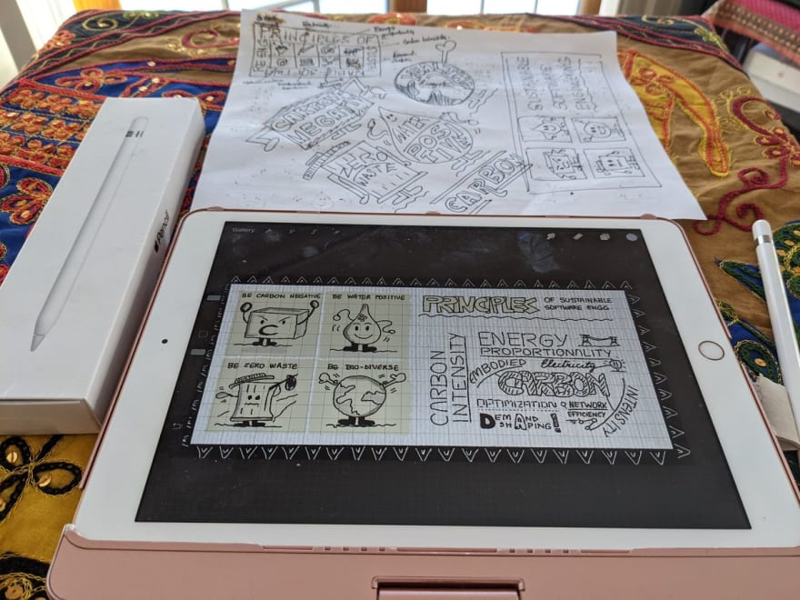
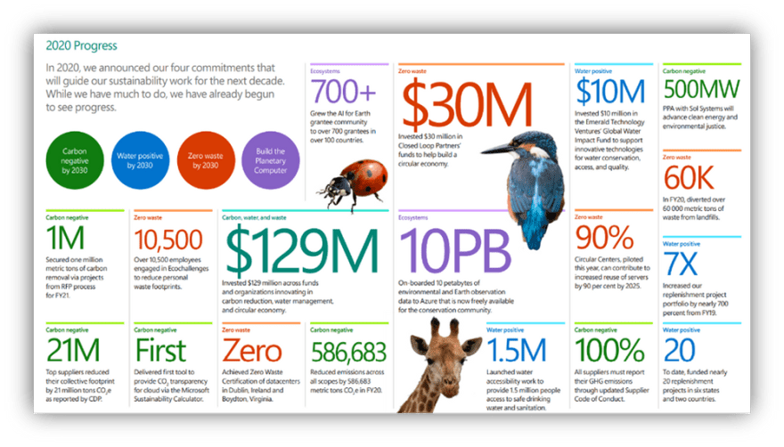
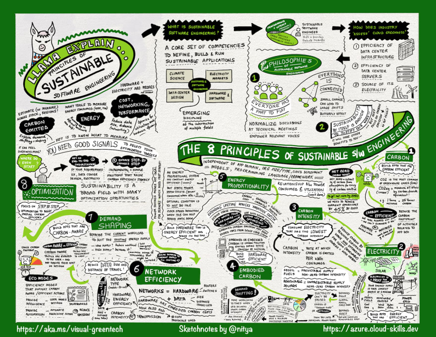

# A Visual Guide To: Sustainable Software Engineering

*This is a condensed form of the article originally published on the [Visual Azure](https://sketchthedocs.dev/visual-azure/posts/visual-guide-to-sse/) site. It's part of an effort to explain technology concepts using visual vocabularies, including sketchnotes!*

---

## Inception

Bonus: here's the process behind the visual for those interested in the visual storytelling side of things. *Check out the [#VisualizeIT](https://dev.to/nitya/series/9917) series if you want to explore those creative skills!*

> 
>
> 
>
> Nitya Narasimhan #VisualAzure
>
> [@nitya](https://dev.to/nitya)
>
> 
>
> I can report that it is already improving my mindset this morning ❣️ [twitter.com/nitya/status/1…](https://t.co/kzHvteR8EV)
>
> 13:49 PM - 12 Feb 2021
>
> Nitya Narasimhan #VisualAzure
> [@nitya](https://dev.to/nitya)
>
> Excited for my latest acquisition. Low cost, mobile, standing desk .. meant for draftsmen. Works for my sketchpad too. Two tiers allow for laptop/keyboard (work) or laptop/ipad (sketch) configuration
> And now I can move anywhere it's sunny and work in peace. Can't wait to try it! https://t.co/R1DYZ2Vb5d

---

## Background

Have you ever wondered what the term *sustainability* means? Or specifically, what *sustainable engineering* means, and how it impacts the way you work, or behave, in our current ecosystem?

Me too! So I did something about it - well, 3 things actually!

> 
>
> 
>
> Nitya Narasimhan #VisualAzure
>
> [@nitya](https://dev.to/nitya)
>
> 
>
> 16:45 PM - 10 Feb 2021

You can read the [longer version](https://sketchthedocs.dev/visual-azure/posts/visual-guide-to-sse/) of that post, but in this article, I wanted to share key learnings from my journey. I hope this inspires you to do three things in return:

---

## What is Sustainable Engineering?

According to UNESCO, [sustainable engineering](http://www.unesco.org/new/en/natural-sciences/science-technology/engineering/sustainable-engineering/) is the process of using resources in a way that *does not compromise the environment or deplete materials for future generations*.

Everything man-made relies on resources extracted from nature. *There is an "us" in "sustainability"* - we are all accountable to taking steps to protect and preserve our ecosystem. And, by definition, sustainable engineering is an interdisciplinary approach that touches on all fields of engineering in some context.

---

## What does Sustainability Involve?

The [Microsoft Sustainability Site](https://www.microsoft.com/en-us/sustainability?activetab=pivot_1%3aprimaryr3&WT.mc_id=mobile-15747-ninarasi) was a good resource for me to understand how companies approach this challenge. In January 2020, Microsoft [announced](https://www.microsoft.com/en-us/sustainability/news-announcements?WT.mc_id=mobile-15747-ninarasi) three sustainability targets for 2030:

- Become Carbon Negative | remove more C02 than we add.
- Become Water Positive | replenish more water than we consume.
- Become Zero Waste | reduce as much waste as we create

You can learn more about the "how" for these goals [here](https://news.microsoft.com/climate/?WT.mc_id=mobile-15747-ninarasi), with the last one focusing on a *zero to landfill* vision where resources like hardware are recycled or repurposed onsite.

A separate goal focuses on *biodiversity* - protecting and preserving ecosystems that are in decline or under threat, using technology. The Azure-powered [Planetary Computer](https://www.youtube.com/watch?v=eOgIuw-JTUU&feature=emb_title) initiative will help researchers collect, aggregate, analyze - and construct machine learning models from - environmental data at scale.

The first [2020 Environmental Sustainability Report](https://techcommunity.microsoft.com/t5/green-tech-blog/part-one-a-review-of-the-microsoft-2020-environmental/ba-p/2115986?WT.mc_id=mobile-15747-ninarasi) was just released in 2021, providing insights into the progress and challenges of delivering on this vision. The 96-page report is [reviewed here](https://techcommunity.microsoft.com/t5/green-tech-blog/part-one-a-review-of-the-microsoft-2020-environmental/ba-p/2115986?WT.mc_id=mobile-15747-ninarasi) with key results in the infographic below.

---

## Principles of Sustainable Engineering

Now that you know what sustainable engineering is, and you get a sense of the high-level goals pursued by industry, it's time to look at how *you* can contribute.

This is where the [Principles Of Sustainable Software Engineering](https://aka.ms/visual-greentech) helps. It gives you core terminology and concepts that provide a foundation on which you can build strategies and tactics.

Want to see the "big picture"? Here it is! Click to expand (or download the original from the [Sketchnotes Repository](https://cloud-skills.dev/).

Here are 5 things I learned from that course. You can find more [detailed notes here](https://sketchthedocs.dev/visual-azure/posts/visual-guide-to-sse/)!

> **1 | Sustainability is a Collective Effort**

We all have a part to play (in engineering) and a duty to protect (the ecosystem). Sustainability as a goal justifies all efforts - execute tasks for their own sake, and not for secondary benefits whatever those might be.

> **2 | Sustainability is Inter-Disciplinary.**

All human activities have inherent carbon footprints. Solving these challenges will require inter-disciplinary engineering solutions - from data center design, hardware and software engineering - to climate science and more. Educating ourselves is the first step to helping.

> **3 | Electricity & Hardware are Proxies for Carbon.**

Carbon dioxide is the most ubiquitous greenhouse gas. "Carbon" is the *carbon dioxide equivalent* measure of the global warming potential of an element or activity.

Hardware has *embodied carbon*. Think of this as the "fixed carbon cost" paid for the creation and disposal of hardware. The cost is typically amortized over its life.

Electricity has *carbon intensity*. Think of this as the variable carbon costs associated with fluctuating demand for computing. Because electricity is drawn from a power grid supplied by *renewable* sources (wind, solar, hyrdoelectric) and *fossil fuels* (coal, gas), its carbon intensity can vary by time and by region.

> **4 | Energy & Hardware Efficiency are key!**

Extend hardware lifetime by recycling parts, or refactoring software (to run on older hardware). And be energy-efficient by *demand shifting* (moving workloads to times or regions with lower carbon intensity) or *demand shaping* (changing current workload to maximize usage of renewable supply and minimize need for marginal power to meet demand).

> **5 | Think Observability & Optimization.**

Observability is about picking the criterion (carbon, energy, cost, data) that gives us the best (or most easily understood) estimate for evaluating impact of our actions.

Optimization can then take two forms – be *carbon-efficient* (take actions that are transparent to users, and automated for aggressive impact) or be *carbon-aware* (make actions visible to users, often by sharing intelligence that can shape their decisions).

---

## Summary

I hope you found this a useful *visual* guide to this new discipline of sustainable software engineering! If you want to see more visual guides, or have feedback on this topic, please do [post a comment](https://dev.to/azure/a-visual-guide-to-sustainable-software-engineering-53hh#comments)

And don't forget to [bookmark the series](https://dev.to/nitya/series/11040) or [follow the Azure publication](https://dev.to/azure) to be notified of new content in this vein!

---

### Resources To Explore!
