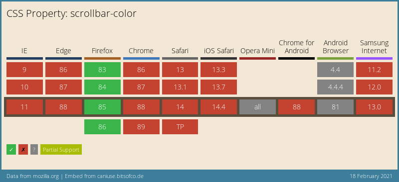
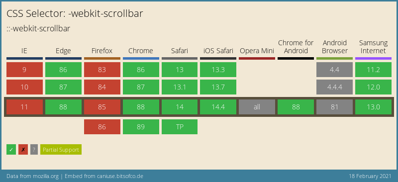

# Styling scrollbars with CSS

Yesterday we looked at removing the scrollbars for certain areas.
In regards to that, let's look at how we can style scrollbars with CSS.

Styled scrollbars are actually pretty rare. I've only seen them on a couple of sites so far.

Some examples of websites using custom scrollbars:

It's somewhat quite weird that we don't see more custom scrollbars, as they can really help to enhance your design.

The scrollbar was a thing that's always been very hard to style, like `select` elements. However, we got some recent additions to CSS that give us `scrollbar-color` and `scrollbar-width`.

## Styling the scrollbar with CSS

Let's see how we can give the best support for a styled scrollbar.

When styling the scrollbar, it's important to use both the WebKit styles and the newer scrollbar styles.

```
:root {
  --scrollbarWidth: 12px;
  --scrollbarBg: rgb(99, 102, 241);
  --scrollbarThumb: rgb(244, 63, 94);
}
.container {
  scrollbar-width: var(--scrollbarWidth);
  scrollbar-color: var(--scrollbarThumb) var(--scrollbarBg);
}
.container::-webkit-scrollbar {
  width: var(--scrollbarWidth);
}
.container::-webkit-scrollbar-track {
  background: var(--scrollbarBg);
}
.container::-webkit-scrollbar-thumb {
  background-color: var(--scrollbarThumb);
  border-radius: 6px;
  border: 3px solid var(--scrollbarBg);
}
```

Alright, let's go through these elements and see what happens for each.

We start by defining some CSS variables so we can re-use the same styles.

```
:root {
  --scrollbarWidth: 12px;
  --scrollbarBg: rgb(99, 102, 241);
  --scrollbarThumb: rgb(244, 63, 94);
}
```

I wrote a more detailed article on [CSS variables](https://daily-dev-tips.com/posts/how-to-use-css-vars/) as well.

The next element is the newer scrollbar options we get.

```
.container {
  scrollbar-width: var(--scrollbarWidth);
  scrollbar-color: var(--scrollbarThumb) var(--scrollbarBg);
}
```

It's new, and so far, I found only Chrome supporting it, but you need to turn on some settings for it.

- MAC: Settings > General > Show scroll bars > Always
- Firefox: about:config > layout.css.scrollbar-color.enabled > true

The values you see for the scrollbar-color or as follows:

- Thumb - background

> Note: It supports other colors, like: `scrollbar-color: dark|light`, but so far, no browser supports this.

This is where our fallback prefixes come in place:

```
.container::-webkit-scrollbar {
  width: var(--scrollbarWidth);
}
.container::-webkit-scrollbar-track {
  background: var(--scrollbarBg);
}
.container::-webkit-scrollbar-thumb {
  background-color: var(--scrollbarThumb);
  border-radius: 6px;
  border: 3px solid var(--scrollbarBg);
}
```

These will make sure the scrollbar renders in all the other modern browsers.
We can use the main scrollbar prefix to define the width of the scrollbar.

Next up, we can style the track, which acts as the background.
Then lastly, we have the option to style the thumb. This is the actual sliding bit. In my example, I use a border-radius and border to offset it from the sides a bit.

And that's it, you now have a styled scrollbar!

Check out the demo I made on Codepen.

## Browser support

Unfortionally the scrollbar-color and scrollbar-width are not supported well.



The WebKit prefix however, is supported more widely. You can see a combination of both can support quite a lot of browsers.



### Thank you for reading, and let's connect!

Thank you for reading my blog. Feel free to subscribe to my email newsletter and connect on [Facebook](https://www.facebook.com/DailyDevTipsBlog) or [Twitter](https://twitter.com/DailyDevTips1)
