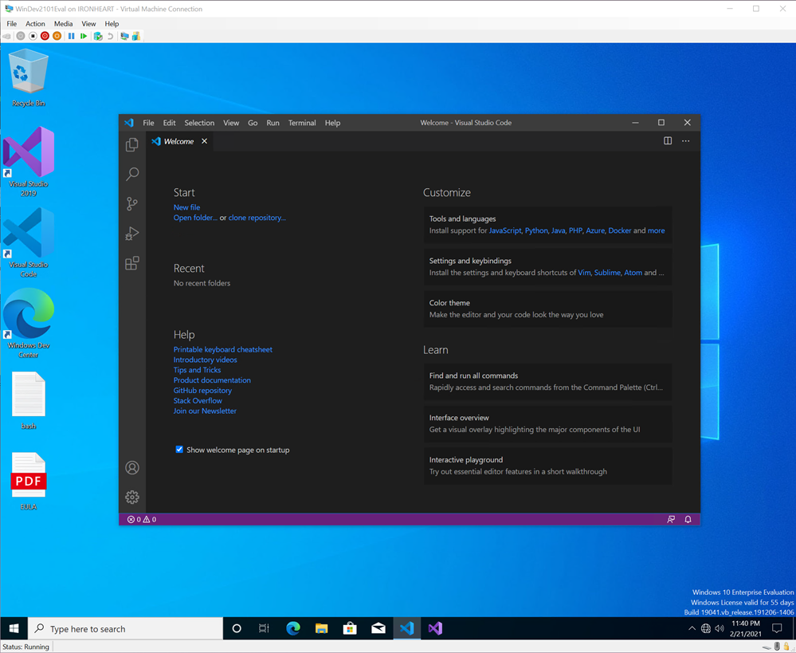

# Free Windows 10 development virtual machines for HyperV, Parallels, VirtualBox, and VMWare

You probably know that you can [download free developer tools for Windows 10 up at the Windows Dev Center here](https://developer.microsoft.com/en-us/windows/downloads?WT.mc_id=-blog-scottha).

[Visual Studio Community](http://visualstudio.com/free?WT.mc_id=-blog-scottha) IS effectively the Pro SKU and is free for Open Source. You may even have a "Take Home" license at your work since the paid version of VS is licensed *per-user, not per-machine,* so ask your boss if you can install it at home and get the same pro tools you use at work.

BUT, did you know (I did not!) that you [can download a free time-boxed Windows 10 Development environment for your Mac, Windows, or Linux machine as a virtual machine](https://developer.microsoft.com/en-us/windows/downloads/virtual-machines/?WT.mc_id=-blog-scottha)?

That means, there's a pre-configured VM for [VMWare](https://aka.ms/windev_VM_vmware) or [Hyper-V](https://aka.ms/windev_VM_hyperv) or [VirtualBox](https://aka.ms/windev_VM_virtualbox) or [Parallels](https://aka.ms/windev_VM_parallels) up at [https://developer.microsoft.com/en-us/windows/downloads/virtual-machines/](https://developer.microsoft.com/en-us/windows/downloads/virtual-machines/?WT.mc_id=-blog-scottha "https://developer.microsoft.com/en-us/windows/downloads/virtual-machines/") right now. This has been super useful when I wanted to get a build running fast on a system to test something or get started TODAY.

This evaluation virtual machine includes:

- Windows 10, version 2004 (10.0.19041.0)
- Windows 10 SDK, version 2004 (10.0.19041.0)
- [Visual Studio 2019](https://developer.microsoft.com/windows/downloads?WT.mc_id=-blog-scottha) with the UWP, .NET desktop, and Azure workflows enabled and also includes the Windows Template Studio extension
- Visual Studio Code
- Windows Subsystem for Linux enabled with Ubuntu installed
- Developer mode enabled

These are for eval or quick testing and expire regularly, so check back to get another if you need to. (BTW there are also [free VMs for testing IE11 or Edge Legacy](https://developer.microsoft.com/en-us/microsoft-edge/tools/vms/?WT.mc_id=-blog-scottha) but we don't talk about those.)

Again, [VS Code](http://code.visualstudio.com/?WT.mc_id=-blog-scottha) is free for Windows, Mac, and Linux, and [VS itself is free for Windows and Mac](http://visualstudio.com/free?WT.mc_id=-blog-scottha) so you may not need these VMs, but knowing there are Windows developer VMs available free for eval is a super useful way to bootstrap development on any machine. Enjoy!

---

**Sponsor:** Have what it takes to code securely? Select from dozens of complimentary interactive secure coding labs, test your skills, and earn a badge. [Learn more!](http://hnsl.mn/37Cldtp)

#### About Scott

Scott Hanselman is a former professor, former Chief Architect in finance, now speaker, consultant, father, diabetic, and Microsoft employee. He is a failed stand-up comic, a cornrower, and a book author.

[About](http://hanselman.com/about)   [Newsletter](http://www.hanselman.com/newsletter)
