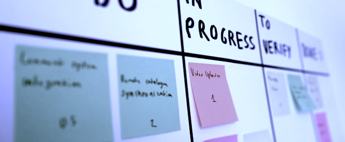
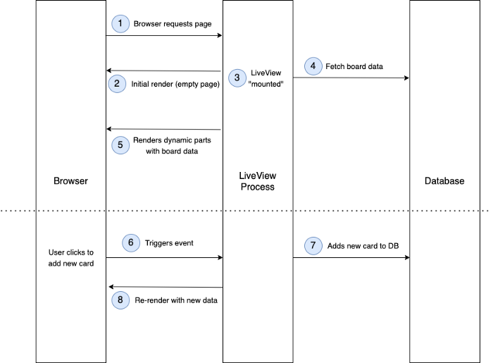
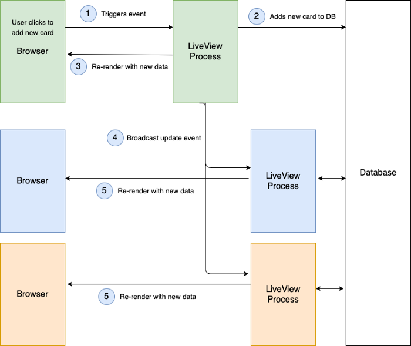

# Building a Real-time Kanban Board with Phoenix LiveView

I’ve been a big advocate of Elixir for a few years now, and even though I’m not currently using it for my daily job, I still enjoy using the Phoenix framework to build web applications.

[I wrote in a previous tutorial](https://medium.com/@leo_hetsch/building-a-ride-sharing-app-with-elixir-and-phoenix-channels-part-1-17bbd292aec4) on how to build interactive, real-time features thanks to Phoenix Channels and Presence. Phoenix’s LiveView is a relatively “new” feature that has been released for almost a year now, and I wanted to experiment with it, and see how I could use it to build a small project.

This post will constitute a walkthrough on how to build a minimal [Kanban](https://en.wikipedia.org/wiki/Kanban_(development)) board application using LiveView.



Okay, but first, what is LiveView? According to the Phoenix documentation:

> The LiveView programming model is declarative: instead of saying “once event X happens, change Y on the page”, events in LiveView are regular messages which may cause changes to its state. Once the state changes, LiveView will re-render the relevant parts of its HTML template and push it to the browser, which updates itself in the most efficient manner.

If you’ve worked with something like React before, it feels very similar: instead of having to track what needs to be changed on the page, and implement those changes, [we can just “declare” what a page needs to look like](https://dev.to/itsjzt/declarative-programming--react-3bh2), depending on some state.

In the context of Phoenix, this state can be composed of one or more Elixir data structures, such as a schema struct managed by [Ecto](https://hexdocs.pm/ecto/Ecto.html). Once this state changes (due to an operation on the backend, triggered by some user action), LiveView will render all the necessary updates. We don’t have to worry about implementing the UI transitions between the previous state and the new one.

[This video gives a really good explanation](https://www.youtube.com/watch?v=U_Pe8Ru06fM) on what is LiveView, and how it differs from the typical model of single-page applications, so I encourage you to watch it if you want to learn more details about it. If you would rather dive in straight into building something with it, then let’s start!

## Scaffolding the project

Let’s think a bit about what our application will contain. If you’ve used Kanban software before, three simple entities will come to mind: boards, columns and cards. A board will have a number of different named columns — for example, “Backlog”, or “In progress”.

Those columns will hold cards, which will constitute the basic building blocks of the Kanban board. In popular softwares such as [Trello](https://trello.com/), cards can actually embed of great variety of content, but for the sake of simplicity, our cards will contain just text.

The first thing we need to do is to setup a new project. Thankfully, this can be done in one line thanks to the Mix task `phx.new`. Don’t forget to use the `--live` option, which will generate useful boilerplate code in order for us to use the LiveView component.

```
$ mix phx.new --live kanban_liveview
```

We will also need a database — I chose to use PostgreSQL running inside a Docker container.

```
$ docker run --name postgres -e POSTGRES_PASSWORD="v3rys3cure" -p 5432:5432 -d postgres
```

Make sure the config file `config/dev.exs` is up to date with the correct database values:

We can then create the database by running the task `mix ecto.create`.

You should now be able to run the project with `iex -S mix phx.server`. Open your browser to [http://localhost:400](http://localhost:400/)0, and you should see the framework default welcome page.

## Creating the database schemas

We’ll take advantage of the `phx.gen.schema` Mix task to quickly create the [Ecto schema](https://hexdocs.pm/ecto/Ecto.Schema.html) modules, and then run the corresponding migrations. We’ll also need to use `has_many` and `belongs_to` in our schemas, so we can later use those associations when fetching records from the database.

```
$ mix phx.gen.schema Board boards title:string  
$ mix phx.gen.schema Column columns title:string board_id:references:boards  
$ mix phx.gen.schema Card cards content:string column_id:references:columns  
$ mix ecto.migrate
```

Let’s create some seed data, so we don’t have to create everything by hand (and so we can also quickly reset our DB to a minimal working state). Those seeds will go in the file `priv/repo/seeds.exs`:

We can now insert the seed data by running `mix run priv/repo/seeds.exs`

Now that the project is setup, let’s have a closer look on how we’ll use LiveView to connect the application backend state to the UI.

## How LiveView works

Let’s imagine a user visits the page `/boards/123` to display a specific Kanban board.

On the first request, an empty page will initially be rendered. The LiveView process will be immediately “mounted”. It will also be given the ID of the board to fetch — in our example, `123`. If we can fetch the board data successfully, we’ll save it to the process socket `assigns`, and LiveView will automatically re-render the page with the freshly retrieved board data.

Once the user interacts with the UI, for example by creating a new card, we will need to trigger an event on the LiveView process. This can be done either by using LiveView DOM bindings, but also by manually broadcasting a message to the LiveView process, as we will see. In the code handling this event, we’ll update the database and the struct in the socket `assigns`, which will then automatically re-render the UI.

As a picture is often worth a thousand words, here’s a diagram showing how those different steps will happen:



## Mounting the LiveView process

Phoenix generated for us some boilerplate code in the `KanbanLiveviewWeb.PageLive` module and the `page_live.html.leex` template. This code implements a sample feature on how LiveView works, with a small form to search through our application dependencies. You may have a look if you’re curious — we’ll then remove the boilerplate implementation to write our own. After cleaning the code, we should now have an empty `PageLive` module.

*Note the* `.leex` *template extension instead of* `.eex`*, which is how Phoenix makes the distinction between LiveView templates and regular ones.*

We can also remove the Phoenix default page header by cleaning up the `<header>` tag in the layout template `templates/layout/root.html.leex`.

The next thing we’ll do is to create a route to access a specific board page. The code of `BoardController` will implement a simple `show` action.

We’ll be using `live_render` in the controller instead of the `render` function which is used for “regular” views. Note that we’re not fetching yet the board record from the database, as the LiveView process will take care of it.

You can also see that we’re passing the board ID as an extra argument in the `session` key. As explained before, after the initial render, the LiveView process `mount` callback function will be invoked and be given that value. We’ll use it to fetch the board from the database and, if it exists, put it into the `socket` assigns.

## Implementing the Kanban front-end

A proper Kanban UI with drag-and-drop demands a bit of work on the front-end side. Since we’re focusing on LiveView in this post, let’s not reinvent the wheel. I chose to borrow the UI code from [this JSFiddle by Sheng Huang](https://jsfiddle.net/wellwind/nxp1yxpu/).

After making a few updates to render the EEx template with the board data, this is what the HTML looks like inside the `page_live.html.leex` template — along with some bits of CSS for styling inside `app.scss`.

Note the presence of the “Add card” button at the end of each column. This button is not doing anything interesting for now — but we’ll come back to it in a moment.

The code uses Bootstrap CSS classes and the JS library [Dragula](https://bevacqua.github.io/dragula/) to handle the drag-and-drop, so we’ll also need to include those in the `root.html.leex` layout.

We’ll finally need a bit of Javascript code inside of the `app.js` file to enable the drag and drop feature on the board’s columns.

If you now open <http://localhost:4000/boards/1> in your browser, you should see the Kanban board with the data created in the DB seeds earlier.

We will now write a few tests to ensure the “mounted” page displays the expected content. The module `Phoenix.LiveViewTest` [provides us with some helpers](https://hexdocs.pm/phoenix_live_view/Phoenix.LiveViewTest.html#module-liveview-testing), making it easier for us to test a page rendered by a LiveView process.

## Adding a new Card to a Column

Remember this “Add card” button that’s not doing anything at the moment?

Let’s now connect this button to the LiveView process, using some of [the DOM bindings](https://hexdocs.pm/phoenix_live_view/Phoenix.LiveView.html#module-bindings). Those bindings allow you to specify, thanks to HTML attributes, how user interaction with UI elements should trigger LiveView events. For example, we’ll use `phx-click` to bind the button’s click to an event called `add_card`.

We’re also using `phx-value-column` to refer to the column database ID. Values for every attribute prefixed by `phx-value-` will be passed to the LiveView process when the event is triggered. By doing this, we can retrieve the column ID inside the LiveView callback, to know in which column we need to insert the new card.

We now need to implement the `handle_event` callback for this event in our LiveView module. We’ll simply create a new card with some default content, associate it to the right column, and insert it. We’ll then fetch the updated board state from the database and `assign` it on the socket again.

Try now clicking the button in your browser, and a new card should appear in the column! Note that we didn’t have to write any Javascript code to handle the state update on the page, LiveView did everything for us!

Again, we can write a simple test case to ensure that the new card gets added when we click the button. We can use the helper functions `element` and `render_click` to target the button element inside the view and simulate a click event, before asserting the new rendered content.

## Broadcasting the new state to everyone

But we’re not quite there yet. We probably want to have different users able to use the application, see the cards and maybe add or move some of them. Without considering the issues of dealing with concurrent updates, what we want is at least for a user to see the change on their browser when a new card is added by someone else.

Try opening the application in a new browser window, and put the two windows side by side on your screen. When creating a new card in one of the columns inside the first window, *nothing is changed* inside the second window. That’s not ideal.

Once again, fortunately, LiveView makes it easy for us to trigger than change for every client which needs to be updated. That is because, much like Presence, LiveView is leveraging the PubSub mechanism of Phoenix.

When a LiveView process is mounted, we can make it subscribe to a specific topic — something such as `boards:<board ID>`. When a new card is added, perhaps on another LiveView process (by another user), we can then broadcast a message so every process receives it. Such behaviour is shown on the diagram below:



We then need to handle this message by writing the `handle_info` callback in the LiveView process implementation. We’ll re-assign the updated board on the socket, so LiveView triggers the re-rendering of the page for this process.

Try now adding a card on the first browser window, and you should see the change in the other window as well!

## Updating a Card’s content

We also want to trigger an update when the user changes the content in the card’s `textarea` element. We can use a similar binding, `phx-blur`, which will trigger the LiveView event when the element loses focus. We’ll use the attribute `phx-value-card` to store the card ID. The content of the `textarea` will be passed automatically to the event callback under the `value` key.

We’ll again use test helpers to simulate the `blur` event and assert the updated card’s content. The map given to `render_blur` contains the `value` that should be used for the new content.

## Handling a card moving to a new column

We should also trigger an update when the user moves a card to a different column. This time, we’ll see how we can trigger a LiveView update from a different layer of the application, such as a Phoenix controller. Let’s first implement a route and the controller to update a card content.

We’re not using LiveView bindings this time, but we can `broadcast` a message in the same way we did before, after updating the card in the database. This will ensure that all LiveView processes which subscribed to the topic will receive the update and re-render the page.

On the frontend, we can use Dragula’s event handler to hook onto the card being dropped into a different column. We’ll then use the browser’s native `fetch` to perform an HTTP request to the API endpoint we’ve just created.
