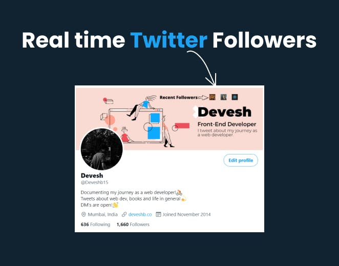
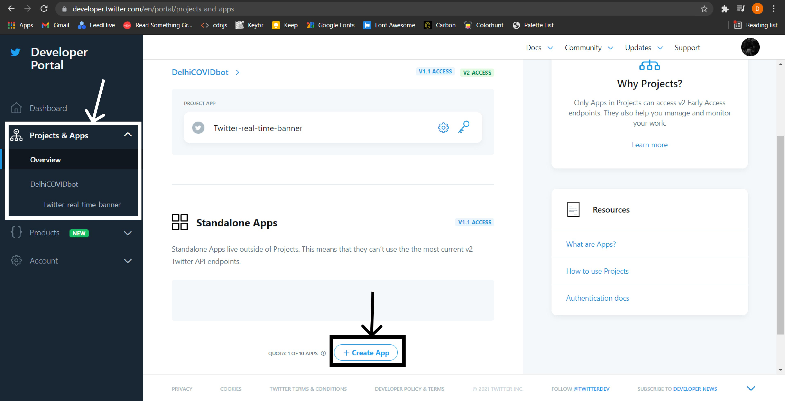
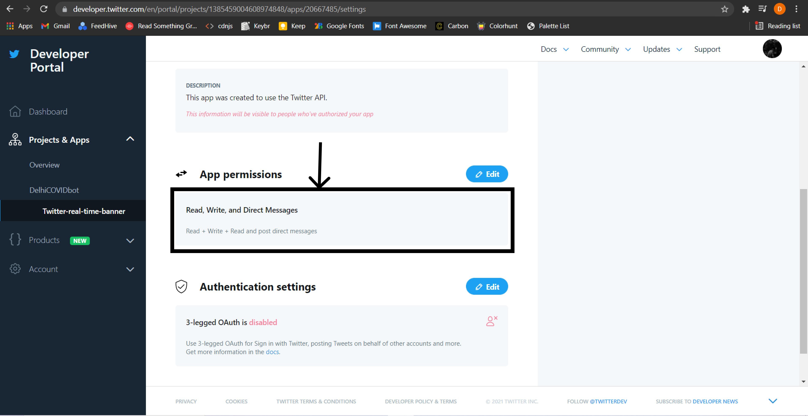
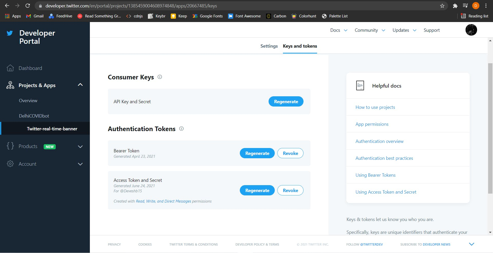
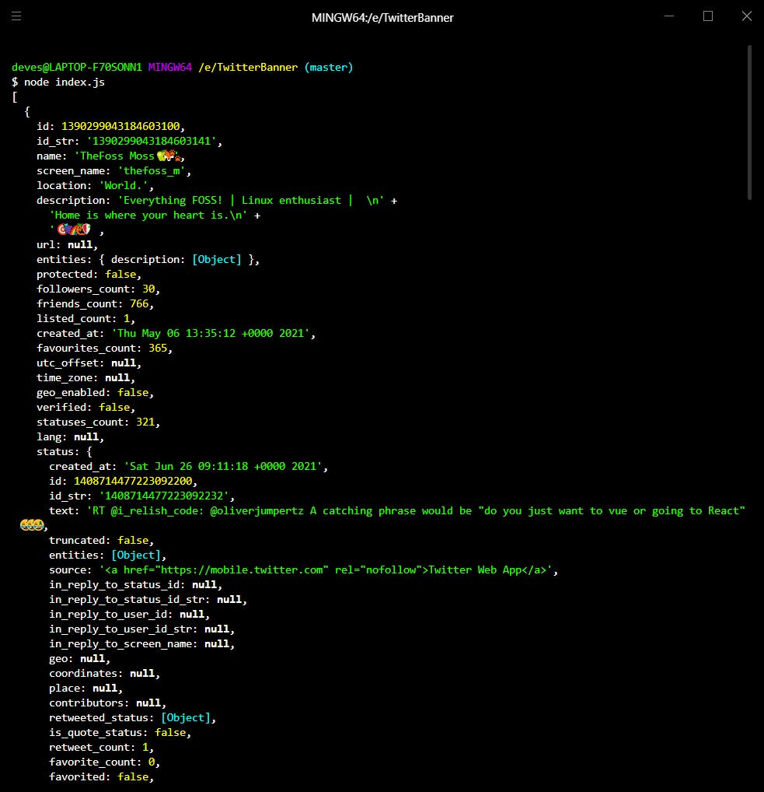

# Create a real-time Twitter banner!

## Create a real-time Twitter banner using Node.js that updates your banner with your recent 3 followers!

Do you want to make this amazing Twitter banner that updates every 60 seconds with profile images of recent three followers?
You can follow me you can see your profile image on my banner. Try it now -> [@Deveshb15](https://twitter.com/Deveshb15)



In this blog, I'll break down the code if you want to build one yourself, and don't worry if you're not a coder you could just visit the GitHub repo which that I've linked at the end of the blog and follow the instructions, it's super easy!

**For people who would like to build it yourself here you go**

**Step 1**- So the first thing you'll need is a Twitter developer account, just go this website -> [Twitter Developer account](https://developer.twitter.com/en/apply-for-access)  and apply for access. It usually takes 5 mins to get approved.

**Step 2**- After getting verified, go to Twitter developer portal and on your Dashboard click on create a new app.



**Step 3**- Change the read and write settings.



**Step 4**- Go to the keys and token section. Get your API key and secret, then get Access Token and Secret which we'll use later in the code.



**Next thing you'll need is a 1500x500px banner, you can create one using [Headers.me](https://www.headers.me/) within seconds, or if you need more customization like me you could use Canva**
Here's mine


Now once we got our API keys and a banner ready we're all set to jump into coding which we'll have been waiting for!
P.S. You can use my Github repo which I have included at the end of the blog, as a reference if you don't understand anything!

**Step 1**- Create a Folder with any name and then create an ***index.js*** file.

**Step 2**- Open the folder in any of your favourite code editor and then open your terminal to initialize npm

```
npm init -y
```

this will initialize npm so that you can download npm packages.

**Step 3**- You'll have to download few npm packages

```
npm install twitter-api-client fs jimp axios
```

we use 'twitter-api-client' to communicate with Twitter API, 'fs 'is used to manipulate files, 'jimp' is used to manipulate images, and 'axios' is used to download images!

You can read about twitter-api-client over here ->[twitter-api-client](https://github.com/FeedHive/twitter-api-client)

**Step 4**- Go to your ***index.js*** file and require all the packages.

```
// Require all the packages
require('dotenv').config()
const client = require('twitter-api-client');
const axios = require('axios');
const fs = require('fs');
const jimp = require('jimp');
```

We do this to load the content of a file into the memory.

**Step 5**- Now this is where you'll add your Twitter API and Access; keys, and tokens.

```
// Your Twitter account
const twitterClient = new client.TwitterClient({
  apiKey: "YOUR API KEY"
  apiSecret: "YOUR API SECRET"
  accessToken: "YOUR ACCESS KEY"
  accessTokenSecret: "YOUR ACCESS SECRET"
});
```

**Step 6**- Now you can test your App if it works by using the this code

```
// Test the twitter-api-client
async function test() {
 const params = { 
     screen_name: 'Deveshb15', 
     count: 3 
  }
 const data = await twitterClient.accountsAndUsers.followersList(params);

 console.log(data.users);
}

test();
```

Open your terminal and run the code using node

```
node index.js
```

If you receive your users, something like this, then your code is working, and if it gives some error check your API keys again, and if it still doesn't work you always have StackOverflow, and if you still can't figure it out then feel free to DM me on [Twitter](https://twitter.com/Deveshb15) !



P.S. Comment this code after you've checked that it works, cause we were just testing if it works!

**Step 7**- We'll create a function that downloads image on the local machine using axios now!

```
//function to download image
const download_image = (url, image_path) =>
axios({
  url,
  responseType: 'stream',
}).then(
  response =>
    new Promise((resolve, reject) => {
      response.data
        .pipe(fs.createWriteStream(image_path))
        .on('finish', () => resolve())
        .on('error', e => reject(e));
    }),
);
```

**Step 8**- We'll create a Function to manipulate profile pictures and put it on the banner and then post it, this is quite long so don't worry, this is because I have explained the code with comments!

```
  // function to draw image and post it
  async function drawImage(banner, img1, img2, img3){
    //Creating an array so it becomes easier to Promise.all instead of one at a time
    let imgArr = [banner, img1, img2, img3];
    // stores all the images that've been read
    let jimps = [];

    //Read the image in jimp and push it to jimps array 
    imgArr.forEach(image => jimps.push(jimp.read(image)));

    // fetch all the images
    Promise.all(jimps).then(data => {
      return Promise.all(jimps)
    }).then(data => {
      // composite the images on one another
      data[0].composite(data[1],1070,50); //Your banner is 1500x500px, so change this pixels accordingly
      data[0].composite(data[2],1160,50); //place the images wherever you want on the banner
      data[0].composite(data[3],1250,50); //experiment with it or DM me on Twitter @Deveshb15 if you want any help

      // Write the image and save it
      data[0].write('1500x500.png', function(){
        console.log("done");
      })
    })

    // encode to base64 to post the image
    const base64 = await fs.readFileSync('1500x500.png', { encoding: 'base64' });
    // Update the banner and post it
    await twitterClient.accountsAndUsers.accountUpdateProfileBanner({banner: base64});
  }
```

**Step 9**- Let's create the start function which does all the work, create a function start and create an array and a variable to store time at which the banner was updated.

```
async function start(){
    //push the url of profile image recent followers
    let image_url = [];

    //we'll set the time at which banner was updated
    let lastDrawImage = 0;
}
```

**Step 10**- Next we'll fetch the users and get their profile image URL and push it to the 'image\_url' array.

```
async function start(){
    //push the url of profile image recent followers
    let image_url = [];
    //we'll set the time at which banner was updated
    let lastDrawImage = 0;

    const params = {
        screen_name: "Deveshb15", //name of twitter account
        count: 3                  //number of followers to be fetched
    }
    // fetch followers
    const data = await twitterClient.accountsAndUsers.followersList(params);

    //push url of profile image to array
    data.users.forEach(item => {
        image_url.unshift(item.profile_image_url_https)
    });
}
```

**Step 11**- I'm not mentioning the above code in this snippet as it gets too long, this is just a continuation of the above code.
The code below is long because I've added amazing comments so that you can understand the code better.

```
async function start(){
  //Create random names to avoid caching issues
  const name = Math.random();  
  (async () => {
    //download the image
    await download_image(image_url[0], `${name}-1.png`)
    await download_image(image_url[1], `${name}-2.png`)
    await download_image(image_url[2], `${name}-3.png`)

    async function drawit() {
    //Get the time at which the banner is updated
    lastDrawImage = Date.now();
    // Draw the image and Post it
    await drawImage('1500x500.png' ,`${name}-1.png`,`${name}-2.png`,`${name}-3.png`);
    }
    // Subtract current time with last updated time
    const remaining = Date.now() - lastDrawImage;

    // Avoid hitting rate limit when update banner
    // 30 requests per 15 mins meaning 1 request per 30 secs
    if (remaining > 30000) {
      await drawit();
    }

    //Delete the images after the banner is updated.
    async function deleteImages() {
      try{
        console.log('removing', `${name}{1,2,3}.png`);
        await fs.unlinkSync(`${name}-1.png`);
        await fs.unlinkSync(`${name}-2.png`);
        await fs.unlinkSync(`${name}-3.png`);
      }catch(e){
        console.log(e);
      }
    }
    //Created this function to improve readability
    await deleteImages();
  })();
}
```

**Step 12**- Finally we are at our last step, to make the code running forever we need to keep starting everything again and again after some interval.

```
// start everything
start();
setInterval(() => {
  start(); 
}, 6000);
```

Here we start the code after an interval of 6 seconds to let the program go on forever, this happens because setInterval keeps on calling the function until clearInterval is called but we never initialize it, so it keeps on running forever.

**Woohoo, finally completed this amazing project, now keep it running or deploy it on *Heroku* so that it runs forever on the server!
P.S. Comment below if you need a blog on how to deploy this on *Heroku*!**

**If you have made this banner don't forget to tag me on Twitter as [@Deveshb15](https://twitter.com/Deveshb15)**

**Finally, If you liked this blog make sure you react to this blog and leave a comment below as it really motivates me to write more quality content!**

**Thank you if you read the blog so far!**

### **Here's is the GitHub repo : [real-time-twitter-banner](https://github.com/Deveshb15/real-twitter-banner)**
