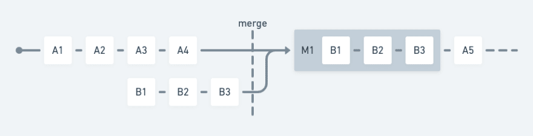
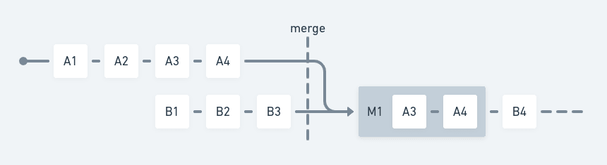
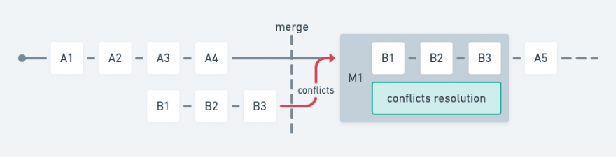
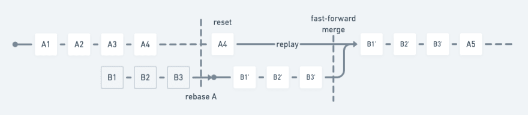
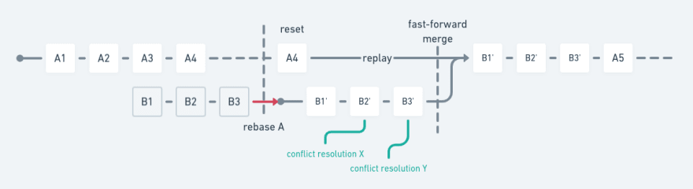
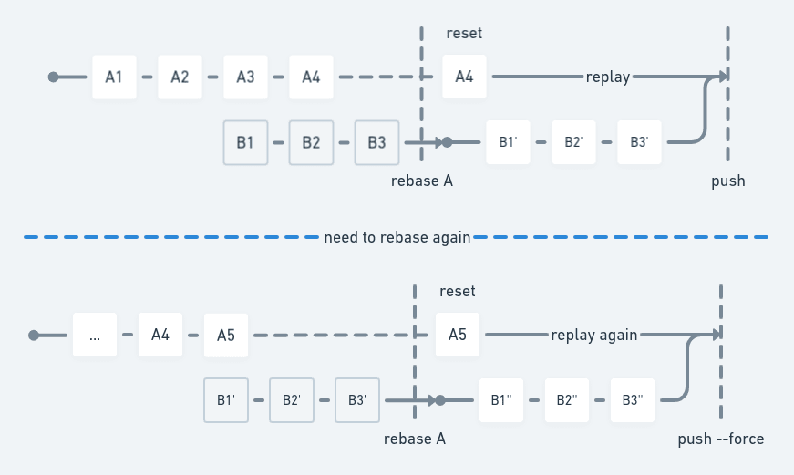

# Merge vs rebase

Jun 11
・*Updated on Jun 15*
・6 min read

Both [merge](https://git-scm.com/docs/git-merge) and [rebase](https://git-scm.com/docs/git-rebase) are excellent tools in the Git toolset, and each is associated with their own distinct use cases, despite being confused and misused sometimes. This usually happens because of team rules that were originally created to help and guide, but often get in the way of simplicity.

Most of the way the people use Git come from their culture and experience as developers. There is really no *merge vs rebase*, but there is always the **right thing to do** in a given situation. One might find a rebase more appropriate under certain circumstances, whereas merging could be more helpful eventually.

## Merge

From the Git documentation:

> git-merge - Join two or more development histories together

The use case of the merge operation is associated with the idea of *moving forward*. Common goals will include:

- Update the `main` branch with a feature (topic) branch.
- Update a feature (topic) branch with latest work from the `main` branch.

The most common example of merging two histories together is the integration of a topic branch onto a parent branch, which is usually done by a remote provider like GitHub:

```
git checkout A  # Could be "main", or "master"
git merge B  # Update A with B
```

[](https://res.cloudinary.com/practicaldev/image/fetch/s--Qv4GVn9f--/c_limit%2Cf_auto%2Cfl_progressive%2Cq_auto%2Cw_880/https://dev-to-uploads.s3.amazonaws.com/uploads/articles/hxyhhybdt848opoopzgm.png)

Merging branch B onto branch A with a merge commit M1.

Following the same principle, one can also update the topic branch with its parent before resuming work or being ready to merge upwards:

```
git checkout B  # A topic branch
git fetch remote A  # Make sure to download the latest stuff
git merge remote/A  # Update B with latest A
```

[](https://res.cloudinary.com/practicaldev/image/fetch/s--VJG4deq3--/c_limit%2Cf_auto%2Cfl_progressive%2Cq_auto%2Cw_880/https://dev-to-uploads.s3.amazonaws.com/uploads/articles/jliy5aof5ziqerj9l0k9.png)

Updating branch B with branch A with a merge commit M1.

Git will also do its best to merge code seamlessly, but sometimes it just needs help stitching pieces together. Those times are known — and feared — as *conflicts*. A good thing about merge commits though, is that conflicts are resolved at the merge level, regardless of the commits within; and as the nature of merging lies in moving forward, once conflicts are dealt with, they will never bug again.

```
git checkout A  # Could be "main", or "master"
git merge B  # Update A with B
# --- conflict resolution work ---
git add conflicting-file.txt  # Mark conflict as resolved
git commit  # Finish merging (by creating a merge commit)
```

[](https://res.cloudinary.com/practicaldev/image/fetch/s--xMfmvq1r--/c_limit%2Cf_auto%2Cfl_progressive%2Cq_auto%2Cw_880/https://dev-to-uploads.s3.amazonaws.com/uploads/articles/q0frd5tdj4wj2o1d44vr.png)

Merging branch B onto branch A with conflicts resolved in merge commit M1.

Another very common practice is to merge branches with a *fast-forward* strategy. With the example above in mind, it means the merge process will not generate a merge commit given the leftmost commit of branch B was created after the rightmost commit of branch B.

```
git checkout A  # Could be "main", or "master"
git merge --ff B  # Update A with B with fast-forward strategy
```

[](https://res.cloudinary.com/practicaldev/image/fetch/s--FMmsR6EY--/c_limit%2Cf_auto%2Cfl_progressive%2Cq_auto%2Cw_880/https://dev-to-uploads.s3.amazonaws.com/uploads/articles/hkp5vlnjyee0ws30kpo3.png)

Merging branch B onto branch A with a fast-forward strategy.

Although a fast-forward merge makes the history look *cleaner* after the merge process, there is a drawback: **one will never know something was merged**, because the merged commits will simply be appended after the base tip without information about their parent branches. Some teams, however, will not see this as a disadvantage, and will actually promote fast-forward merges — and with it, comes the need to [rebase](https://www.notion.so/Git-workflow-595ee853e5ad4e358bed53af796b1e4a) often.

## Rebase

From the Git documentation:

> git-rebase - Re-apply commits on top of another base tip

The use case of the rebase operation is associated with the idea of *rewriting and cleaning up*. Common goals will include:

- Update a feature (topic) branch with the latest work from the `main` branch by resetting the branch to `main` and replaying the commit history.

Rebase is also very useful in a few not-so-common or advanced scenarios:

- Move a commit history *onto* another point in history.
- Rewrite history in order to change (fix, squash, rename) previous commits.

Both the merge and rebase operations can be used to update a branch with some other history. In the case of rebase, we're literally *rebasing* an existing history from a base point.

```
git checkout A  # Could be "main", or "master"
git merge --ff B  # Hmmm no can do! B doesn't start after A
git checkout B  # Go back to B
git rebase A  # Reset to A then replay commits from B
git checkout A  # Let's try again
git merge --ff B  # Oh yeah
```

[](https://res.cloudinary.com/practicaldev/image/fetch/s--nuKv1mRz--/c_limit%2Cf_auto%2Cfl_progressive%2Cq_auto%2Cw_880/https://dev-to-uploads.s3.amazonaws.com/uploads/articles/61kqi7qfdu8ijzpmcz20.png)

Rebasing branch B from branch A, then merging branch B onto branch A with a fast-forward strategy.

The figure above demonstrates the most common use case of a rebase operation: update a topic branch with the latest history *in the cleanest way possible*. Note, however, *"cleanest"* also means rewriting history with similar, nevertheless distinct commit objects.

> Rebasing a branch will, **invariably**, rewrite its history.

As said before, some teams will just prefer a cleanly linear history of commits, and that will require people to master rebasing and always merge with the fast-forward strategy. The example above will repeat itself every time someone needs to rebase their branch until they're ready to merge it.

```
git checkout B  # We already know we need a rebase
git rebase A  # Let's see...
# --- conflict resolution work on commit B2 ---
git add conflicting-file.txt  # Looks good now
git commit --amend  # Commit with the "amend" option to fixup B2
git rebase --continue  # Now we go
# --- conflict resolution work on commit B3 ---
git add another-conflicting-file.txt  # Ouch
git commit --amend  # Fixup B3
git rebase --continue  # Done
```

[](https://res.cloudinary.com/practicaldev/image/fetch/s--Zs2-UfOA--/c_limit%2Cf_auto%2Cfl_progressive%2Cq_auto%2Cw_880/https://dev-to-uploads.s3.amazonaws.com/uploads/articles/awtujyezsfjkjplth64e.png)

Rebasing branch B from branch A, resolving conflicts in some commits from B, then merging branch B onto branch A with a fast-forward strategy.

In regards to conflicts, rebasing often requires more work, since conflicts need to be resolved at commit level. As such, should changes be introduced in the base branch, conflicts will likely need to be resolved again during the rebase process.

Another thing to consider when rebasing is that it may discard or rewrite objects pushed by other people, be it regular commits or merge commits with any conflict resolutions attached. Such action is **strongly discouraged**, since it will interfere with things whose authorship is not of the person doing the rebase. Once rebased, a branch should be warned about once Git finds it disconnected from the remote counterpart, thus requiring one to force-push (`git push --force`) the branch in order to upload it to the remote.

```
git checkout B  # Let's clean this up
git rebase A  # Reset to A then replay commits from B
git push remote B  # Upload rewritten history
# --- Branch A was updated by other people ---
git fetch remote  # Make sure to download the latest stuff
git rebase remote/A  # Reset to latest A then re-replay commits from B
git push remote B  # Oops it doesn't work, histories differ!
git push --force remote B  # Force-push branch B
```

[](https://res.cloudinary.com/practicaldev/image/fetch/s--0ivzu7oY--/c_limit%2Cf_auto%2Cfl_progressive%2Cq_auto%2Cw_880/https://dev-to-uploads.s3.amazonaws.com/uploads/articles/wwnw8i5iiljhtpl1ogi6.png)

Rebasing branch B from branch A, then rebasing branch B from branch A again after an update in branch A.

Taking history in consideration, a rebase operation will often omit the event in which someone had updated their branch with newer history, since replaying a branch leaves a linear commit log.

### Rebasing and `git pull`

After force-pushing a branch with the intention of keeping a clean and linear history, users with less experience with Git may unknowingly pull a more recent version of a branch on top of itself using a regular `git pull`, thus causing a confusing -- and unnecessary -- merge commit. *This is particularly common with graphical user interfaces that translate clicks to hidden Git commands.*

```
Merge remote-tracking branch 'origin/feature-x' into feature-x
```

To prevent that, `git pull --rebase` will reset the branch to its state in the remote then re-apply any newer commits on top of it -- which is usually the original intention. This behavior can be set as default in the [Git configuration](https://git-scm.com/docs/git-config#Documentation/git-config.txt-pullrebase):

```
git config --global pull.rebase true
```

## What should I do?

It depends on what your goal is, and it also depends on what the team has agreed with. Simply put:

- Merging works best for joining histories, while keeping verbosity and simplicity. It also helps keeping a record of conflict resolution and events like "I last updated my branch from upstream last Tuesday".
- Rebasing works best for administrative tasks when a branch is still unknown to the remote, or when its history needs to be rewritten for some reason.

As a general rule, it all boils down to the team's experience with Git, and how everyone intends to see their contributions converging to a common goal.

[](https://i.giphy.com/media/cFkiFMDg3iFoI/giphy.gif)
