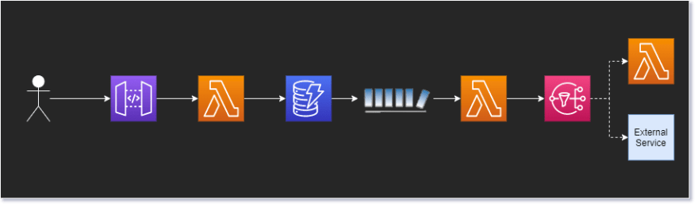
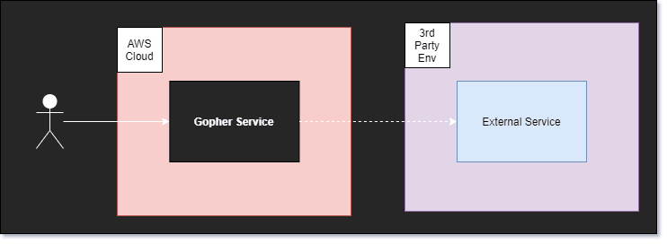
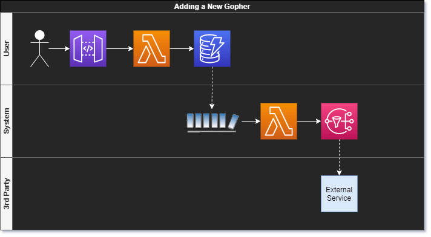
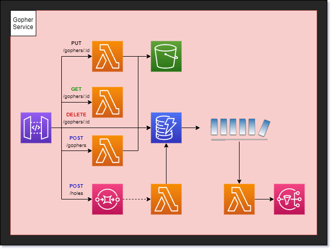
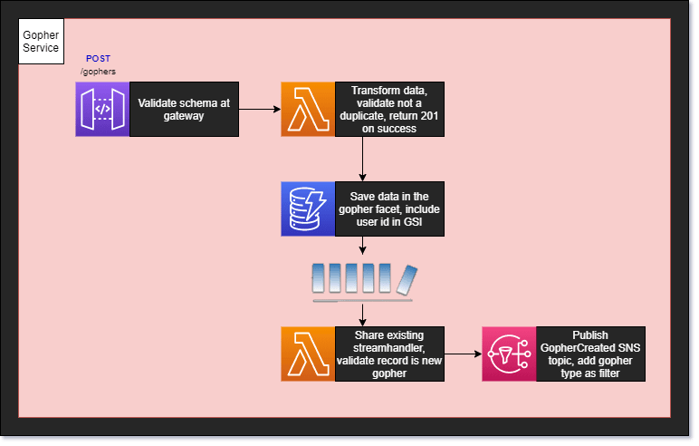

# Solutions Architect Tips - The 5 Types of Architecture Diagrams

Mar 17
*Originally published at
[readysetcloud.io](https://www.readysetcloud.io/blog/allen.helton/the-5-types-of-architecture-diagrams/)*
・6 min read

Have you ever been in a meeting where someone is trying to explain how a software system works?

I was having a conversation with a relatively new solutions architect who was trying to describe a system they had come up with. It had about eight different components to it and they all interacted with each other in multiple ways.

They were explaining the solution using hand gestures and a lot of "and this piece communicates with this one by...".

I understood the words coming out of their mouth but they don't make sense strung together.

Words get lost when explaining complex conceptual architecture. I was trying to build a mental model while following a train of thought. I needed a visual.

**I needed a diagram.**

But not just any diagram. Architecture diagrams are not a "one size fits all" solution.

We've discussed recently that a significant part of [being a solutions architect](https://www.readysetcloud.io/blog/allen.helton/making-the-move-from-contributor-to-solutions-architect) is effectively communicating your ideas to both technical and non-technical audiences.

Your diagrams must take that into consideration. If you want to get your idea across to different sets of people, you must make multiple versions of your diagrams.

Today we are going to talk about the **5 different types** of diagrams you should make depending on 5 different audiences.

We will take an example from my fake business but real API, [Gopher Holes Unlimited](https://github.com/allenheltondev/gopher-holes-unlimited), where we add a new gopher into the system to be tracked.

## The Flow Diagram

The most generic and generally broadest reaching diagram you can make is the flow diagram. It is a medium-high level diagram that shows all the pieces of a workflow.

This diagram illustrates the moving parts in a business process.

**Audience**

The audience for this type of diagram is generally technical. It may be used to pitch an idea to an architecture board or describe how a business process works to a developer.

**Considerations**

The major component to the *architecture flow diagram* is to include all the moving parts. In the case of our [serverless AWS environment](https://www.readysetcloud.io/blog/allen.helton/serverless-you-keep-using-that-word-i-do-not-think-it-means-what-you-think-it-means-c7d5516a5ecc), we label each managed service and which ones communicate with each other.

No details are described in how the pieces interact with each other, but it does show the connections. It shows how data flows through the system.

## The Service Diagram

A service diagram illustrates connectivity from a high level. It does not show any detail into how the workflow or service works, but instead shows the major pieces at play. This is a diagram intended to show the internal vs external services used in an application.

**Audience**

IT and network engineers tend to be most interested in this type of diagram. They care about any connections you're making to outside services, plus they need to know if any internal connectivity needs to be monitored.

I often use this diagram to describe how systems work to executives. They want to know connections between major applications and there is nothing better than the service diagram to represent those connections.

**Considerations**

When building an *architecture service diagram* it's good to list all the microservices that make up your application or ecosystem. Label which services communicate with each other and be sure to make the distinction between services your company owns and services that are external.

Details into how the services work are not necessary in this high level diagram. This is all about the services that make an application run.

## The Persona Diagram

It is important to show that your architecture solves the business problem. A persona diagram describes a chronological view and actors in a particular workflow. This is your best tool for proving that you've taken the business into consideration when developing your solution.

**Audience**

Business oriented individuals and product owners are the intended audience for this type of diagram. They are focused on personas and how they interact with the system. Showing them a graph of *who does what, when* will perfectly describe what your system is doing.

**Considerations**

The *architecture persona diagram* dips into the [BPMN model](https://www.bpmn.org/) a little bit. Make use of swim lanes to show the different actors in a workflow. This type of diagram tends to be lower level, as it includes more detail than the others. Be sure to label the personas, the workflow, and any assumptions of how the business process gets from one step to the other.

These diagrams also help developers who are new to a domain and offer insightful context into what they will be building.

## The Infrastructure Diagram

The infrastructure diagram is a "what you see is what you get" model. It represents everything that has been implemented. A low-level diagram in nature, it is meant to be inclusive of everything that exists in a service/application/ecosystem.

The purpose of this diagram is to show what has been built and how the system currently works. Consider this a *blueprint* of the application you built.

**Audience**

The audience for an infrastructure diagram varies. It can be used to show developers what they have to work with in a specific microservice. It could also be used to show a client all the resources your company uses to accomplish a task.

Technical people will be the primary consumers your infrastructure diagram. Since you're providing an inventory and not conveying ideas or business processes, the intended use of this diagram is scoped down to informational only. It's for people who like the "nitty-gritty" detail.

**Considerations**

When building an *architecture infrastructure diagram*, don't leave out any pieces. The goal of this type of diagram is to show everything in your app and how they connect. You don't need to go into too much detail of *how* it all works, but rather focus on getting all the pieces of your app included in the diagram.

## The Developer Diagram

When you need to get down to brass tacks, the developer diagram is going to be your best bet. It includes everything a developer would need in order to build the solution. The goal is to answer any questions that might come up by looking at a *flow diagram* and include them in the design. This is the lowest level diagram of the bunch and is intended to get the idea across without your presence.

Someone should be able to read this diagram and know exactly what to do.

**Audience**

The developers implementing the solution are the audience here. The level of detail included in the diagram is unnecessary for people outside of your team. Sometimes too much detail can be a bad thing for an audience that doesn't need it.

Providing implementation details to people outside of the development team is a perfect example of too much detail. It causes a distraction and takes away from other messages you are trying to convey.

**Considerations**

The *architecture developer diagram* is essentially the *flow diagram* with added detail. Label each piece with any specific implementation detail you can think of and be sure to label important transitions.

This type of diagram does not replace user stories, but it does help enhance them and increase understanding across a development team. Use them when you can because when implementation is done, you have a useful artifact to reference in the future.

## Conclusion

There are many types of architecture diagrams. Each one serves a unique purpose and many serve different audiences. As a solutions architect, you must be able to provide the right type of diagram to the right people when pitching your ideas.

Oftentimes one version of the diagram isn't enough. When I start a new design, I always start with the *flow diagram*. I get all my thoughts down and pitch it to other SAs. Once we agree on a solution, I take that diagram and turn it into a *persona diagram* and take to the business folks.

When I get sign off from the business side of the house, I am then free to make the *developer diagram* and the *service diagram*. The service diagram is given to executives to make sure they get a high level view of what we're doing. The developer diagram is given to the engineers who are going to be implementing the solution.

Once the solution is built, we can update the *infrastructure diagram* to include the new work.

A picture is worth a thousand words, but when it comes to architecture diagrams they might be worth five thousand. Being able to get people to understand your idea quickly and easily is the key to being a great solutions architect.

With the ability to build different types of diagrams for different audiences, you set yourself up for success.

P.S. - I always use [draw.io](https://draw.io/) for building my diagrams. It is a free tool that provides everything you need to make beautiful, comprehensive charts, models, and diagrams.
