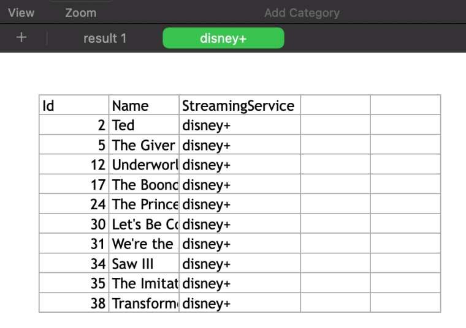

# Read and Write Excel Spreadsheets With C#


Photo by [Mika Baumeister](https://unsplash.com/@mbaumi)

Microsoft Excel is the undisputed champion of the business world, powering every industry and informing decision-makers at the highest echelons of corporate structures. As a developer, it is not a matter of *if* we’ll have to deal with Excel spreadsheets, but a matter of *when*. Fret not! This post will look at the most straightforward way I’ve found reading and writing Excel spreadsheets using C# and the .NET runtime.

## [ExcelMapper](https://khalidabuhakmeh.com/read-write-excel-spreadsheets-with-csharp#excelmapper)

[**ExcelMapper**](https://github.com/mganss/ExcelMapper) is an MIT-licensed .NET OSS package that allows us to read and write Excel files using *“Plain old C# objects (POCOs)”*. The library works cross-platform using a purely managed [NPOI library](https://github.com/nissl-lab/npoi) instead of the Jet database engine found exclusively on Windows devices. Those familiar with other data access libraries will find using ExcelMapper reminiscent of libraries like Entity Framework Core or Dapper. Users can also work with **dynamic** objects and **records**, allowing them to use the cutting edge in .NET features. ExcelMapper also supports Excel concepts like formulas, formatting, and sheets.

### [Reading From An An Excel File](https://khalidabuhakmeh.com/read-write-excel-spreadsheets-with-csharp#reading-from-an-an-excel-file)

Let’s say we have an Excel file that contains data about movies. The header column includes values for `Id`, `Name`, and `StreamingService`. ExcelMapper can create dynamic mappings based on our columns, so we only need to create a record that matches our column names.

```
public record Movie(
    int Id, 
    string Name, 
    string StreamingService
);
```

The next step is to create an instance of `ExcelMapper` and then call the `FetchAsync` method with our record type.

```
const string excelFile = "Movies.xlsx";
var excel = new ExcelMapper();
var movies = (await excel.FetchAsync<Movie>(excelFile)).ToList();
```

Now we can use our `movies` in a `foreach` loop.

```
foreach (var movie in movies)
{
    Console.WriteLine(movie);
}
```

Running our application, we can see the results in our console output.

```
Movie { Id = 2, Name = Ted, StreamingService = netflix }
Movie { Id = 5, Name = The Giver, StreamingService = netflix }
Movie { Id = 12, Name = Underworld: Awakening, StreamingService = netflix }
Movie { Id = 17, Name = The Boondock Saints, StreamingService = netflix }
Movie { Id = 24, Name = The Princess and the Frog, StreamingService = netflix }
Movie { Id = 30, Name = Let's Be Cops, StreamingService = netflix }
Movie { Id = 31, Name = We're the Millers, StreamingService = netflix }
Movie { Id = 34, Name = Saw III, StreamingService = netflix }
Movie { Id = 35, Name = The Imitation Game, StreamingService = netflix }
Movie { Id = 38, Name = Transformers: Age of Extinction, StreamingService = netflix }
```

### [Writing To An Excel File](https://khalidabuhakmeh.com/read-write-excel-spreadsheets-with-csharp#writing-to-an-excel-file)

Like reading from an Excel file, we’ll first need to create an instance of `ExcelMapper`. Let’s take our first example and alter the `StreamingService` column and then write it to a new sheet labeled `disney+`. Since we’re using C# 9 records, we’ll use the `with` keyword to create duplicate instances.

```
using System;
using System.Collections.Generic;
using System.Linq;
using Ganss.Excel;

const string excelFile = "Movies.xlsx";
var excel = new ExcelMapper();
var movies = (await excel.FetchAsync<Movie>(excelFile)).ToList();
var purchasedByDisney = new List<Movie>();
const string disney = "disney+";
foreach (var movie in movies)
{
    Console.WriteLine(movie);
    purchasedByDisney.Add(movie with
    {
        StreamingService = disney
    });
}

await excel.SaveAsync(
    excelFile,
    purchasedByDisney,
    sheetName: disney
);

public record Movie(
    int Id,
    string Name,
    string StreamingService
);
```

After executing our program, we can see we have a new sheet labeled `disney+` in our favorite spreadsheet viewer.



Wow, it doesn’t get any easier than that!

## [Conclusion](https://khalidabuhakmeh.com/read-write-excel-spreadsheets-with-csharp#conclusion)

[**ExcelMapper**](https://github.com/mganss/ExcelMapper) allows .NET developers to focus on data while still giving them access to the features that make Excel a great all-purpose tool. Read existing data into POCOs, manipulate rows, and write it back any way you like. In a few lines of C# 9, we can do all we want with minimal effort. That’ll keep the business folks in our lives that much happier.

Thanks for reading, and please leave a comment below. Also, follow me on Twitter at [@buhakmeh](https://twitter.com/buhakmeh) to get the latest .NET news and tutorials.

Tags:
[dotnet](https://khalidabuhakmeh.com/tag/dotnet/)
[csharp](https://khalidabuhakmeh.com/tag/csharp/)

Advertisement


## About Khalid Abuhakmeh

Khalid is a developer advocate at JetBrains focusing on .NET technologies and tooling.

Advertisement
