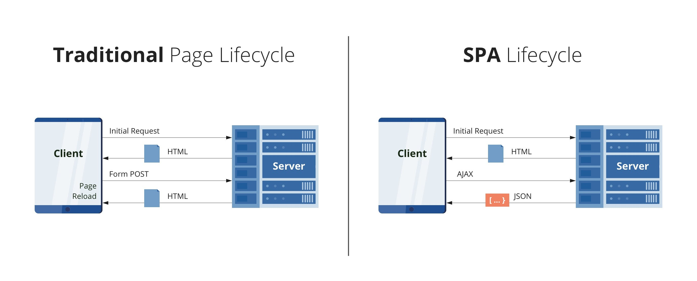

# How LiveView differs from a traditional SPA.

Differently from the traditional [Multi-Page-Application](https://dzone.com/articles/the-comparison-of-single-page-and-multi-page-appli), where the entire page needs to be reloaded whenever the user interacts with it, a [Single Page Application](https://en.wikipedia.org/wiki/Single-page_application) does not require page reloading during use, it requests the markup and data independently and renders pages straight in the browser leading to better performance and a pleasant user experience.

The acknowledgment of these [advantages](https://www.pluralsight.com/guides/why-do-we-need-a-single-page-application) created a huge buzz in the web development community, leading to the emerge of a bunch of "solutions" to ease the development of SPAs. Most of them being [JavaScript frameworks](https://developer.mozilla.org/en-US/docs/Learn/Tools_and_testing/Client-side_JavaScript_frameworks), like [React](https://reactjs.org/) and [Angular](https://angular.io/), but we all know how messy the interaction between the front and back-end can be. [Phoenix LiveView](https://hexdocs.pm/phoenix_live_view/Phoenix.LiveView.html) was created to be an alternative for everything that is out there, you can have most of the SPA's advantages without having to write any JavaScript or worry about splitting your code into separate parts, and that alone is amazing.

Phoenix LiveView is a framework for building single-page flows on the web. It’s an [Elixir](https://elixir-lang.org/) library that you will include as a dependency in your [Phoenix app](https://www.phoenixframework.org/), allowing you to build interactive, real-time LiveView flows as part of that Phoenix application. Now that you know a little bit about LiveView and SPAs we can finally start talking about how they differ.

SPAs are all about coordinating and managing the state of our page across the server and the client, which leads to our code being separated into multiple parts residing in different nodes of a network and that is where the traditional "request-response" mindset enters the game, while this outlook isn't tough to build, it is tedious and error-prone, you have several JavaScript elements with multiple clients on your browser page, and the failure of the JavaScript in any one of them can impact the others. In consequence, it seems that this mindset is no longer sufficient for conceptualizing the complex modern SPA because if you're building a SPA with custom JavaScript and some server-side layer, you can no longer claim this beautiful, simplified isolation.

The mechanisms might vary, but most current approaches to building SPAs force us to think in terms of interactions that initiate tiny requests and responses that independently change a page in some way. The hardest part of the whole process is splitting our development across the client and server. That split has some very serious consequences:

• By splitting our application development across the client and server boundary, we enable a whole class of potential security breaches, as a mistake in any single interaction leaves our whole page vulnerable.   
• By splitting our teams across the client and server, we surrender to a slower and more complex development cycle.   
• By splitting our design across the client and server, we commit to slower and more complex bug remediation cycles. By introducing a custom boundary between our browser and server, we dramatically complicate testing.

Web apps are now often multi-language distributed systems with JavaScript and HTML on the client, and some general-purpose application language on the server. On the client-side alone, JavaScript has become frighteningly complex, with many different frontend frameworks applying very different approaches. This had made SPA development much more challenging and time-consuming than it needs to be.

On the other hand, LiveView lets programmers rely on its infrastructure to handle all the state on the server-side, rather than forcing them to write their own custom code between the browser and server. As a result, it's no surprise that with LiveView you can create stunningly interactive and fast apps. (If you are curious to know more about how LiveView handles state, you should check my "State in LiveView" post, just click [here](https://rafaelantunes.com.br/how-phoenix-liveview-handles-state)!

Compared to the traditional SPA, these flows will have some characteristics that seem almost magical to many developers:   
• The apps we build will be stunningly interactive.   
• The apps we write will be shockingly resistant to failure.   
• These interactive apps will use a framework to manage JavaScript for us, so we don’t have to write our own client-side code.   
• The programming model is simple but composes well to handle complexity.  
• The programming model keeps our brain in one place, firmly on the
server.

All of this means that SPAs built with LiveView will be able to easily meet the interactive demands of their users. Such SPAs will be pleasurable to write and easy to maintain, spurring development teams to new heights of productivity. Unlike many existing SPA frameworks, LiveView shields you from the details of distributed systems by providing some common infrastructure between the browser and the server. Your code, and your mind, will live in one place, on the server-side, and the infrastructure will manage the details. To conclude, LiveView meets all of the interactivity and real-time needs of your average single-page app, while being easy to build and maintain leading to a big change in the way we develop and think about our web apps.
