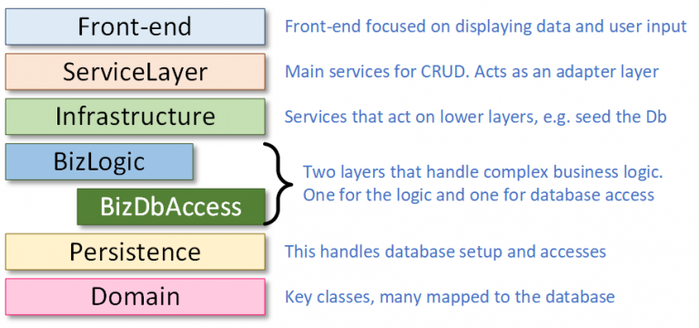
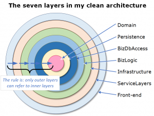
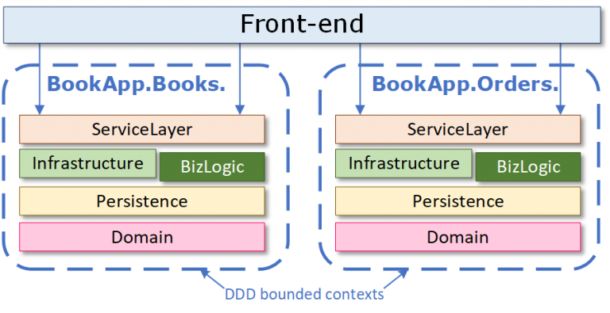
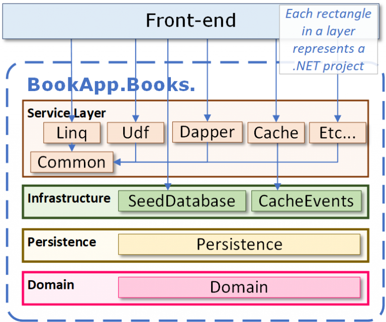

# Evolving modular monoliths: 1. An architecture for .NET

This is the first article in a series about building a .NET application using a modular monolith architecture. The aim of this architecture is to keep the simplicity of a monolith design while providing a better structure so that as your application grows it doesn’t turn into what is known as “a big ball of mud” (see the [original article](http://www.laputan.org/mud/) which describes a big ball of mud as “haphazardly structured, sprawling, sloppy, duct-tape-and-baling-wire, spaghetti-code jungle”).

The designs I describe will create a clean separation between the main parts of your monolith application by using a modular monolith architecture and Domain-Driven Design’s (DDD) *bounded context* approach. These designs also provide a way to add a modular monolith section to an old application whose architecture isn’t easy to work with (see part 3).

> NOTE: This article doesn’t compare a Monolith against a Microservice or Serverless architecture (read [this article](https://medium.com/ni-tech-talk/monolith-vs-microservices-vs-serverless-and-what-to-choose-for-your-business-needs-49d58b9e91f1) for a quick review of the three architectures). The general view is that a monolith architecture is the simplest to start with but can easily become “a ball of mud”. These articles are about improving the basic monolith design so that it keeps a good design for longer.

In Evolving Modular Monoliths series, the articles are:

- Evolving modular monoliths: 1. An architecture for .NET **(this article)**
- [Evolving modular monoliths: 2. Breaking up your app into multiple solutions](https://www.thereformedprogrammer.net/evolving-modular-monoliths-2-breaking-up-your-app-into-multiple-solutions/)
- Evolving modular monoliths: 3. Sharing data between bounded contexts

> NOTE: To support this series I create a demo ASP.NET Core e-commerce application that sells books using a modular monolith architecture. For this article the code in the <https://github.com/JonPSmith/BookApp.All> repo provides an example of the modularize bounded context design described in this article.

## Who should read these articles?

These articles are aimed at all .NET software developers and software architects. It gives an overview of a modular monolith architecture approach, but later articles also look at team collaboration, and the nitty-gritty of checking, testing and deploying your modular monolith application.

I assume the reader is already a .NET software developer and is comfortable with writing C# code and understand .NET term, such as .NET projects (also known as assemblies), [NuGet packages](https://docs.microsoft.com/en-us/nuget/what-is-nuget) and so on.

## What software principals do we need to avoid “a big ball of mud”?

Certain software principals and architectures can help organise the code in your application. The more complex the application, then the more you need to use good software principals to guide you to create code that is understandable, refactorable and robust. Here are some software principals that I will apply in this series:

- [**Encapsulation**](https://docs.microsoft.com/en-us/dotnet/architecture/modern-web-apps-azure/architectural-principles#encapsulation): Isolating the various code for each business features from each other so that that a change to code for one business feature doesn’t break code for another business feature.
- [**Separation of Concerns**](https://docs.microsoft.com/en-us/dotnet/architecture/modern-web-apps-azure/architectural-principles#separation-of-concerns) **(SoC)**: That is, this design provides high cohesion (links only to relevant code) and low dependency (isn’t affected by other parts of the code).
- **Organisation**: Makes it easy to find the various parts of code for a specific feature when you want to change things.
- **Collaboration**: Allows multiple software developers to work on an application at the same time.
- **Development effort/reward**: We want a architecture that balances speed of development against building an application that is easy to enhance and refactor.
- **Testability**: Breaking up a feature into different parts often makes it easier to test the code.

## Stages in building an ASP.NET Core application

I am going to take you three levels of modularization: modularization using an n-layered architecture, modularization at the DDD bounded context level, and finally modularization inside a DDD bounded context. Each level builds on the previous level, ending up with a high level of isolated for your code.

### 1. Basic n-layered application

I start with the well-known approach of breaking up an application into *layers*, known as *an n-layered architecture*. The figure below shows the way I break up an application into layers within my modular monolith design.

You might be surprised by the number of layers I used, but they are there to help to apply the SoC principal.  Later on, I define some architectural rules, enforced by unit tests, that ensures that the code to implement a feature has is high cohesion and low dependency.

To help you to understand what all these layers are for let’s look at how the creation of an order for book in my BookApp application (you try this feature by downloading [BookApp.All repo](https://github.com/JonPSmith/BookApp.All) and running it on your computer):

- Front-end: The ASP.NET Core app handles showing the user’s basket and sending their order to the ServiceLayer.
- ServiceLayer: This contains a class with a method that accepts the order data and sends it to the business layer. If everything is OK, it commits the order to the database and clears the user’s basket.
- Infrastructure: Not needed for this feature.
- BizLogic / BizDbAccess: An order is complex, so it has its own business logic code which is isolated from the database via code held in the BizDbAccess layer (this approach is [described here](https://www.thereformedprogrammer.net/architecture-of-business-layer-working-with-entity-framework-core-and-v6-revisited/)).
- Persistence: This provides the EF Core code to map the Orders classes to the database.
- Domain: This holds the Order classes mapped to the database.

- 

The figure above shows the seven layers as [n-layer architecture](https://docs.microsoft.com/en-us/azure/architecture/guide/architecture-styles/n-tier) which most developers are aware of. But in fact, I am using the [clean architecture](https://blog.cleancoder.com/uncle-bob/2012/08/13/the-clean-architecture.html) layering approach, which depicted as a series of rings, as shown in the figure to the right (click for a larger view). The clean architecture is also known as [Hexagonal Architecture](http://alistair.cockburn.us/Hexagonal+architecture) and [Onion Architecture](http://jeffreypalermo.com/blog/the-onion-architecture-part-1/).

I use the clean architecture layering approach because I like its rules, such as inner layers can’t access outer layers. But any good n-layering approach would work.

I really like the clean architecture’s “layers can’t access outer layers” rule, but I have altered some of the clean architecture’s rules. They are:

- I added a Persistence layer deep inside the rings to accommodate EF Core. See [this section of a pervious article](https://www.thereformedprogrammer.net/my-experience-of-using-the-clean-code-architecture-with-a-modular-monolith/#b-clean-architecture-what-was-bad) which explains why.
- The clean architecture would place all the interfaces in the inner Domain layer, but I place the interfaces in the same project where the service is defined for two reasons: a) to me keeping the interface with the service is a better SoC design and, b) it also means an inner layer can’t call outer service via DI because they can’t access the interface.

Two general layering approaches that still apply when we move to a modular monolith architecture. They are:

- I place as little as possible business code in the Front-end layer, but instead the Front-end calls *services* registered with the dependency injection system to display or input data. I do this because a) the Front-end should only manage the output / input of data, and b) it’s easier to test these services as a method call rather than testing ASP.NET Core APIs or Pages, which is much harder and slower.
- The ServiceLayer has a very important role in my applications, as it acts an adapter between the business classes and the user display/input classes. See the section called “[the importance of the Service Layer in the Clean Architecture layers](https://www.thereformedprogrammer.net/my-experience-of-using-the-clean-code-architecture-with-a-modular-monolith/#the-importance-of-the-service-layer-in-the-clean-architecture-layers)” in a previous article to find out why.

#### The downsides of only using an n-layered architecture

I have used the n-layered architecture for many years, and it works, but the problem is that the n-layered architecture only applies the SoC principal at layer level, but not within layer. This has two bad effects on the structure of your application.

- Layers can very big, especially the ServiceLayer, and hard to find and change anything.
- When you do find the code for a business feature it’s not obvious whether other classes link you this code.

The question is, is there an architecture that would help you to follow the SoC encapsulation principals? Once I tried a modular monolith architecture (with DDD and clean architecture) I found the whole experience was significantly better than the n-layered architecture on its own. That’s because I knew where code for a certain business feature was by the name of the .NET project, and I knew that those projects only held code that is relevant to the business feature I am looking at. See a previous article called “[My experience of using modular monolith and DDD architectures](https://www.thereformedprogrammer.net/my-experience-of-using-modular-monolith-and-ddd-architectures/)” where I reflect on using modular monolith on a project that was running late.

### 2. Modularize your code using DDD’s bounded context approach

So, rather than having all your code in an n-layered architecture we want to isolate the code for each feature. One way is to break up your application into specific business groups, and DDD provides an approach called *bounded contexts* (see [this article by Martin Fowler](https://martinfowler.com/bliki/BoundedContext.html) for an overview of bounded contexts).

Bounded contexts are found by looking at the business needs in your application but Identifying bounded context can be hard (see this the video [The Art of Discovering Bounded Contexts](https://www.youtube.com/watch?v=ez9GWESKG4I) by Nick Tune for some tips). Personally, I define some bounded contexts early on, but I am happy to change the bounded context’s boundary walls and names as the project progresses and I gain more understand of the business rules.

> NOTE: I use the name *bounded context* throughout this series, but there lots of different names around DDD’s bounded context concept, such as domain, subdomain, core domain etc. In many places I should use the DDD term *domain*, but that clashed with the clean architecture’s usage of the term *domain, so* I use the term *bounded context* wherever DDD bounded contexts or DDD domains are used. If you want some more information on all of the DDD terms around the bounded context try this [short article by Nick Tune](https://medium.com/nick-tune-tech-strategy-blog/domains-subdomain-problem-solution-space-in-ddd-clearly-defined-e0b49c7b586c).

DDD’s bounded context work at the large scale in your business, for example in my BookApp as well as displaying books the user could also order books. From a DDD point of view the handling of books and handling of user’s orders are in different bounded contexts: BookApp.Books and BookApp.Orders – see the figure below.

Each layer in each bounded context has a .NET project containing the code for each layer, with the BookApp.Books .NET projects separate from the BookApp.Orders NET projects. So, in the figure the .NET projects in the *Books* bounded context is completely separate from the .NET projects in the Orders bounded context, which means each bounded context is isolated from each other.

> NOTE: Another way to keep the bounded context isolated is to build a separate EF Core DbContext for each bounded context with only the tables that the bounded context needs to access. I cover how to do this in part 3 of this series.

Each layer is a .NET project/namespace and must have a unique name, and we want a naming convention that makes it easy for the developer to find the code they want to work on: the figure below shows the naming convention I that best described the application’s parts.

Bounded contexts also need to share data between bounded contexts, but in a way that doesn’t compromise the isolation por design of the bounded context. There are known design patterns of sharing data between bounded contexts, and I cover these in part 3.

> NOTE: I recommend Kamil Grzybek’s [excellent series on the Modular Monolith](http://www.kamilgrzybek.com/design/modular-monolith-primer/). He uses the same approach as I have described in this section. Kamil’s articles give a more details on the architectural design behind this design while my series introduces some extra ways to modularize and share your code.

### 3. Modularize inside a bounded context

The problem of just modularizing at the bounded context level is that many bounded contexts contain a lot of code. I can think of client projects I have worked where a single bounded context contained at over a years’ worth of developer effort.  That could mean that a single bounded context could become “a big ball of mud” all by itself. For this reason, I have developed a way to modularize within a single bounded context.

> NOTE: There is a fully working BookApp build using a modularizing bounded context approach at <https://github.com/JonPSmith/BookApp.All>. It contains 23 projects and provides a small but complex application as an example of how the modularizing bounded context approach could be applied to a .NET application.

Modularizing at the bounded context level is done via the high-level business design of your application, while the modularization inside a bounded context is done by grouping all the code for a specific feature and give it its own .NET project(s). Taking an example from my Book App used in my book I created lots of different ways to query the database, so I had one .NET project for each query type in the ServiceLayer. These then linked down to the lower layers as shown in the figure below, although I don’t show all the references (for instance nearly every outer layer links to the Domain layer) as it would make the figure hard to understand.

> NOTE: As you can see there are lots of .NET projects in the ServiceLayer, a few in the Infrastructure, none in the BizLogic/DbAccess layers and often only one .NET project in the Persistence and Domain layers. Typically, the ServiceLayer has the most projects with the Persistence and Domain layers only containing one project.

Building a modularized bounded context looks like a lot of work, but for me it was very natural, and positive, change from what I did when using an n-layer architecture. Previously, when using an n-layer architecture, I grouped my code into folders, but with modular monolith approach the previous classes etc in each folder are placed in a .NET project instead.

These .NET projects/namespaces and must have a unique name so I extend the naming convention I showed in the previous bounded context modularization section by adding an extra name on the end of each .NET project/namespace name when needed, as shown below.

The rules for how the .NET projects in a modularized bounded context are pretty simple, but powerful:

- A .NET project can only reference other .NET projects within its bounded context (see part 3 for how data can exchanged between bounded contexts).
- A .NET project in an outer layer can only reference .NET projects in the inner layers.
- A .NET project can access a .NET project in the same layer, but only if its name contains the word “Common”. This allows your code to be DRY (i.e., no duplicate code) but it’s very clear that any .NET project containing “Common” in its name effects multiple features.

> NOTE: To ensure these are adhered to I wrote some unit test code that will check your application follows these three rules – see [this unit test class](https://github.com/JonPSmith/BookApp.All/blob/main/Test/UnitTests/TestModularMonolithRules.cs) in the BookApp.All repo.

The positive effects of using this modularization approach and its rules are:

- The code is isolated from the other feature code (using a folder didn’t do that).
- I can find the code more quickly via the .NET project’s name.
- I can create unit test to check that my code is following the modularization rules.

Overall, this modularization approach stops the spaghetti-code jungle part of the “a big ball of mud” because now the relationships are managed by .NET and you can’t get around them easily. In the end, it’s up to the developer to apply the SoC and encapsulation software principals but following this modularization style will help you to write code that is easy to understand and easy to refactor.

## Thinking about the downside – what happens with large applications?

I learnt a lot of things about building .NET application using my modular monolith modularization approach, but it was very small compared to the applications I work on for clients. So, I need to consider the downsides of building a large application to ensure this approach will scale, because a really big application could have 1,000 .NET projects.

The first issue to consider is, can the development tools handle an application with say 1,000 .NET projects? The recent announcement of the 64-bit [Visual Studio 2022](https://devblogs.microsoft.com/visualstudio/visual-studio-2022/), which can handle 1,600 projects, says this won’t be a problem. And even Visual Studio 2019 can handle 1,000 .NET projects (according to a report @ErikEJ found), but another person on Twitter said that 300 .NET projects too much. However, an application with lots of .NET projects could be tiresome to navigate through.

The second issue to consider is, can multiple teams of developers work together on a large application? In my view the bounded context approach is the key to allowing multiple teams to work together, as different teams can work on different bounded contexts. Of course, the teams need to follow the DDD bounded context rules, especially the rules about how bounded context communicate with each other, which I cover in part 3 of this series.

The final issue to consider is, how could the modular monolith modularization be applied to an existing application? There are many existing monolith applications, and it would be great if you could add new features using the modular monolith modularization approach. I talk about this in more detail in part 3, but I do see a way to make that work.

### An answer to these downsides – break the application into separate packages

While the 3 downsides could be handled through rules and good team communication a modular monolith doesn’t have the level of separation that separate solutions (i.e., like Microservice do), but how can we do this when we are dealing with a monolith? My answer is to move any of the larger or complex bounded contexts into its own solution, pack each solution into a NuGet package and then install these NuGet packages into the main application.

This physically separates one or more of your bounded contexts from main application code while keeping the benefits of the monolith’s quick method/data transfer. Turning a bounded context into a separate solution allows a team to work on a bounded context on its own with easier navigation and no clashing with other team’s changes. And for existing applications you can create new features in a separate solution using the modular monolith approach and add these new features via NuGet packages to your existing application.

In part 2 I describe how you can turn a bounded context into separate solution and turn it into a NuGet package that can be installed in the main application, with special focus on the development cycle to make it only take a few seconds (not the few minutes that nuget.org takes) to create, upload, and install a NuGet package for local testing.

## Conclusion

I have introduced you to the modular monolith architecture and then provided two approaches to applying a modular monolith architecture and DDD principals to .NET applications. One modularized at the DDD’s bounded context level and the second level added extra modularization inside a bounded context.

The question is: will the extra work needed to apply a modular monolith architecture to your application really create an application that is easier to extend over time? My first use of a modular monolith architecture was while writing the Book, “[Entity Framework Core in Action](https://bit.ly/EfCoreBook2)” and it was very positive. Overall, I think it made me slightly faster than using an n-layered architecture because it was easier to find things. But the real benefit was when I added features for performance tuning and added CQRS architecture, which required a lot of refactoring and moving of code.

> NOTE: I recommend you read the sections “[Modular Monolith – what was bad](https://www.thereformedprogrammer.net/my-experience-of-using-modular-monolith-and-ddd-architectures/#1b-modular-monolith-what-was-bad)?” and “[Modular Monolith – how did it fair under time pressure?](https://www.thereformedprogrammer.net/my-experience-of-using-modular-monolith-and-ddd-architectures/#1c-modular-monolith-how-did-it-fair-under-time-pressure)” for my review of my first use of a modular monolith architecture.

Since my first use of a modular monolith architecture, I have further refined my modular monolith design to handle large application development. In the second article I add a further level of separation for development team so that large parts of your application can be worked on in its own solution. As a software developer myself I ensured that the development process is quick and reliable, as it’s quite possible I will use this approach on a client’s application.

Please do leave comments on this article. Happy to discuss the best ways to implement a modular monolith architecture or hear of any experience people have of using a modular monolith architecture.

Happy coding!
