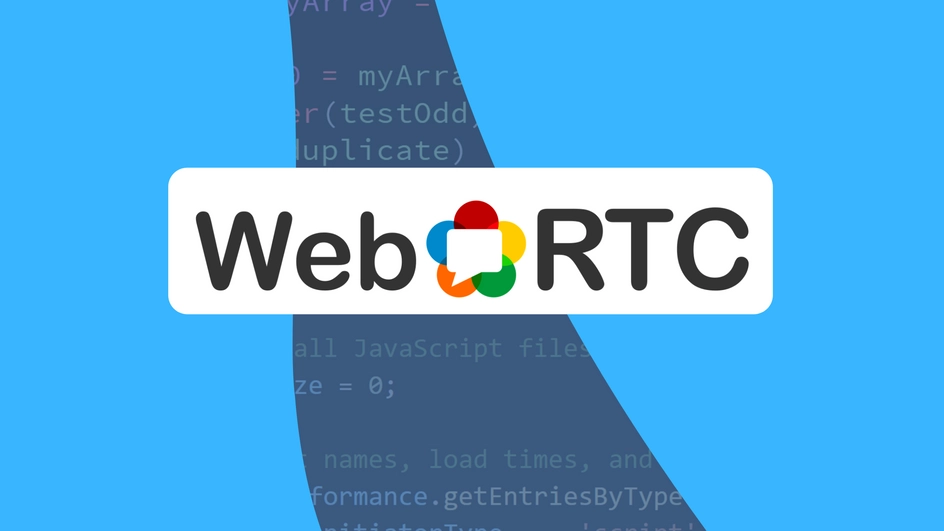
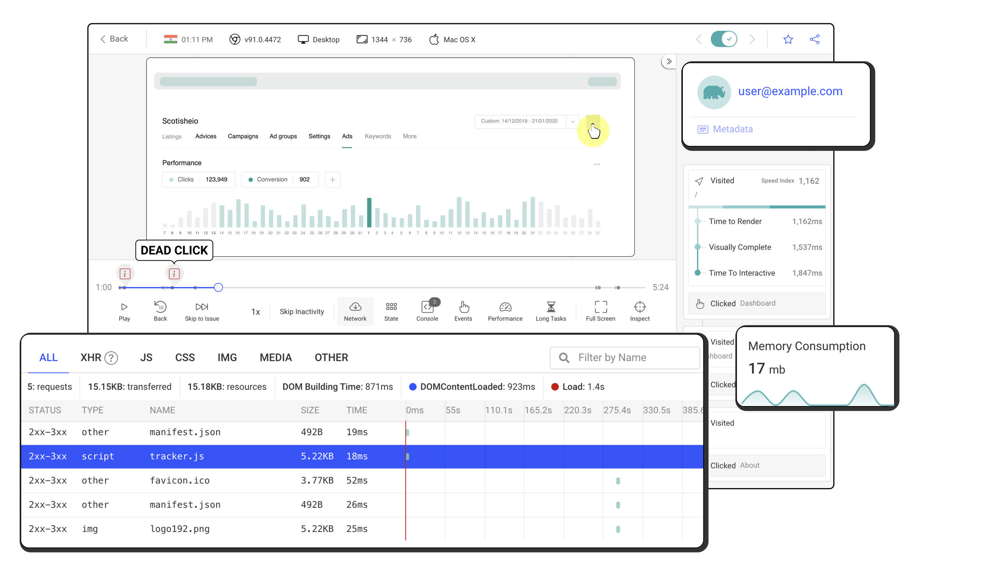

# Everything You Ever Wanted to Know About WebRTC

July 27th, 2021 · 7 min read




Live messaging, streaming, Torrents, and other similar **real-time data transfer** techniques have greatly affected and improved our virtual experiences. First, they were available natively, now through the web, bringing an impressive amount of possibilities to this universal platform. That’s all thanks to APIs known as [WebSocket](https://developer.mozilla.org/en-US/docs/Web/API/WebSocket) and [WebRTC](https://developer.mozilla.org/en-US/docs/Web/API/WebRTC_API).

## WebSocket revision

Now, I bet that you’ve heard of WebSocket. In fact, you’ve likely used it in some of your previous projects. Still, if not, here’s a brief overview.

WebSocket is a simple API that allows you to connect your clients **indirectly**, i.e., through a server. Basically, if one user wants to send some data to the other one, they both need to be **connected with the server** first and then pass the data through it. This approach naturally comes with some pros and cons. While it allows you to optionally process data on the server-side and assures the completeness of sent information (through [TCP protocol](https://en.wikipedia.org/wiki/Transmission_Control_Protocol)), it isn’t really fast. Because of the proxy-like server, a generic transfer can take up to 1 second, which isn’t much, but can make a huge difference in use-cases like audio and video calls.

That’s why WebRTC was introduced back in 2011. And, even if quite a lot of time has passed since then, its complexity and cross-browser support concerns result in beginners still having a hard time learning and using it. That’s why, in this post, we’ll go through the basics of WebRTC and explaining everything as simply as possible.

## [WebRTC](https://webrtc.io/)

WebRTC stands for **Web Real-Time Communication**. The key concept to understand about it is that it’s meant for **direct connection**. This means that after the connection has been established (more on that later), in most cases, you don’t need any sort of server being involved in data transfer. That translates to, of course, faster transfer speeds. This fact makes it the best choice right now for audio/video streaming or creating P2P networks like [Torrent](https://webtorrent.io/).

### Servers in WebRTC

Don’t get me wrong tho. You still need a server - even when working with WebRTC. It’ll be used in a process called *“signaling”*, where the **peers** will be connected to each other. After that, all the data will be transferred directly between the peers in an encrypted state. This means that a WebRTC connection is **secure by default**.

Other than that, keep in mind that servers can still play other roles in a WebRTC connection. For example, they can serve as an always-online peers, ready to transfer or backup data at any time.

### Browser support

Because WebRTC is newer than e.g. WebSocket, it isn’t really backward-compatible, resulting in no support for IE and all older browsers. Still, according to [*caniuse.com*](https://caniuse.com/#feat=rtcpeerconnection), it’s supported by more than **94%** of the reported browsers, so no worries here.

## Three in one

WebRTC is, in fact, a **collection of different APIs** rather than a single one. That’s why we’re not going to cover all but only the core parts of WebRTC. These are:

- **MediaStream API** - for getting access to user’s camera and audio (media);
- **RTCPeerConnection** & **RTCDataChannel** - for actual WebRTC connection;

## [MediaStream API](https://www.tutorialspoint.com/webrtc/webrtc_media_stream_apis.htm)

While not being a part of the WebRTC connection process per se, MediaStream API, with its capabilities of capturing **video** and **audio** data through user’s device, is vital to one of WebRTC’s main use-cases - video/audio streaming.

### Video and audio

At the heart of MediaStream API is the `getUserMedia()` method of the `navigator.mediaDevices` object. Note that this object will only be available when you’re working in an **HTTPS** \*\*\*\*(secured) context.

```
1constgetMedia=()=>{

2const constraints ={

3// ...

4};

5

6try{

7const stream =awaitnavigator.mediaDevices.getUserMedia(constraints);

8// use the stream

9}catch(err){

10// handle the error - user's rejection or no media available

11}

12}

13getMedia();
```

The method takes what’s called a *constraints* object and returns a promise that resolves to a new `MediaStream` instance. Such an interface is a representation of currently streamed media. It consists of zero or more separate `MediaStreamTrack`s, each representing video or audio track, from which audio tracks consist of right and left channels (for stereo and stuff). These tracks also provide some special methods and events if you need further control.

### Constraints

Let’s now talk about our [constraints object](https://developer.mozilla.org/en-US/docs/Web/API/MediaStreamConstraints), as this is a very important piece. It’s used to **configure** our `getUserMedia()` request and the resulting stream. This object can have two properties of either boolean or object value - `audio` and `video`.

```
1// ...

2const constraints ={

3    video:true,

4    audio:true,

5};

6// ...
```

By setting both of them to true, we’re requesting access to the user’s default video and audio input devices, with default settings applied. Know that for `getUserMedia()` to work, you have to set at least one of those two properties.

If you want to configure your media source device settings further, you’ll need to pass an object. The list of properties available here is quite long and differs based on the type of track it’s applied to (video, audio). You can see a complete list of those [here](https://developer.mozilla.org/en-US/docs/Web/API/MediaTrackConstraints) and check for the available ones with the `getSupportedConstraints()` method.

So, let’s say that we want to be a bit more specific this time, and specify some additional configuration for our video track. That’ll be its width, height, and input device.

```
1constgetConstraints=async()=>{

2const supportedConstraints =navigator.mediaDevices.getSupportedConstraints();

3const video ={};

4

5if(supportedConstraints.width){

6        video.width=1920;

7}

8if(supportedConstraints.height){

9        video.height=1080;

10}

11if(supportedConstraints.deviceId){

12const devices =awaitnavigator.mediaDevices.enumerateDevices();

13const device = devices.find((device)=>{

14return device.kind=="videoinput";

15});

16

17        video.deviceId= device.deviceId;

18}

19

20return{ video };

21};

22// ...
```

Notice how we check if the given constraint is supported (although all used above should always be - unless there’s no input device), and use the `enumerateDevices()` method to check for **available input devices**, together with setting the video’s resolution. It returns a promise which resolves to an array of `MediaDeviceInfo` objects, which we later use, to select the first one in line for video input.

Then, a simple edit to our `getMedia()` function, and we’re good to go!

```
1// ...

2const constraints =awaitgetConstraints();

3// ...
```

### Screen capture

You might be interested in hearing that’s there’s also a method for accessing the device screen (and even sound in the latest browsers), called [Screen Capture API](https://developer.mozilla.org/en-US/docs/Web/API/Screen_Capture_API), which consists of a single `getDisplayMedia()` method.

```
1navigator.mediaDevices.getDisplayMedia();
```

There’s a lot of **potential** in using the `getUserMedia()` and `getDisplayMedia()` methods. Especially when combined with, e.g., Canvas and Web Audio APIs. But, as this is a topic for another day, we’re only interested in previewing our streams with simple `<video>` and `<audio>` elements.

```
1<videoautoplay></video>

2<audioautoplay></audio>
```

As for actually using those from JS:

```
1// ...

2// inside getMedia() after successfully retrieving MediaStream

3const video =document.querySelector("video");

4const audio =document.querySelector("audio");

5

6video.srcObject= stream;

7audio.srcObject= stream;

8// ...
```

## WebRTC-based interaction: OpenReplay Assist

Debugging a web application in production may be challenging and time-consuming, however through the use of **[OpenReplay’s Assist](https://github.com/openreplay/openreplay)**, you can see the live screen of your users and even jump on a quick call with them. All thanks to the power of WebRTC.



[OpenReplay](https://github.com/openreplay/openreplay) is an Open-source alternative to FullStory, LogRocket and Hotjar. It allows you to monitor and replay everything your users do and shows how your app behaves for every issue.

Happy debugging, for modern frontend teams - [Start monitoring your web app for free](https://github.com/openreplay/openreplay).

## [RTCPeerConnection](https://developer.mozilla.org/en-US/docs/Web/API/RTCPeerConnection)

The RTCPeerConnection is the main interface behind any WebRTC connection. It hides a lot of complex stuff like data encoding, encryption, processing and more, in a small and somewhat user-friendly API.

### Signaling

Before we start sending data, we need to first connect the two or more peers in the signaling process. As more than 2 peers would require special handling and a [TURN server](https://webrtc.org/getting-started/turn-server#:~:text=The%20term%20stands%20for%20Traversal,and%20as%20cloud%20provided%20services.), we’ll stick to the basics and work with only 2.

As the `RTCPeerConnection` relies on events, we’ll use these and something called `RTCIceCandidate` to set up our connection. ICE stands for **Internet Connectivity Establishment** and indicates the established protocol and routing used throughout the connection. Here you can, e.g., decide between the UDP and TCP protocols, depending on whether you need your data to be delivered fast with some possible losses or otherwise.

```
1// One RTCPeerConnection instance for each side

2const localConnection =newRTCPeerConnection();

3// On the remote side:

4const remoteConnection =newRTCPeerConnection();
```

Because demonstrating snippets with the involvement of server code can be tough, we’ll work with two connections created in the same environment. Don’t worry - if you already know WebSocket or any other form of data transfer for that matter, you should be able to use the herein code for real-world scenarios relatively easily.

After creating our connections, we’ll need to set up their respective `icecandidate` event handlers to listen for possible offers.

```
1localConnection.addEventListener("icecandidate",async(event)=>{

2if(event.candidate){

3// Send event.candidate to the other side through e.g. WebSocket

4try{

5// On the remote side:

6await remoteConnection.addIceCandidate(event.candidate);

7}catch{

8// handle error

9}

10}

11});

12// On the remote side:

13remoteConnection.addEventListener("icecandidate",async(e)=>{

14if(e.candidate){

15// Send event.candidate to the other side through e.g. WebSocket

16try{

17// On the local side:

18await localConnection.addIceCandidate(e.candidate);

19}catch{

20// handle error

21}

22}

23});
```

With the code above, we listen to new ICE candidates and accept them immediately on both sides. In reality, this process can take a bit longer. Generally, the whole idea behind it is that the users will offer each other different connection configurations, until both sides settle on one, and the connection will start. It’s at that time that you will need the server to exchange the offers.

```
1constconnect=async()=>{

2try{

3const offer =await localConnection.createOffer();

4

5await localConnection.setLocalDescription(offer);

6/* Send offer to the other side through e.g. WebSocket

7            Then, on the remote side: */

8await remoteConnection.setRemoteDescription(

9            localConnection.localDescription

10);

11

12const answer =await remoteConnection.createAnswer();

13

14await remoteConnection.setLocalDescription(answer);

15/* Send offer to the other side through e.g. WebSocket

16            Then, on the local side: */

17await localConnection.setRemoteDescription(

18            remoteConnection.localDescription

19);

20}catch{

21// handle errors

22}

23};

24connect();
```

Now we move onto creating an offer. You can do just that with the `createOffer()` call, to then use it to configure the local connection. After that, we have to send this configuration to the remote connection, where it’ll be either accepted or rejected. Here, as we don’t do any decision-making process, we’re accepting any configuration up-front. We do this using the `setRemoteDescription()`, and then we send the return information to be accepted again on the local side.

After all the “negotiations” are done, the `icecandidate` event will be fired, and the signaling process is complete.

### Streaming

So, with signaling done - somewhat of the toughest part of the process - we can now go straight to streaming.

I’ve already shown you how to get a `MediaStream` object from one of the user’s input devices. We’ll use that for this demo.

Let’s assume that we have a `MediaStream` object ready to go. In this case, you can use the `addTrack()` method to start transmitting individual tracks. It’s worth noting that there used to be an `addStream()` method to add whole `MediaStream`s at once, but it’s now obsolete and you shouldn’t use it (although some browsers might still support it).

```
1conststartStreaming=async()=>{

2const stream =awaitnavigator.mediaDevices.getUserMedia({

3        video:true,

4        audio:true,

5});

6

7for(const track of stream.getTracks()){

8        localConnection.addTrack(track);

9}

10};
```

On the receiving side, create a new `MediaStream` with its constructor, and listen for `track` events. Add all incoming tracks to the stream, and attach the stream itself to a video element.

```
1conststartReceiving=()=>{

2const video =document.getElementById("video");

3const stream =newMediaStream();

4

5    video.srcObject= stream;

6    remoteConnection.addEventListener("track",(event)=>{

7        stream.addTrack(event.track);

8});

9};
```

Now, to make the system work, you need to remember to set up streaming and receiving **before** you make an offer. In our case, this translates to before the `connect()` call.

```
1construn=async()=>{

2awaitstartStreaming();

3// On the remote side:

4startReceiving();

5// On both sides:

6connect();

7};

8

9run();
```

If you’d like to update the streamed tracks down the line, you’ll need to handle `negotiationneeded` event on the `RTCPeerConnection` and renegotiate the offer there.

## [RTCDataChannel](https://developer.mozilla.org/en-US/docs/Web/API/RTCDataChannel)

Apart from streams, you can also use WebRTC for transferring arbitrary data. That’s thanks to `RTCDataChannel`.

To create a data channel, you have to use the `createDataChannel()` method of `RTCPeerConnection`, passing the channel’s name as a parameter.

```
1conststartSendingData=async()=>{

2const dataChannel = localConnection.createDataChannel("my-data-channel");

3};
```

On the other side, listen for `datachannel` events, and extract `channel` property from the event object.

```
1conststartReceivingData=()=>{

2    remoteConnection.addEventListener("datachannel",async(event)=>{

3const dataChannel = event.channel;

4});

5};
```

To actually use the channel, you need first to wait for it to open, using the `open` event listener. After that’s done, you can use the `send()` method to send [all kinds of data](https://developer.mozilla.org/en-US/docs/Web/API/RTCDataChannel/send#parameters) and receive it on the other side within the `message` event handler.

```
1constuseDataChannel=(dataChannel, onMessage)=>{

2returnnewPromise((resolve)=>{

3        dataChannel.addEventListener("open",()=>{

4            dataChannel.addEventListener("message",(event)=>{

5if(onMessage){

6onMessage(event);

7}

8});

9resolve((message)=>{

10                dataChannel.send(message);

11});

12});

13});

14};
```

Above, we’ve got a simple React Hook-like wrapper around `RTCDataChannel`. Its Promise resolves on `open`, returning a function for sending data and allowing for an optional callback to handle `message` events coming from the other side.

You can use the wrapper like so in the original connection functions:

```
1conststartSendingData=()=>{

2const dataChannel = localConnection.createDataChannel("my-data-channel");

3const sendMessage =useDataChannel(dataChannel,(event)=>{

4console.log("Local:", event.data);

5}).then((sendMessage)=>{

6sendMessage("Message from local");

7});

8};

9conststartReceivingData=()=>{

10    remoteConnection.addEventListener("datachannel",(event)=>{

11const dataChannel = event.channel;

12const sendMessage =useDataChannel(dataChannel,(event)=>{

13console.log("Remote:", event.data);

14}).then(()=>{

15sendMessage("Message from remote");

16});

17});

18};
```

You can initiate the system similarly to how it was done for streaming - with `connect()` function called last.

```
1construn=async()=>{

2startSendingData();

3// On the remote side:

4startReceivingData();

5// On both sides:

6connect();

7};

8run();
```

Note that you shouldn’t `await` for the channel to open - it’ll happen after the connection is made. To avoid confusion and illustrate this intention in both `startSendingData()` and `startReceivingData()` I’ve used the `then()` instead of `async`/`await`.

## Conclusion

As you can see, working with WebRTC API isn’t that hard. Furthermore, with additional help from WebSocket, or a public TURN server, you shouldn’t have much problem with establishing production-ready connections for 2 or more peers.

With the ability to both stream video and audio and exchange any arbitrary data directly between peers, WebRTC is a powerful tool for building performant, cost-efficient real-time applications.
