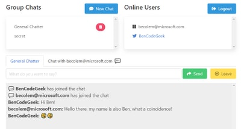
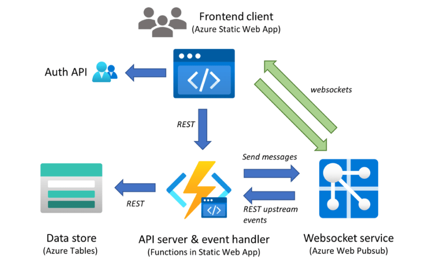

# Build serverless real-time chat application with Web PubSub and Static Web Apps

21 de jun.
・6 min read

With the growth of internet and mobile, building the cross platform real-time chat experience into your application also becomes a very common need, for example patient and doctor chat in healthcare, customer support chat in eCommerce, student and teacher chat in remote education, players chat in eGaming, instant chat for social media or live video stream, and so on. The real-time chat experience offers several values to your application to help your customers success:

- Instant and efficient communication to faster problem resolution.
- Collaboration and purposeful conversation to overcome business challenges.
- Smooth built-in experience to improve the customer service and loyalty.
- Cross platform support to empower the customer to discovery easily.

In general, there are some fundamental and critical needs for an application with build-in real-time chat experience:

- Real-time chat experience with users.
- Management of user and group.
- Notification and popup.
- AI-enabled, e.g., language moderator, bot, etc.
- Typing indicator.

But it is not easy to build these functionalities into your application from scratch. You may have the issues to achieve the real-time performance, handles hosting, scalability, load balancing and other infrastructure related challenges, adapt with multiple client platforms, etc. Now, the Azure Web PubSub service which is a fully managed service give the opportunity to you to enable the real-time capability to your application with native and serverless WebSockets support.

Let’s follow with [Ben Coleman](https://twitter.com/BenCodeGeek) together to build a serverless Chatr web application and learn how does he leverage the advantages of the Azure Web PubSub and Azure Static Web Apps to achieve this easily and quickly.

## What's the Chatr?

[Chatr](https://chatr.benco.io/) is a simple real-time, multi-user chat application, highlighting the ease of building applications on top of two of Azure services: [Azure Web PubSub](https://azure.microsoft.com/services/web-pubsub/) and [Azure Static Web Apps](https://azure.microsoft.com/services/app-service/static/). The Chatr application provides many of the features you might expect; a way to sign in and authenticate, group chats, user to user private chats, a global online user list, idle (away from keyboard) detection and more. However it was built to be a way to learn and showcase possibilities rather than a fully fledged and production grade chat system.

[](https://res.cloudinary.com/practicaldev/image/fetch/s--wyjbKOQf--/c_limit%2Cf_auto%2Cfl_progressive%2Cq_auto%2Cw_880/https://techcommunity.microsoft.com/t5/image/serverpage/image-id/287807iB0F45BC03F96DD74/image-size/medium%3Fv%3Dv2%26px%3D400)

Chatr consists of four components:

- The client or frontend, which users interact with – This is written in JavaScript and uses Vue.js
- The backend service, which provides message processing & event handling, written in Node.js
- A globally available but secure Websockets service – provided by Azure Web PubSub
- Persistence state storage and key value store – provided by Azure Table Storage

A diagram will help illustrate how these all interact, and some of the main message & data flows. Let’s explore these components in more detail.

[](https://res.cloudinary.com/practicaldev/image/fetch/s--jQpCWjfY--/c_limit%2Cf_auto%2Cfl_progressive%2Cq_auto%2Cw_880/https://techcommunity.microsoft.com/t5/image/serverpage/image-id/287759i888989074CA0312D/image-size/large%3Fv%3Dv2%26px%3D999)

## Use Web PubSub to build the scalable backend

The Azure WebPubSub service works hand in hand with the Chatr backend, to provide the core chat functionality. This is done through [‘event handlers’ within Azure WebPub sub](https://azure.github.io/azure-webpubsub/references/protocol-cloudevents), these handlers enable an upstream service to receive client side WebSocket messages as “events”. These events are HTTP messages, which the service can then react to. These events supports both a range of built-in system events (e.g. client connecting or disconnecting) but also custom application specific events, in the case of Chatr there are many of these such events, for example “joinChat” or “userEnterIdle” etc.

The backend uses the service client of the [Web PubSub SDK for Node.js](https://azure.github.io/azure-webpubsub/references/server-sdks/js-server-sdks#service-client-library), which can be instantiated easily. Here we are storing configuration details such as the connection string in an Azure Function App Settings, and obtain it them securely through environmental variables.

```
const { WebPubSubServiceClient } = require('@azure/web-pubsub')
const CONN_STR = process.env.PUBSUB_CONNECTION_STRING 
const HUB = process.env.PUBSUB_HUB 
const serviceClient = new WebPubSubServiceClient(CONN_STR, HUB)
```

Within the Function itself we can handle any event sent to us from clients by binding to HTTP trigger POST requests and processing them as follows. For example, the code below shows how Chatr handles when a user has created a new shared group-chat. When doing so they send an event called “createChat”, when handling this we get the properties we require from both the headers and the HTTP body, (the special 'ce' headers are populated by Azure Web PubSub), then store into state and finally notify all clients about the new chat with an outbound message.

```
consteventName=req.headers['ce-eventname'] 
constuserId=req.headers['ce-userid'] 

if(eventName==='createChat'){ 
  // Build custom event payload 
    constchatPayload={ 
    id:req.body.id, 
    name:req.body.name, 
    owner:userId 
    } 

  // ... Update state, removed for brevity ... 

  // Send message to all clients with custom JSON payload 
  // Will be routed via Azure Web PubSub with WebSocket protocol 
  serviceClient.sendToAll({ 
    chatEvent:'chatCreated', 
    data:JSON.stringify(chatPayload),
  }) 
}
```

## Build frontend with extensive platform and host easily with Static Web Apps

The Chatr frontend consists of a JavaScript static app or SPA (single page application) built on the Vue.js framework, this is hosted using the Azure Static Web App service as a set of HTML and JS files. This Azure service aside from just hosting static content, also provides Chatr a means to sign in and authenticate users and also a way to host the backend Azure Function service. The frontend establishes a secure connection to Azure Web PubSub using WebSockets, no SDK or client libraries are required making it quick easy to use. Let's walk through the frontend together.

### Setup connection between application and backend service

The clients first request a way to access to Azure Web PubSub by calling a REST endpoint on our backend which in turn obtains a client access URL (which includes an access token) this is done using the same serviceClient described above, as this is done server side it provides a way to restrict access and secure the application. In the case of Chatr all users are permitted to request an access URL. The userId in the code below has been [fetched previously through a call to Azure Static WebApps](https://docs.microsoft.com/en-us/azure/static-web-apps/authentication-authorization), for the purposes of Azure Web PubSub. It’s simply a string and has no special meaning.

```
// Get URL & token to connect to Azure Web Pubsub 
res=awaitfetch(`/api/getToken?userId=${userId}`) 
lettoken=awaitres.json() 

// Now connect to Azure Web PubSub using the URL we obtained 
let ws=newWebSocket(token.url,'json.webpubsub.azure.v1')
```

We only use standard modern JavaScript APIs like fetch and WebSocket this means the Chatr frontend can be deployed without any bundling or WebPack stage. Also note how we use the ‘json.webpubsub.azure.v1' subprotocol when establishing the connection, this [extension to plain WebSockets provides a range of additional capabilities](https://azure.github.io/azure-webpubsub/references/pubsub-websocket-subprotocol.html) which are used by Chatr such as; client to client messaging (without a round trip to the server), a means to join send messages to groups (which is how Chatr provides group chats) and also a way to send custom events which are routed to the service as described above.

### Send custom event or message

Sending a custom event from the client is very simple, for example.

```
ws.send(
  JSON.stringify({
    type: "event",
    event: "createChat",
    dataType: "json",
    data: { name: chatName, id: chatId },
  })
);
```

Chat messages between users are sent a very similar way, except leveraging the 'sendToGroup' message type. Rather than plain text strings (which are also supported) we enrich the messages we send with meta data such as the userId of who sent the message and send a JSON payload. It’s important to note these messages are not relayed by the Chatr backend we described above, they are handled entirely by the Azure Web PubSub service without any backend or server code.

```
ws.send(
  JSON.stringify({
    type: "sendToGroup",
    group: chatId,
    dataType: "json",
    data: {
      message: message,
      fromUserId: userId,
    },
  })
);
```

## Summary

We’ve just scratched the surface of what the Chatr sample app does, and we’ve not covered details such as how state is stored using Azure Tables or how the authentication wrappers of Azure Static WebApps are used. However I hope what we have shown illustrates some of the power and flexibility of Azure Web PubSub. If you are looking for more details about this application, you can refer to the [Chatr repo on GitHub](https://github.com/benc-uk/chatr) where the code is hosted, along with information and docs on how to deploy it to Azure and run it yourself.

## Next Steps

If you are trying to build your first real-time application with Azure Web PubSub, you could also get more helpful resources from the [getting stated contents](https://azure.microsoft.com/services/web-pubsub/#documentation). We are looking forward your feedback and ideas to help us become better via [Azure Feedback Forum](https://feedback.azure.com/forums/934191-azure-web-pubsub-service)!

### More Information

*This blog is also posted on [Tech Community](https://techcommunity.microsoft.com/t5/apps-on-azure/build-serveless-real-time-chat-application-with-web-pubsub-and/ba-p/2433211) and you could also get more blogs about the Web PubSub and its new features here.*
