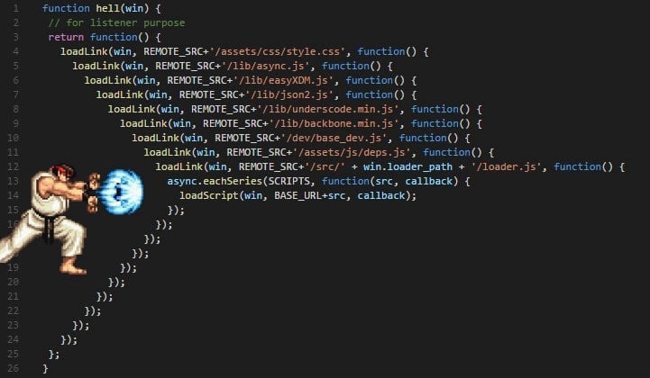

[](https://dev.to/codewithahsan)

[Muhammad Ahsan Ayaz](https://dev.to/codewithahsan)

Posted on Jan 2

# 8 techniques to write cleaner JavaScript code

[#javascript](https://dev.to/t/javascript)
[#webdev](https://dev.to/t/webdev)
[#node](https://dev.to/t/node)
[#beginners](https://dev.to/t/beginners)

I believe being a Software Engineer is just like being a Super Hero! And with great power, comes great responsibility. While writing code is an integral part of being a Software Engineer, just like estimations, brainstorming, writing unit tests are important aspects, writing clean code is really important as well.   
In this article, we're going to look at 8 different techniques to help you write cleaner JavaScript code.

> If you'd prefer watching a video instead, check this out:  
> [Video Tutorial](https://youtu.be/LTGcEIC2Tp8)

Now let's discuss each technique, one at a time.

## Pure Functions

A pure function is a function that always returns the same output, given the same input(s). It doesn't depend on any external variable apart from the inputs provided, nor it affects/changes any outside variable.  
Having pure functions makes it a lot easier for testing as they make testing super easy as you can always stub/mock the inputs and test your expected values. Let's see the following example

```
let name = "Peter Parker";
const splitName = () => {
  name = name.split(' ');
}
name = splitName();
console.log(name); // outputs [ 'Peter', 'Parker' ]
```


While the above code seems appropriate. It is not (lol). And that's because the `splitName` function depends on an outside variable named `name` and if someone else starts changing this variable, the function `splitName` starts providing a different output. Making it a non-pure function as we'd still be calling `splitName()` but the output is going to be different.

Let's change this to a pure function and let's see how that would look like:

```
let name = "Peter Parker";
const splitName = (nameString) => {
  return nameString.split(' ');
}
name = splitName(name);
console.log(name); // outputs [ 'Peter', 'Parker' ]
```


With the above change, the `splitName` is now a Pure Function because:

- It only relies on the input(s) (the `nameString` input).
- It doesn't change/re-assign any external variable

## Fewer or Named Parameters

When using functions, we often use positional parameters which have to be provided as they're declared with the function declaration. For example, in the call `arithmaticOp(num1, num2, operator)`, we can't provide the `operator` argument without providing `num1` and `num2`. And while this works for this example, for many functions, that'd become a problem.  
Consider the following example:

```
const createButton = (title, color, disabled, padding, margin, border, shadow)  => {
  console.log(title, color, disabled, padding, margin, border, shadow)
}
```


Looking at the above code, you can already see that in if we wanted to make any of the arguments optional (to use default values) while calling the `createButton` +, that'd be a disaster and might look something like this:

```
createButton('John Wick', undefined /* optional color */, true ,'2px....', undefined  /* optional margin*/);
```


You can see that the above statement doesn't look **Clean** at all. Also, it is hard to see from the function-calling statement which parameter corresponds to which argument of the function. So this is a practice we could follow:

- If we have 2 or fewer arguments, we can keep them as positional arguments
- Else, we provide an object with key-value pairs

Let's use this technique with the above example and see how it looks like:

```
const createButton = ({title, color, disabled, padding, margin, border, shadow})  => {
  console.log(title, color, disabled, padding, margin, border, shadow)
}

createButton({
  title: 'John Wick',
  disabled: true,
  shadow: '2px....'
});
```


Notice that the statement to call the `createButton` function is much cleaner now. And we can easily see which value in the key-value pair corresponds to the arguments for the functions. Yayy!

## Object / Array Destructuring

Consider the following javascript example in which we're taking some properties from an object and assigning to their individual variables:

```
const user = {
  name: 'Muhammad Ahsan',
  email: 'hi@codewithahsan.dev',
  designation: 'Software Architect',
  loves: 'The Code With Ahsan Community'
}

const name = user.name;
const email = user.email;
const loves = user.loves;
```


In the above example, it is much cringe to use the `user.*` notation so many times. This is where Object Destructuring comes in. We can change the above example as follows with Object Destructuring:

```
const user = {
  name: 'Muhammad Ahsan',
  email: 'hi@codewithahsan.dev',
  designation: 'Software Architect',
  loves: 'The Code With Ahsan Community'
}

const {name, email, loves} = user;
```


See! Much better. Right? Let's consider another example:

```
const getDetails = () => {
  return ['Muhammad Ahsan', 'hi@codewithahsan.dev', 'Some Street', 'Some City', 'Some Zip', 'Some Country'];
}

const details = getDetails();
const uName = details[0];
const uEmail = details[1];
const uAddress = `${details[2]}, ${details[3]}, ${details[4]}, ${details[5]}`;
const uFirstName = uName.split(' ')[0];
const uLastName = uName.split(' ')[1];
```


Ugh. I even hated the code writing the above example . Had to do it though. You can see that the code looks super weird and is hard to read. We can use Array Destructuring to write it a bit cleaner as follows:

```
const getDetails = () => {
  return ['Muhammad Ahsan', 'hi@codewithahsan.dev', 'Some Street', 'Some City', 'Some Zip', 'Some Country'];
}

const [uName, uEmail, ...uAddressArr] = getDetails();
const uAddress = uAddressArr.join(', ');
const [uFirstName, uLastName] = uName.split('');
console.log({
  uFirstName,
  uLastName,
  uEmail,
  uAddress
});
```


You can see how cleaner this is

## Avoid Hard-coded values

This is an issue that I often request changes for the Pull Requests I review. And is a no-go. Let's see an example:

```
/**
 * Some huge code
 * 
 * 
 * 
 * 
 * 
 */

setInterval(() => {
  // do something
}, 86400000);
// WHAT IS THIS 86400000 ???
```


Someone looking at the code would have no idea what this number stands for, how it was calculated and what's the business logic behind this. Instead of hardcoding this value, we could've created a constant as follows:

```
const DAY_IN_MILLISECONDS = 3600 * 24 * 1000; // 86400000

setInterval(() => {
  // do something
}, DAY_IN_MILLISECONDS);
// now this makes sense
```


Let's consider another example:

```
const createUser = (name, designation, type) => {
  console.log({name, designation, type});
}

createUser('Muhammad Ahsan', 'Software Architect', '1');
// WHAT IS this '1'?
```


Looking at the call for `createUser` method. It is really hard for someone reading the code to understand what this `'1'` stands for. I.e. what `type` of user this is. So instead of hard-coding the value `'1'` here, we could've created an Object mapping of the type of users we have as follows:

```
const USER_TYPES = {
  REGULAR_EMPLOYEE: '1'
}

const createUser = (name, designation, type) => {
  console.log({name, designation, type});
}

createUser('Muhammad Ahsan', 'Software Architect', USER_TYPES.REGULAR_EMPLOYEE);
// smoooooooth
```


## Avoid Short-hand variable names

Short-hand variables make sense where they're needed. Like if you've positional coordinates like `x` and `y`, that works. But if we create variables like `p`, `t`, `c` without having a context, it is really hard to read, trace and maintain such code. See this example for instance:

```
const t = 25;

let users = ['Muhammad Ahsan', 'Darainn Mukarram'];

users = users.map((user) => {
  /**
   * 
   * 
   * 
   * 
   * 
   * 
   * 
   * 
   * 
   * 
   * 
   * 
   * 
   * 
   * 
   * 
   * 
   * 
   * 
   * 
   * 
   * 
   * 
   * 
   */

  return {
    ...user,
    tax: user.salary * t / 100 // WHAT IS `t` again? 
  }
})
```


The above examples shows that now the developer/reader has to scroll all the way up or go to the definition to try to understand what this variable is. Ergo NOT CLEAN CODE . This is also called mind-mapping the variables in which only the author knows what they mean. So instead of the short hand variable name, we could've given this a proper name as follows:

```
const taxFactor = 25;

let users = ['Muhammad Ahsan', 'Darainn Mukarram'];

users = users.map((user) => {
  // some code
  return {
    ...user,
    tax: user.salary * taxFactor / 100
  }
})
```


And now this makes much more sense.

## Set default Object values using Object.assign()

There might be cases where you'd want to create a new object from another object, providing some default value if the source object doesn't have them. Consider the following example:

```
const createButton = ({title, color, disabled, padding})  => {
  const button = {};
  button.color = color || '#333';
  button.disabled = disabled || false;
  button.title = title || '';
  button.padding = padding || 0;
  return button;
}

const buttonConfig = {
  title: 'Click me!',
  disabled: true
}

const newButton = createButton(buttonConfig);
console.log('newButton', newButton)
```


Instead of doing all that, we can use `Object.assign()` to override the default properties if provided by the source object as follows:

```
const createButton = (config)  => {
  return {
    ...{
      color: '#dcdcdc',
      disabled: false,
      title: '',
      padding: 0
    },
    ...config 
  };
}

const buttonConfig = {
  title: 'Click me!',
  disabled: true
}

const newButton = createButton(buttonConfig);
console.log('newButton', newButton)
```


## Use method chaining (especially for classes)

Method chaining is a technique that can be useful if we know the user of the class/object is going to use multiple functions together. You might have seen this with libraries like moment.js. Let's see an example:

```
class Player {
  constructor (name, score, position) {
    this.position = position;
    this.score = score;
    this.name = name;
  }
  setName(name) {
    this.name = name;
  }
  setPosition(position) {
    this.position = position;
  }
  setScore(score) {
    this.score = score;
  }
}

const player = new Player();
player.setScore(0);
player.setName('Ahsan');
player..setPosition([2, 0]);
console.log(player)
```


In the above code, you can see that we needed to call a bunch of functions together for the player. If this is the case for your object/class, use method chaining. And all you need to do is to return the object's instance from the functions you want to chain. The above example can be modified as follows to achieve this:

```
class Player {
  constructor (name, score, position) {
    this.position = position;
    this.score = score;
    this.name = name;
  }
  setName(name) {
    this.name = name;
    return this; // <-- THIS
  }
  setPosition(position) {
    this.position = position;
    return this; // <-- THIS
  }
  setScore(score) {
    this.score = score;
    return this; // <-- THIS
  }
}

const player = new Player();
player.setScore(0).setName('Ahsan').setPosition([2, 0]);
// SUPER COOL 
console.log(player)
```


## Use Promises over Callbacks

Promises have made our lives easier. We had something called callback hell a couple of years ago that made the code so hard to read. It looks something like this:

[](https://res.cloudinary.com/practicaldev/image/fetch/s--D9C34L9R--/c_limit%2Cf_auto%2Cfl_progressive%2Cq_auto%2Cw_880/https://dev-to-uploads.s3.amazonaws.com/uploads/articles/ssr9izx4571fazh655ej.png)

Even if I'm working with a library that has callbacks, I try to add a wrapper there that promisifies that (yeah, that's a term now). Let's consider the following example:

```
 const getSocials = (callback) => {
  setTimeout(() => {
      callback({socials: {youtube: 'youtube.com/CodeWithAhsan', twitter: '@codewith_ahsan'}});
    }, 1500);
}

const getBooks = (callback) => {
  setTimeout(() => {
    callback({books: ['Angular Cookbook']});
  }, 1500);
}

const getDesignation = (callback) => {
  setTimeout(() => {
    callback({designation: 'Software Architect'});
  }, 1500);
}

const getUser = (callback) => {
  setTimeout(() => {
    callback({user: 'Ahsan'});
  }, 1500);
}

 getUser(({user}) => {
    console.log('user retrieved', user)
    getDesignation(({designation}) => {
      console.log('designation retrieved', designation)
      getBooks(({books}) => {
        console.log('books retrieved', books)
        getSocials(({socials}) => {
          console.log('socials retrieved', socials)
        })
      })
    })
  })
```


All of the functions in the above code are asynchronous and they send back the data after 1.5 seconds. Now if there were 15 different functions involved, imagine what it would look like. Probably like the image I shared above . Instead of having this callback hell, we can promisify our functions and use promises as follows for better readability:

```
const getSocials = () => {
  return new Promise(resolve => {
    setTimeout(() => {
      resolve({socials: {youtube: 'youtube.com/CodeWithAhsan', twitter: '@codewith_ahsan'}});
    }, 1500);
  })

}

const getBooks = () => {
  return new Promise(resolve => {
    setTimeout(() => {
      resolve({books: ['Angular Cookbook']});
    }, 1500);
  })
}

const getDesignation = () => {
  return new Promise(resolve => {
    setTimeout(() => {
      resolve({designation: 'Software Architect'});
    }, 1500);
  })
}

const getUser = () => {
  return new Promise(resolve => {
    setTimeout(() => {
      resolve({user: 'Ahsan'});
    }, 1500);
  })
}

  getUser()
    .then(({user}) => {
      console.log('user retrieved', user);
      return getDesignation();
    })
    .then(({designation}) => {
      console.log('designation retrieved', designation)
      return getBooks();
    })
    .then(({books}) => {
      console.log('books retrieved', books);
      return getSocials();
    })
    .then(({socials}) => {
      console.log('socials retrieved', socials)
    })
```


You can see that the code already is much readable now as all the `.then()` statements are indented and show what data is retrieved in each `.then()` step. We can easily see the steps using this syntax as every `.then()` call returns the next function call along with its promise.

Now we can take it up a notch and make our code even more readable. How? By using `async await`. We'll modify our code as follows to achieve that:

```
const getSocials = () => {
  return new Promise(resolve => {
    setTimeout(() => {
      resolve({socials: {youtube: 'youtube.com/CodeWithAhsan', twitter: '@codewith_ahsan'}});
    }, 1500);
  })

}

const getBooks = () => {
  return new Promise(resolve => {
    setTimeout(() => {
      resolve({books: ['Angular Cookbook']});
    }, 1500);
  })
}

const getDesignation = () => {
  return new Promise(resolve => {
    setTimeout(() => {
      resolve({designation: 'Software Architect'});
    }, 1500);
  })
}

const getUser = () => {
  return new Promise(resolve => {
    setTimeout(() => {
      resolve({user: 'Ahsan'});
    }, 1500);
  })
}

const performTasks = async () => {
  const {user} = await getUser();
  console.log('user retrieved', user);

  const {designation} = await getDesignation();
  console.log('designation retrieved', designation);

  const {books} = await getBooks();
  console.log('books retrieved', books);

  const {socials} = await getSocials();
  console.log('socials retrieved', socials);
}
```


Notice that we wrapped our code inside the `performTasks()` function which is an `async` function as you can see the usage of the `async` keyword. And inside, we're making each function call using the `await` keyword which essentially would wait for the promise from the function to be resolved before executing the next line of code. And with this syntax, our code look as if it was all synchronous, however being asynchronous. And our code is a lot more cleaner

# Conclusion

I hope you enjoyed reading the article. If you did, make sure to hit like and bookmark. And check my [YouTube Channel](https://youtube.com/CodeWithAhsan) for more amazing content. And if you feel adventurous and are interested in taking your #Angular skills to the next level, check out my [Angular Cookbook](https://ahsanayaz.com/ng-book)

## Discussion (16)


[](https://dev.to/lukeshiru)

•
[Jan 3](https://dev.to/lukeshiru/comment/1l0e1)

Nice article, a few things to add:

- You can make this one even better:

```
const splitName = nameString => {
    return nameString.split(" ");
};
```


We just need to get rid of the block we are not using, and we can also make it curried so is more reusable. And instead of calling it `splitName`, we just call it what it is: `spaceSplit`:

```
const split = separator => string => string.split(separator);
const spaceSplit = split(" ");

spaceSplit("Peter Parker"); // ["Peter", "Parker"]
```


- You can use `Object.assign` when you want to actually update a newly created object that's more complex than a plain one, take this example:

```
const createElement = tagName => props =>
    Object.assign(document.createElement(tagName), props);
const createButton = createElement("button");

createButton({
    className: "btn",
    textContent: "Hello there!",
}); // <button class="btn">Hello there!</button>
```


- Instead of using chained methods, you could just pipe functions:

```
const set = property => value => object => ({
    ...object,
    [property]: value,
});

const setName = set("name");
const setPosition = set("position");
const setScore = set("score");

const pipe = functions => value =>
    functions.reduce((output, pipedFunction) => pipedFunction(output), value);

const player = pipe([setScore(0), setName("Ahsan"), setPosition([2, 0])])({});
```


With some luck we'll get the [pipe operator soon](https://github.com/tc39/proposal-pipeline-operator), and this will be even cleaner:

```
const player = setScore(0)({}) |> setName("Ahsan")(%) |> setPosition([2, 0])(%);
```


- Finally, the `async`/`await` solution can be also simplified without the need for `async`/`await`:

```
const delayed = timeout => value => () =>
    new Promise(resolve => setTimeout(() => resolve(value), timeout));

const delayed1500 = delayed(1500);

const getSocials = delayed1500({
    socials: {
        youtube: "youtube.com/CodeWithAhsan",
        twitter: "@codewith_ahsan",
    },
});
const getBooks = delayed1500({ books: ["Angular Cookbook"] });
const getDesignation = delayed1500({ designation: "Software Architect" });
const getUser = delayed1500({ user: "Ahsan" });

const log = prepend => log => console.log(prepend, log);

getUser()
    .then(log("user retrieved"))
    .then(getDesignation)
    .then(log("designation retrieved"))
    .then(getBooks)
    .then(log("books retrieved"))
    .then(getSocials)
    .then(log("socials retrieved"));
```


Cheers!

[
Reply](https://dev.to/codewithahsan/8-techniques-to-write-cleaner-javascript-code-369e#/codewithahsan/8-techniques-to-write-cleaner-javascript-code-369e/comments/new/1l0e1)


[](https://dev.to/romeerez)

•
[Jan 9](https://dev.to/romeerez/comment/1l576)

The article was about general advises, and you are suggesting a functional programming approach which is worth a separate article :)

The approach is tricky, leads to unclean code (what createElement does? creates a function!) so I wouldn't recommend it as a general advise

[
Reply](https://dev.to/codewithahsan/8-techniques-to-write-cleaner-javascript-code-369e#/codewithahsan/8-techniques-to-write-cleaner-javascript-code-369e/comments/new/1l576)


[](https://dev.to/lukeshiru)

•
[Jan 9](https://dev.to/lukeshiru/comment/1l579)

You and me seem to have pretty different definitions of "unclean" .... you might want to take a look at [currying](https://wikipedia.org/wiki/Currying) ... and "unclean" libraries such as [ramda](https://ramdajs.com/)


Thread

[](https://dev.to/romeerez)

•
[Jan 9
• Edited on Jan 9](https://dev.to/romeerez/comment/1l57g)

Guess what `isQueenOfSpades` contains in ramda docs? Guessing not works in here, in such way need to read source to know. While in normal JS where naming matters it is a boolean.

Is it clean? In common programming sense, name is given to describe what function or variable does, so in this way no, it's not clean. Functional programming has roots in math where naming doesn't matter, they are cool with formulas like [this one](https://stackoverflow.com/questions/12532552/what-part-of-hindley-milner-do-you-not-understand), but it's not right to expect your teammates will be happy of guessing how your `log` works.


Thread

[](https://dev.to/lukeshiru)

•
[Jan 9
• Edited on Jan 9](https://dev.to/lukeshiru/comment/1l57l)

Let's go one thing at a time:

1. You don't need to read the source to understand a function, nowadays we have inline docs and typing systems.
2. Is it really hard for you to figure out what `isQueenOfSpades` does? Do you prefer the name to be `isAnObjectWhichContainsARankQAndASuitOfSpades` instead?
3. A name should hint what a function does, but you don't need to explain the entire implementation in the name.
4. If you're working with currying, you already know every function is an unary that returns a new function until you have all the arguments.
5. Programming has roots in binary and asm, and that doesn't have anything to do with the way we do things nowadays. I would never advocate for naming practices like the ones used in languages like Haskell, with single letters. Using Haskell to debate FP practices is like using ASM to justify that programming is hard to understand.
6. Nobody needs to "guess" how something works if it has good docs, types and a clear enough name.

Do you use libraries without knowing what the utils they provide will return, and relying only on the name? I imagine back in the day you had a really hard time with jQuery's `$.get` if that's the case. My teammates are perfectly fine with a `log` function, because when they use it they get autocompletion in their editors telling them the arguments that function takes, the thing it returns, and if they use it wrong they get a red squiggly underline to let them know, not to mention that if they hover over the function or the arguments, they get examples from the JSDocs


Thread

[](https://dev.to/romeerez)

•
[Jan 9
• Edited on Jan 9](https://dev.to/romeerez/comment/1l583)

Agree, makes sense now, I get used to rely on naming and I'm not hovering things at all, while in this practice programmer has to rely on hovering hint. I've tested and it works nicely, even in plain JS I got hint

```
log = (prepend: any) => (log: any) => void
```


Libraries is a different thing and only way is it read docs and memoize frequently used stuff.

$.get - jQuery was intended to do what document.querySelector does before it appeared, so I expect it to get element by selector. I honestly didn't check docs. But if it was ramda I would expect: get(key, object) and get(key)(object), but wrong, it's a 'prop' in ramda.

1 nowadays we have inline docs and typing systems.

So in general thanks for response, in editors it's not hard to get hints.

But not everywhere, while reviewing code in github it can give you hints as well, but far less intelligent and it won't work so nicely.

2 and 3 `isAnObjectWhichContainsARankQAndASuitOfSpades`

I would have a type Card = { rank: string, suite: string }

And a function `getIsCardAQueenOfSpaces`.

And now I can assign it to local variable `isQueenOfSpaces` and use it in imperative way

4 Makes sense, but it means whole project need to follow FP and currying to stay predictable, everyone in team must be good with FP and be on same page

> Do you use libraries without knowing what the utils they provide will return, and relying only on the name?

Yes, sure, other teammates may introduce libs which I never used and I'm reviewing the code, and usually it's understandable just by looking on name and usage

[
Reply](https://dev.to/codewithahsan/8-techniques-to-write-cleaner-javascript-code-369e#/codewithahsan/8-techniques-to-write-cleaner-javascript-code-369e/comments/new/1l583)


[](https://dev.to/codewithahsan)


Author

•
[Jan 4](https://dev.to/codewithahsan/comment/1l242)

[@lukeshiru](https://dev.to/lukeshiru) You're right. Thanks for the tips. I tried to keep things in this article (and the video). But yeah, once we get the pipe operator, things are going to be much more fun.

[
Reply](https://dev.to/codewithahsan/8-techniques-to-write-cleaner-javascript-code-369e#/codewithahsan/8-techniques-to-write-cleaner-javascript-code-369e/comments/new/1l242)


[](https://dev.to/samantrags)

•
[Jan 3](https://dev.to/samantrags/comment/1l0mb)

Great writeup Muhammud .

Q: const DAY\_IN\_MILLISECONDS = 3600 \* 24 \* 1000; // 86400000  
isnt it better to put the breakup in comments to avoid the calculations being done every time ? Performance over ease of understanding

[
Reply](https://dev.to/codewithahsan/8-techniques-to-write-cleaner-javascript-code-369e#/codewithahsan/8-techniques-to-write-cleaner-javascript-code-369e/comments/new/1l0mb)


[](https://dev.to/codewithahsan)


Author

•
[Jan 4](https://dev.to/codewithahsan/comment/1l243)

Thanks Raghav,  
I didn't understand the question. With `const DAY_IN_MILLISECONDS = 3600 * 24 * 1000;` we're performing the calculations one time and that constant can be used multiple times now. And we can definitely have a better comment around it.

[
Reply](https://dev.to/codewithahsan/8-techniques-to-write-cleaner-javascript-code-369e#/codewithahsan/8-techniques-to-write-cleaner-javascript-code-369e/comments/new/1l243)


[](https://dev.to/luishrodg)

•
[Jan 5](https://dev.to/luishrodg/comment/1l2f2)

I believe that what Raghav meant was, if you put this variable in an kind of component that calculation will be done every time that i use the component.

use this:

```
const DAY_IN_MILLISECONDS = 86400000 // 3600 * 24 * 1000
```


Thread

[](https://dev.to/codewithahsan)


Author

•
[Jan 8](https://dev.to/codewithahsan/comment/1l4h2)

Oh. Yeah, definitely. This should most likely be in a constants file or something. You're right.

[
Reply](https://dev.to/codewithahsan/8-techniques-to-write-cleaner-javascript-code-369e#/codewithahsan/8-techniques-to-write-cleaner-javascript-code-369e/comments/new/1l4h2)


[](https://dev.to/zalithka)

•
[Jan 18](https://dev.to/zalithka/comment/1lc3a)

I'm normally somewhat sceptical of posts in this category, simply because so many of these points end up being very closely tied to the wonderful concept of "personal preference".. that said, this has some real gems, with some good clear examples. nicely done!

with regards to the idea of avoiding short-hand variable names, I agree wholeheartedly with what you're saying, but *(..and there it is)* I have one small exception to this "rule": and that is dinky, tiny, one-liner helper functions..

using your first `splitName` function as an example, simply because of how small it actually is, instead of writing it like this:

```
const splitName = (nameString) => {
  return nameString.split(' ');
}
```


*I personally* would have written is like this:

```
const splitName = (n) => n.split(' ');
```


with that said, as soon as the function arguments start growing, or the function body requires more than a single line, then **both** the implicit return and short-hand variable names go straight out the window.. tied to a rock.. shot by a cannon.. sometimes without even opening the window first.. (:

[
Reply](https://dev.to/codewithahsan/8-techniques-to-write-cleaner-javascript-code-369e#/codewithahsan/8-techniques-to-write-cleaner-javascript-code-369e/comments/new/1lc3a)


[](https://dev.to/robertrynard)

•
[Jan 11](https://dev.to/robertrynard/comment/1l75n)

For default object values is there a reason you are spreading out the two objects. Is there an advantage over doing

```
const createButton = (config) => {
    return {
      color: "#dcdcdc",
      disabled: false,
      title: "",
      padding: 0,
      ...config
    };
}
```


or using the default values in the arguments?

```
const createButton = ({ title = "", color = "#333", disabled = false, padding = 0 }) => {
  return {
      title,
      color,
      disabled,
      padding
  };
};
```


[
Reply](https://dev.to/codewithahsan/8-techniques-to-write-cleaner-javascript-code-369e#/codewithahsan/8-techniques-to-write-cleaner-javascript-code-369e/comments/new/1l75n)


[](https://dev.to/rafiqm)

•
[Jan 18](https://dev.to/rafiqm/comment/1lc53)

Awesome Article, Thanks for the great techniques, you provided in this great article

[
Reply](https://dev.to/codewithahsan/8-techniques-to-write-cleaner-javascript-code-369e#/codewithahsan/8-techniques-to-write-cleaner-javascript-code-369e/comments/new/1lc53)


[](https://dev.to/codewithahsan)


Author

•
[Jan 19](https://dev.to/codewithahsan/comment/1lcpo)

Anytime!! Thanks.

[
Reply](https://dev.to/codewithahsan/8-techniques-to-write-cleaner-javascript-code-369e#/codewithahsan/8-techniques-to-write-cleaner-javascript-code-369e/comments/new/1lcpo)


[](https://dev.to/gabrielizalo)

•
[Jan 31](https://dev.to/gabrielizalo/comment/1lkoe)

Hey.. Remember update your Twitter in your Dev Profile: [dev.to/codewithahsan](https://dev.to/codewithahsan)

[
Reply](https://dev.to/codewithahsan/8-techniques-to-write-cleaner-javascript-code-369e#/codewithahsan/8-techniques-to-write-cleaner-javascript-code-369e/comments/new/1lkoe)

[Code of Conduct](https://dev.to/code-of-conduct)
•
[Report abuse](https://dev.to/report-abuse)
