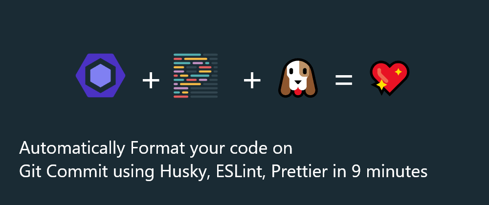
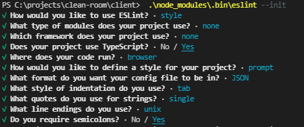
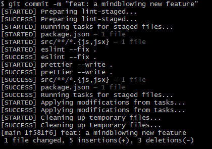

[](https://dev.to/ruppysuppy)

[Tapajyoti Bose](https://dev.to/ruppysuppy)

Posted on Mar 13
• Originally published at [tapajyoti-bose.Medium](https://tapajyoti-bose.medium.com/automatically-format-your-code-on-git-commit-using-husky-eslint-prettier-in-9-minutes-4dd6233f32b1)

# Automatically Format your code on Git Commit using Husky, ESLint, Prettier in 9 minutes

[#javascript](https://dev.to/t/javascript)
[#webdev](https://dev.to/t/webdev)
[#productivity](https://dev.to/t/productivity)
[#git](https://dev.to/t/git)

When collaborating on a project with several other developers, maintaining a **consistent code style** drastically improves the **code readability** and **maintainability**.

Luckily we can automate this crucial process using **Husky**, **ESLint**, **Prettier** to make sure the code is formatted, every time someone commits.

## 1. Install Packages

We need to install the following packages:

- **Husky**: A tool that makes working with `git hooks` a piece of cake
- **ESLint**: `Linter` for **JavaScript**
- **Prettier**: `Code formatter`
- **Lint-staged**: As the docs state: Run `linters` against staged `git` files and don't let slip into your codebase!

To install the packages, use:

```
npm install --save-dev eslint prettier lint-staged husky
```


## 2. Configure ESLint

Run the following command to initialize **ESLint**:

```
npx eslint --init
```


You will be prompted to answer a few questions, from which the **configuration** for your specific use case will be generated

[](https://res.cloudinary.com/practicaldev/image/fetch/s--tmGHiQUO--/c_limit%2Cf_auto%2Cfl_progressive%2Cq_auto%2Cw_880/https://dev-to-uploads.s3.amazonaws.com/uploads/articles/1qjf4xq4ww5qarco9riz.png)

The generated **configuration** would look something like this:

```
{
  "env": {
    "browser": true,
    "es2021": true
  },
  "extends": ["eslint:recommended"]
}
```


If you are lazy like me, just copy and paste the **configuration** into a file called `.eslintrc.json` instead of answering the long list of questions.

To check out all the available **configurations**, visit the [ESLint documentation](https://eslint.org/docs/rules/). The config provided above is just a barebone example.

## 3. Configure Prettier

Configuring **Prettier** is similar to **ESlint**, just add a `.prettierrc.json` file to your project root and you are good to go.

You can use the following **configuration** as a starting point:

```
{
  "bracketSpacing": true,
  "semi": true,
  "singleQuote": true,
  "trailingComma": "all",
  "printWidth": 80,
  "tabWidth": 2
}
```


To check out all the available options, head over to the [Prettier Documentation](https://prettier.io/docs/en/options.html).

Also add a `.prettierignore` file to your project root to `ignore` files that you don't want to be formatted, use the following content as a base:

```
package-lock.json
yarn.lock
node_modules
# any other unwanted files or folders
```


## 4. Configure Lint-staged

**Lint-staged** too is quite simple to configure. Just add the following to your `package.json` file and you are good to go:

```
{
  /* other configurations */
  "lint-staged": {
    "**/*.{js,jsx,json}": ["eslint . --fix", "prettier --write ."]
  }
}
```


## 5. Configure Husky

We are at the last peg of our configuration journey. Configuring **Husky** is a bit trickier than the other **configurations**. Add the following script to your `package.json` file:

```
{
  /* other configurations */
  "scripts": {
    /* other scripts */
    "configure-husky": "npx husky install && npx husky add .husky/pre-commit "npx --no-install lint-staged""
  },
  "husky": {
    "hooks": {
      "pre-commit": "lint-staged"
    }
  }
}
```


Run the `configure-husky` script to install **Husky** and connect it to the `pre-commit` hook:

```
npm run configure-husky
```


You are now set! Let's try `committing` some changes

[](https://res.cloudinary.com/practicaldev/image/fetch/s--6diOu2n0--/c_limit%2Cf_auto%2Cfl_progressive%2Cq_auto%2Cw_880/https://dev-to-uploads.s3.amazonaws.com/uploads/articles/p2zch9zfse2qzv1c957f.PNG)

**BINGO! IT WORKS!**

From now on, maintaining a **consistent code style** in your project will be a breeze.

**Happy Developing!**

Research says, **writing down your goals on pen & paper** makes you **21%** to **39%** more likely to achieve them. Check out these notebooks and journals to **make the journey of achieving your dreams easier**: <https://www.amazon.com/dp/B09VFRWBH9>

# Thanks for reading

Need a **Top Rated Front-End Development Freelancer** to chop away your development woes? Contact me on [Upwork](https://www.upwork.com/o/profiles/users/~01c12e516ee1d35044/)

Want to see what I am working on? Check out my [Personal Website](https://tapajyoti-bose.vercel.app/) and [GitHub](https://github.com/ruppysuppy)

Want to connect? Reach out to me on [LinkedIn](https://www.linkedin.com/in/tapajyoti-bose/)

I am a freelancer who will start off as a **Digital Nomad** in mid-2022. Want to catch the journey? Follow me on [Instagram](https://www.instagram.com/tapajyotib/)

Follow my blogs for **Weekly new Tidbits** on [Dev](https://dev.to/ruppysuppy)

**FAQ**

These are a few commonly asked questions I get. So, I hope this **FAQ** section solves your issues.

1. **I am a beginner, how should I learn Front-End Web Dev?**  
   Look into the following articles:

   1. [Front End Development Roadmap](https://dev.to/ruppysuppy/front-end-developer-roadmap-zero-to-hero-4pkf)
   2. [Front End Project Ideas](https://dev.to/ruppysuppy/5-projects-to-master-front-end-development-57p)

## Discussion (2)


[](https://dev.to/aviavinav)

•
[Mar 14](https://dev.to/aviavinav/comment/1mlh4)

Amazing article! I was wanting to implement this in my projects, didn't know how to and then I found this.

[
Reply](https://dev.to/ruppysuppy/automatically-format-your-code-on-git-commit-using-husky-eslint-prettier-in-9-minutes-45eg#/ruppysuppy/automatically-format-your-code-on-git-commit-using-husky-eslint-prettier-in-9-minutes-45eg/comments/new/1mlh4)


[](https://dev.to/darkwiiplayer)

•
[Mar 16](https://dev.to/darkwiiplayer/comment/1mmm1)

Tried something similar using [git hooks](https://github.com/DarkWiiPlayer/darkrc/blob/master/githooks/pre-commit) once, but it's a bit more complicated to set up

[
Reply](https://dev.to/ruppysuppy/automatically-format-your-code-on-git-commit-using-husky-eslint-prettier-in-9-minutes-45eg#/ruppysuppy/automatically-format-your-code-on-git-commit-using-husky-eslint-prettier-in-9-minutes-45eg/comments/new/1mmm1)

[Code of Conduct](https://dev.to/code-of-conduct)
•
[Report abuse](https://dev.to/report-abuse)
