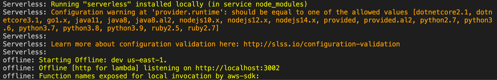
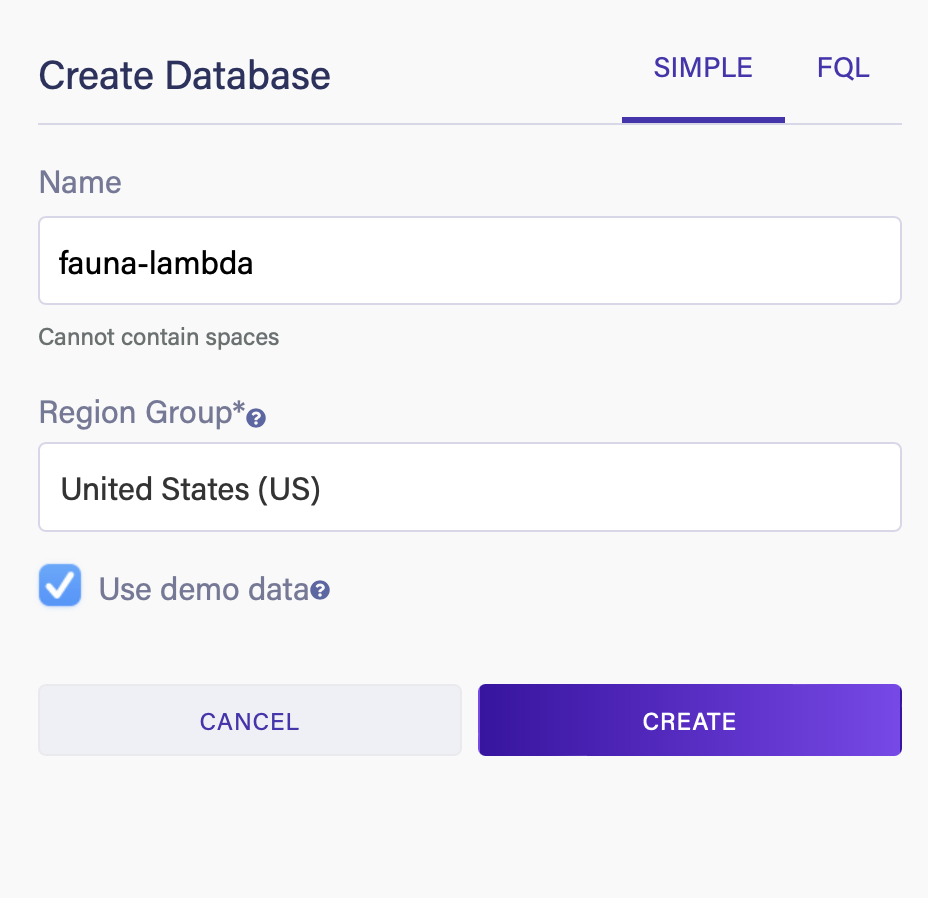
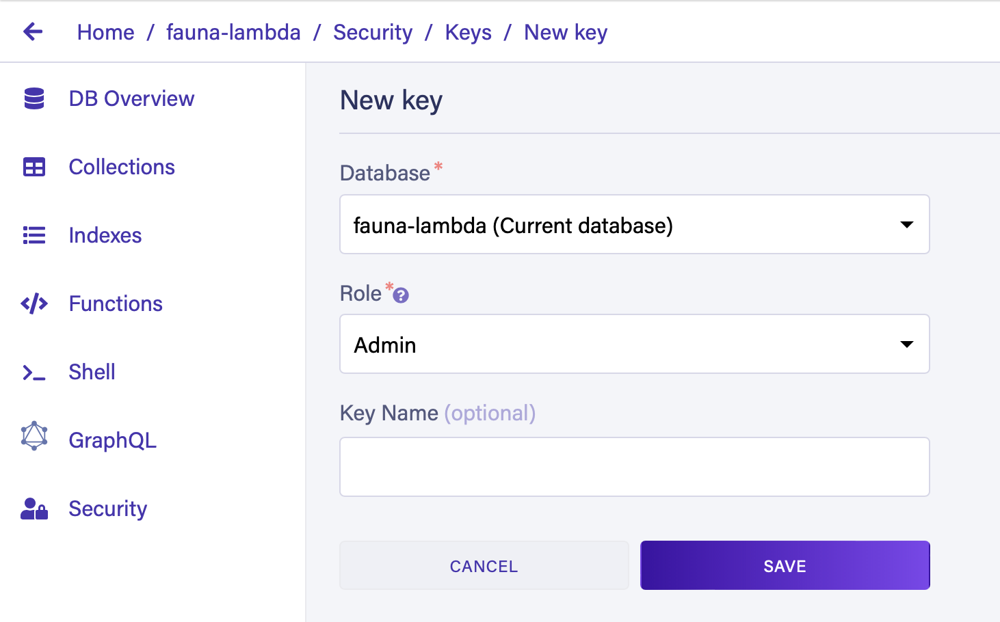
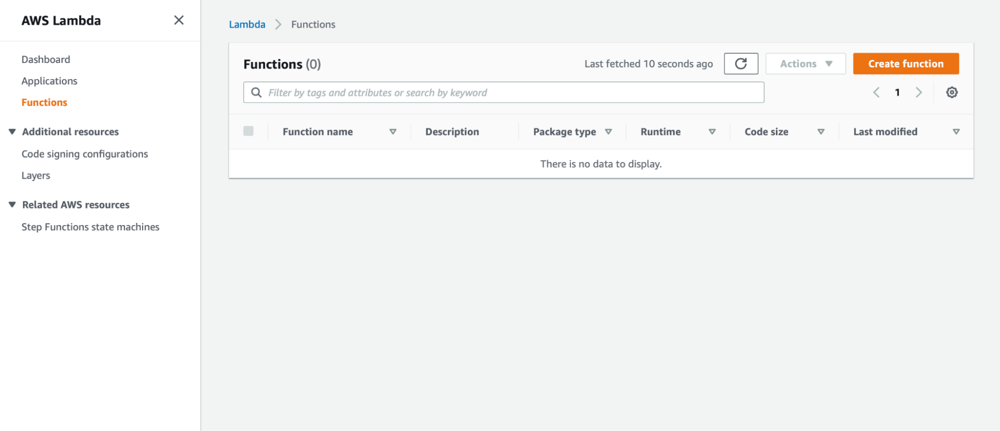
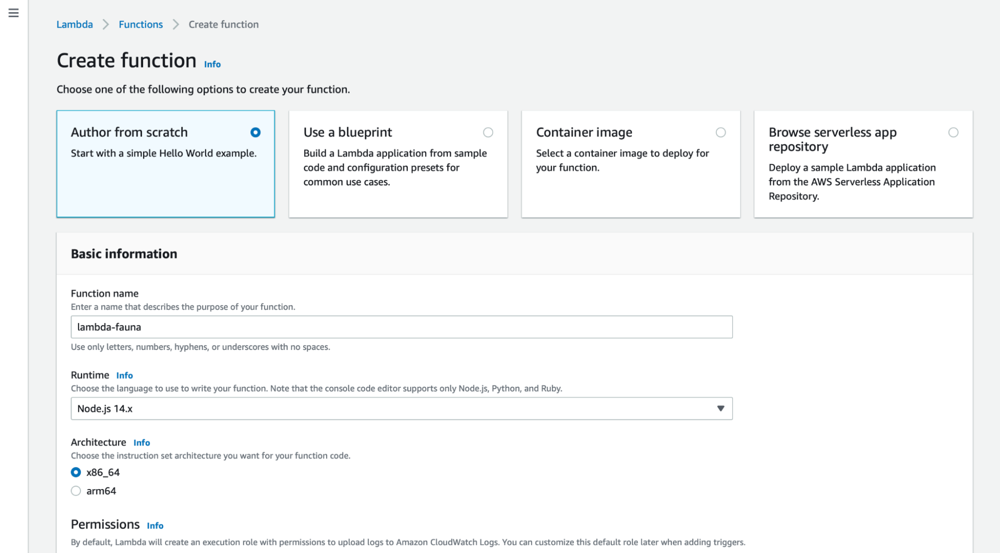
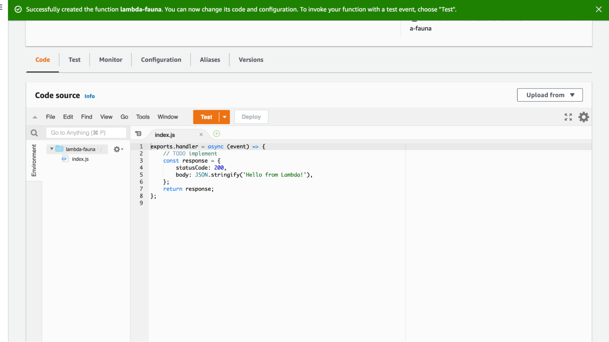
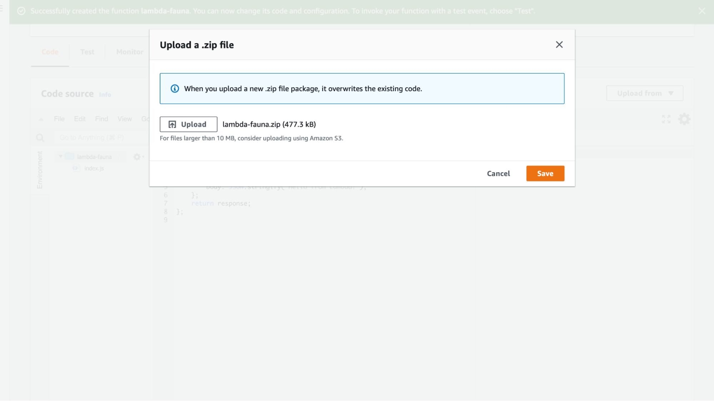
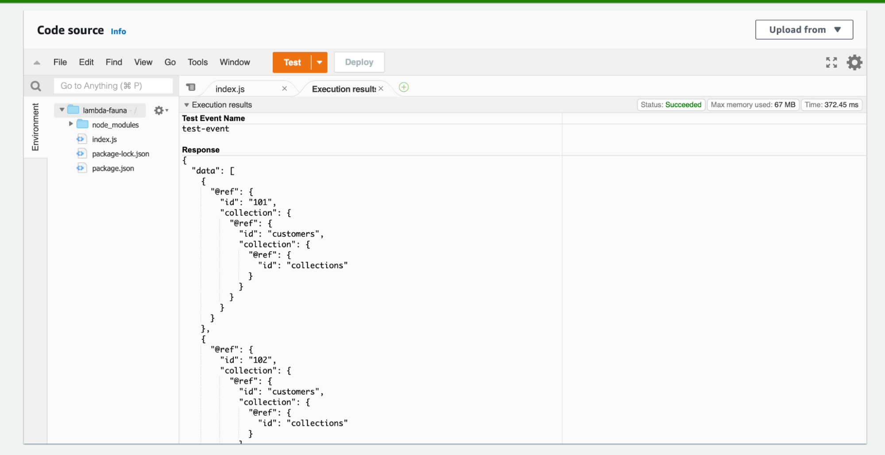

# How to develop locally using serverless offline

Oct 9th, 2021

The serverless offline plugin for Node.js allows you to emulate AWS Lambda and API Gateway on a local machine. By using the serverless offline plugin, you can test your [serverless applications](https://fauna.com/blog/what-is-serverless-architecture-and-who-should-use-it) without deploying them every time you make a change. This makes for a faster and better developer experience.

The plugin starts an HTTP server locally to handle request lifecycles and invoke handlers. Typically, this is run locally on a developer’s machine or in a shared development environment.

## Why use the serverless offline plugin?

By having these applications running locally on a developer’s machine or in a development environment, users can quickly view logs and debug their code locally rather than in the cloud, where they’re usually running production workloads. In addition, by not having to continuously deploy changes online to stay current, serverless offline allows development teams to operate at their own pace. This means that developers can freely make changes to their code and run tests locally without worrying about impacting the rest of their team.

Embedding serverless offline into existing serverless workflows can offer developers all of the advantages of serverless architecture while making them more efficient at the same time. This guide will go through the steps involved in updating an existing serverless application to integrate serverless offline, illustrating how effortless the process can be.

## How to set up serverless offline

The first step is to include the serverless-offline Node.js package in your existing application. To set up serverless offline in your project, run the following command in your Node.js project:

```
$ npm i serverless-offline
```

Once the package is installed, add the following in the plugin section of your serverless.yml file. Add the plugin section if you don’t already have it.

```
plugins:- serverless-offline
```

Save the file and verify that the package is installed by running the following command from your terminal:

```
$ serverless offline
```

This will start a local server that emulates AWS Lambda and API gateways on your local machine.



## How to pull up command line option

Depending on the environment in which you are working, you can update your Lambda functions to use your local serverless instance or your AWS endpoint. For example, you can set the IS\_OFFLINE variable in your .env to true while in your local development environment and to false in your production environment. Using the .env file allows you to configure the system from the command line without making any significant changes and worrying about them impacting other developers or the production environment.

```
const{Lambda}=require('aws-sdk')const lambda =newLambda({apiVersion:'v0.0.1',endpoint: process.env.IS_OFFLINE?'http://localhost:3002':'<YOUR_AWS_ENDPOINT>',})
```

When you have updated your Lambda functions, you can then call them using your existing handlers, just like in a serverless application.

```
exports.handler=asyncfunction(){const params ={// FunctionName is composed of: service name - stage - function name, e.g.FunctionName:'myServiceName-dev-invokedHandler',InvocationType:'RequestResponse',Payload:JSON.stringify({ data:'foo'}),}const response =await lambda.invoke(params).promise()}
```

You can then execute these Lambda functions locally by running the following from your terminal:

```
$ aws lambda invoke /dev/null   --endpoint-url http://localhost:3002   --function-name myServiceName-dev-invokedHandler
```

While the option above can be used by pointing the endpoint-url to your local serverless offline instance, using the serverless-offline package comes with a CLI that simplifies the configuration and management of your instances. Enter the following command to display the commands available:

```
$ serverless offline --help
```

This will provide some information about your serverless offline installation as well as list all the commands available:

```
Serverless: Running "serverless" installed locally (in service node_modules)
offline ....................... Simulates API Gateway to call your lambda functions offline.
offline start ................. Simulates API Gateway to call your lambda functions offline using backward compatible initialization.
    --apiKey ...........................Defines the API key value to be used for endpoints marked as private. Defaults to a random hash.
    --corsAllowHeaders .................Used to build the Access-Control-Allow-Headers header for CORS support.
    --corsAllowOrigin ..................Used to build the Access-Control-Allow-Origin header for CORS support.
    --corsDisallowCredentials ..........Used to override the Access-Control-Allow-Credentials default (which is true) to false.
    --corsExposedHeaders ...............Used to build the Access-Control-Exposed-Headers response header for CORS support
    --disableCookieValidation ..........Used to disable cookie-validation on hapi.js-server
    --enforceSecureCookies .............Enforce secure cookies
    --hideStackTraces ..................Hide the stack trace on lambda failure. Default: false
    --host / -o ........................The host name to listen on. Default: localhost
    --httpPort .........................HTTP port to listen on. Default: 3000
    --httpsProtocol / -H ...............To enable HTTPS, specify directory (relative to your cwd, typically your project dir) for both cert.pem and key.pem files.
    --lambdaPort .......................Lambda http port to listen on. Default: 3002
    --noPrependStageInUrl ..............Don't prepend http routes with the stage.
    --noStripTrailingSlashInUrl ........Don't strip trailing slash from http routes.
    --noAuth ...........................Turns off all authorizers
    --ignoreJWTSignature ...............When using HttpApi with a JWT authorizer, don't check the signature of the JWT token. This should only be used for local development.
    --noTimeout / -t ...................Disables the timeout feature.
    --prefix / -p ......................Adds a prefix to every path, to send your requests to http://localhost:3000/prefix/[your_path] instead.
    --printOutput ......................Outputs your lambda response to the terminal.
    --resourceRoutes ...................Turns on loading of your HTTP proxy settings from serverless.yml.
    --useChildProcesses ................Uses separate node processes for handlers
    --useWorkerThreads .................Uses worker threads for handlers. Requires node.js v11.7.0 or higher
    --websocketPort ....................Websocket port to listen on. Default: 3001
    --webSocketHardTimeout .............Set WebSocket hard timeout in seconds to reproduce AWS limits (https://docs.aws.amazon.com/apigateway/latest/developerguide/limits.html#apigateway-execution-service-websocket-limits-table). Default: 7200 (2 hours)
    --webSocketIdleTimeout .............Set WebSocket idle timeout in seconds to reproduce AWS limits (https://docs.aws.amazon.com/apigateway/latest/developerguide/limits.html#apigateway-execution-service-websocket-limits-table). Default: 600 (10 minutes)
    --useDocker ........................Uses docker for node/python/ruby/provided
    --layersDir ........................The directory layers should be stored in. Default: {codeDir}/.serverless-offline/layers
    --dockerReadOnly ...................Marks if the docker code layer should be read only. Default: true
    --functionCleanupIdleTimeSeconds ...Number of seconds until an idle function is eligible for cleanup
    --allowCache .......................Allows the code of lambda functions to cache if supported
    --dockerHost .......................The host name of Docker. Default: localhost
    --dockerHostServicePath ............Defines service path which is used by SLS running inside Docker container
    --dockerNetwork ....................The network that the Docker container will connect to
    --region / -r ......................Region of the service
    --aws-profile ......................AWS profile to use with the command
    --app ..............................Dashboard app
    --org ..............................Dashboard org
    --use-local-credentials ............Rely on locally resolved AWS credentials instead of loading them from Dashboard provider settings (applies only to services integrated with Dashboard)
    --config / -c ......................Path to serverless config file
    --stage / -s .......................Stage of the service
    --help / -h ........................Show this message
    --version ..........................Show version info
```

When you might not want to use the CLI, such as in a programmatic scenario, you can set options in your serverless.yml file. For example, you can configure to use the httpProtocol or httpsProtocol using the serverless.yml file as shown below. This method eliminates the need to chain a long list of options together.

```
custom:serverless-offline:httpsProtocol:"dev-certs"httpPort:4000
```

*NOTE: The CLI options override the values specified in the .yml file if you pass them.*

## Serverless database for Node.js

In this section, we will go through the process of creating a Fauna database with sample data and then create an AWS Lambda function to query one of the collections in this sample database.
First, [sign up for a Fauna account](https://dashboard.fauna.com/accounts/register) and create a new database. Here we’re naming the database fauna-lambda and selecting the *Use demo data* option.



Once the database is created, go to the *Security* tab and create a new key. This will generate a key that will be used by our Lambda function to connect to the database. *Make a note of the key so that it can be used later.*



Next, log in to AWS and go to the Lambda section. Select *Create Function.*



Choose the *Author from Scratch* option and give it a name.



This will create a new Lambda function with some sample code.



In this example, we will have to create a *Lambda function* in an npm project and upload it to AWS. The *Lambda* function will use the faunadb npm package. On your local machine, create an npm project and install the Fauna package by running the following:

```
$ mkdir lambda-fauna
$ cd lambda-fauna
$ npm init -y
$ npminstall faunadb
$ touch index.js
```

Next, in the index.js file, add the following. This will create a Fauna client instance that is configured for our database and the query that will be executed when we run our Lambda function. Make sure to update the secret key from the one generated in the previous step. As a best practice, in production, this key should be retrieved using a [secret management service.](https://docs.aws.amazon.com/lambda/latest/dg/configuration-envvars.html)

```
const faunadb =require('faunadb');const client =newfaunadb.Client({   secret:'<YOUR_SECRET_KEY>',   domain:'db.us.fauna.com',// NOTE: Use the correct domain for your database's Region Group.   port:443,   scheme:'https'});
exports.handler=async(event)=>{return client.query(q.Paginate(q.Match(q.Ref("indexes/all_customers")))).then((response)=>{return response;}).catch((error)=>{return error
})};
```

Next, create a zip file of the folder by running the following.

```
zip -r lambda-fauna.zip ./
```

From AWS, you can now upload the .zip file.



Once the file is uploaded, you should be able to test out the Lambda function. Click on the Test button. The response will now contain the data from the query.



With Fauna — a flexible, developer-friendly, transactional database delivered as a secure and scalable cloud API with native GraphQL — you can use serverless, multiregional instances in the cloud, accessible via an API. With native support for languages such as Node.js, C#, JVM, Go, and Python, Fauna makes developing applications easy.

Developers can easily integrate Fauna into a serverless architecture and never worry about provisioning, scaling, sharding, replication, or correctness again. Using the [Fauna Node.js driver](https://docs.fauna.com/fauna/current/drivers/javascript) and the Node.js serverless offline packages in their applications, developers can quickly build on and adapt their existing serverless workflows, focusing on the products they create rather than the platforms they must use.

### Get started on Fauna instantly with flexible pricing per-use

**Sign-up for free**
The data API for modern applications is here. Sign-up for free without a credit card and get started instantly.
[Sign-up now](https://dashboard.fauna.com/accounts/register)

**Quick start guide**
Try our quick start guide to get up and running with your first Fauna database, in only 5 minutes!
[Read more](https://docs.fauna.com/fauna/v3/start/cloud)
