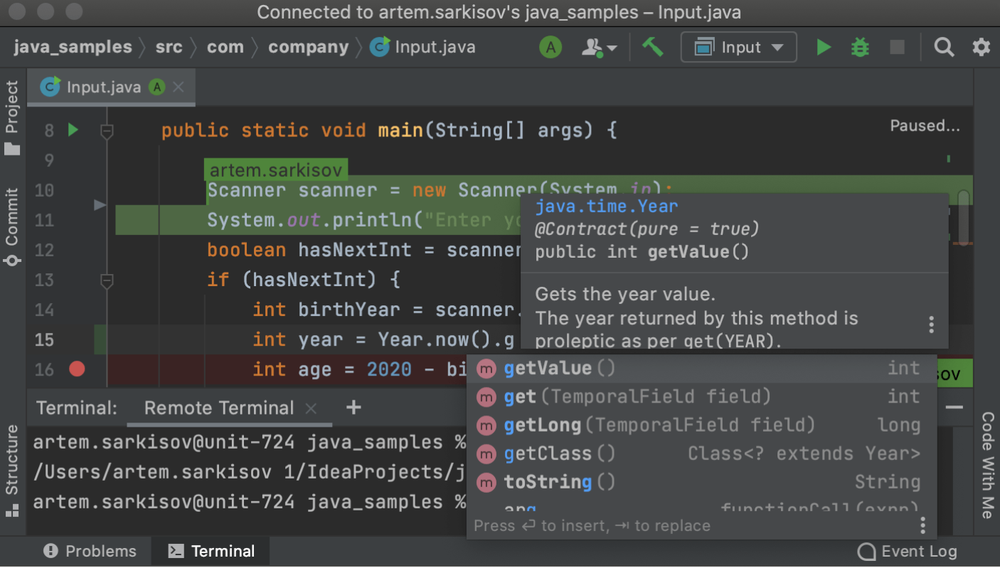
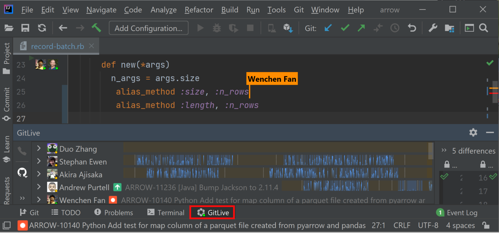
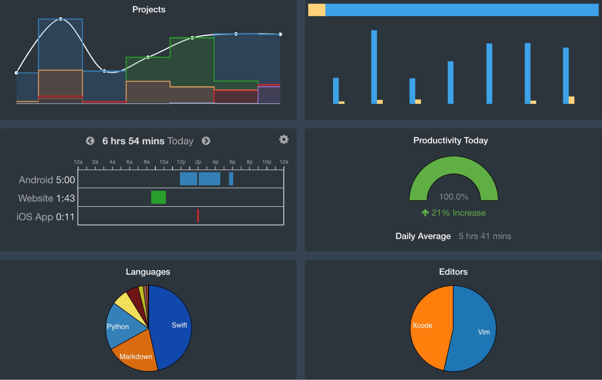
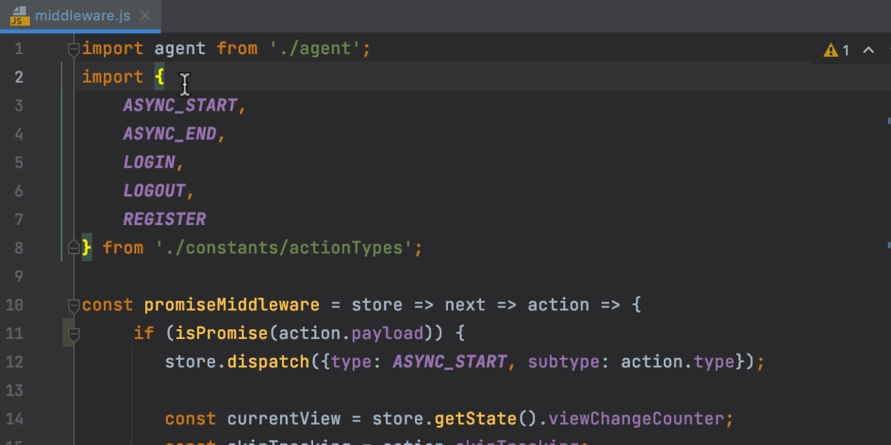
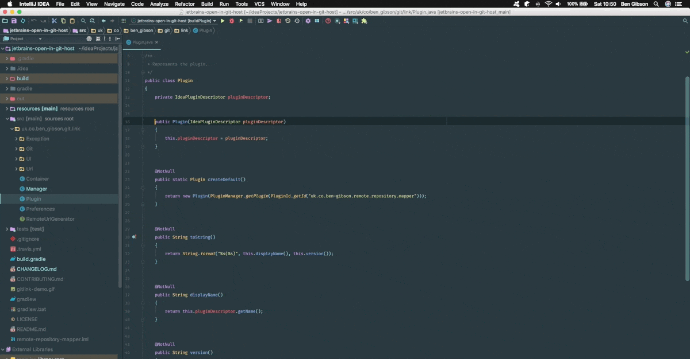
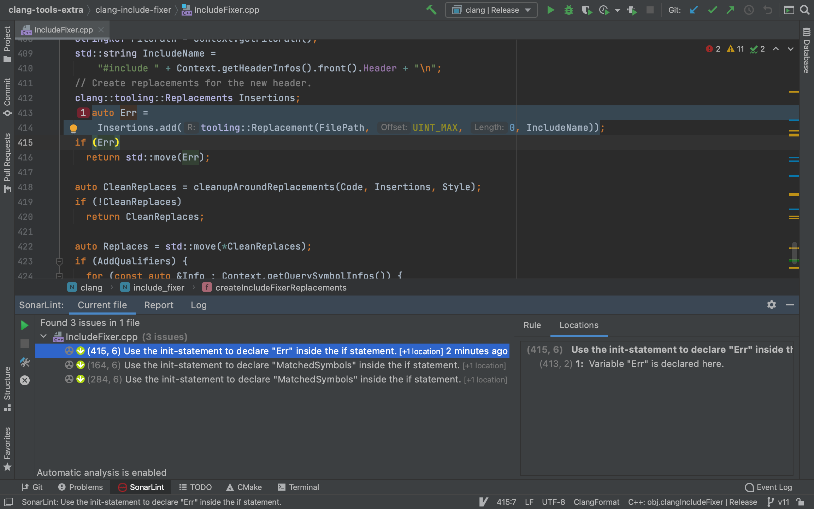

# 5 must-have JetBrains plugins for remote developers

What do developers want? Money, flexible schedules, pizza? Sure. Effortless remote collaboration? Hell, yes! Programming is a team sport and without proper communication, you can’t really expect spectacular results. A remote set-up can make developer-to-developer communication challenging, but equipped with the right tools you have nothing to fear. Let’s take a look at the best JetBrains plugins that can seriously improve your remote working routine.

### [Code With Me](https://plugins.jetbrains.com/plugin/14896-code-with-me)

If you are a JetBrains user working remotely, the chances are that you’re already familiar with this one. Code With Me is a collaborative coding and pair programming service bundled in the latest versions of most IntelliJ IDEs.

Code With Me lets you share your JetBrains IDE with others by inviting them to join a coding session (as a matter of fact, the guests don’t even need to have a JetBrains IDE installed - they can download a light-weight client instead). Thanks to the integrated group calls and customisable permissions, the plugin can be useful for educational purposes like teaching but works fine also for code reviews or technical interviews.

**Benefits for remote teams:**
Boost your team’s productivity by pair-programming in real-time, straight from your JetBrains IDE!

### [GitLive](https://plugins.jetbrains.com/plugin/11955-gitlive)

This plugin is for all you team players out there, GitLive makes Git, well, live.

It adds a tool window where you can see the collaborators from your repository, if they are online, and all their work in progress (branches/issues/PRs they are working on not yet merged in) where you can view diffs of the file changes, all updated in real-time.

Their flagship feature, instant merge conflict detection, provides early warning of potential merge conflicts. Real-time gutter indicators show ​​where your teammates have made changes to the file you’re currently working on, which can be very useful, especially on the bigger projects.

On top of that, GitLive also supports starting a Code With Me session with a fellow collaborator via a single click (or keyboard shortcut), and for those pesky collaborators that use VS Code there is even cross-IDE codeshare support!

[
Checkout our latest product - the ultimate tailwindcss page creator](https://devdojo.com/tails)

**Benefits for remote teams:**
Improve developer communication with real-time cross-IDE collaboration, merge conflict detection and video calls!

### [Waka Time](https://plugins.jetbrains.com/plugin/7425-wakatime)

One common problem that people have with remote working is the blurring of the lines between work and leisure time. Waka Time is a plugin that helps with this. It gives you a nice, visually appealing dashboard in your IDE’s which summarises your day’s coding activity. It shows you how much time you’ve spent programming, and also breaks down into how much time you’ve spent using different languages, IDEs or how much time you’ve spent on different projects.

**Benefit for remote teams:**
A good way to monitor how you’re splitting your time between projects and tasks. The team plan gives you an overview of your team’s project details. WakaTime detects your team projects automatically and shows how long each team member coded individually on each project.

### [Presentation Assistant](https://plugins.jetbrains.com/plugin/7345-presentation-assistant)

If you’ve ever given an online code presentation you know that moving too quickly can confuse your audience and constant questions about your last move can easily throw you off your game. Luckily this handy plugin can help you and your audience stay on a track during the live coding session. It provides annotations that explain which shortcuts you’re using as you are presenting your screen, which can make it much easier for your audience to follow along as you work.

**Benefits for remote teams:**
This plugin comes in handy during company-wide presentations, when you need to record screencasts and of course, during a pair programming session.

### [GitLink](https://plugins.jetbrains.com/plugin/8183-gitlink)

Simple and effective extension that does one job: allows you to send a link with selected code from your editor to your teammates, who can view it in GitHub. Besides the advantage of sharing code with your team (note that only committed changes will be reflected in the link), it is also useful if you want to check history, contributors, or branch versions.

**Benefits for remote teams:**
Easily send links of code snippets to coworkers!

### [SonarLint](https://plugins.jetbrains.com/plugin/7973-sonarlint)

Looking for a tool that will help you write efficient, safe and quality code?
Most modern IDEs have a mechanism to allow for static code analysis, but you can bring the analysis to the next level by using a handy plugin like SonarLint. SonarLint SonarLint is a static code analyser meant as a way to get feedback about your code directly in the IDE. It’s great when it comes to detecting bad smells or finding and fixing bugs.

SonarLint integrates with most JetBrains IDEs and supports languages like C, C++, Java, JavaScript, TypeScript, Python, C#, Kotlin, Ruby, HTML & PHP.

**Benefits for remote teams:**
You can use it on your own, but it works best when connected with the SonarQube platform, where your team can share common language rulesets or project analysis settings.

Good communication within a distributed team is key to productive remote working. Hopefully, some of the tools I rounded up in this short article will make your team collaboration faster, more efficient and productive. Happy hacking!
