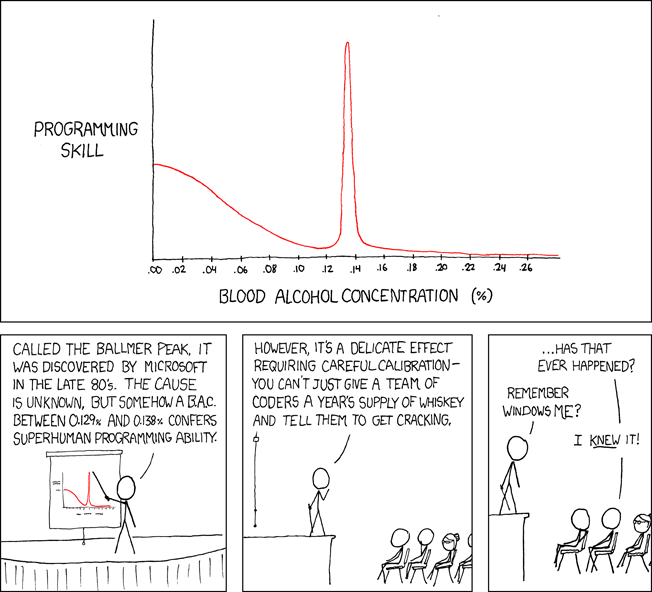
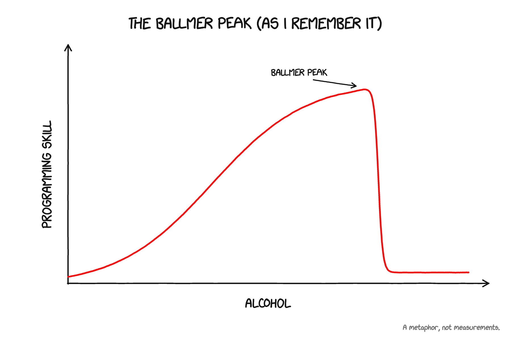
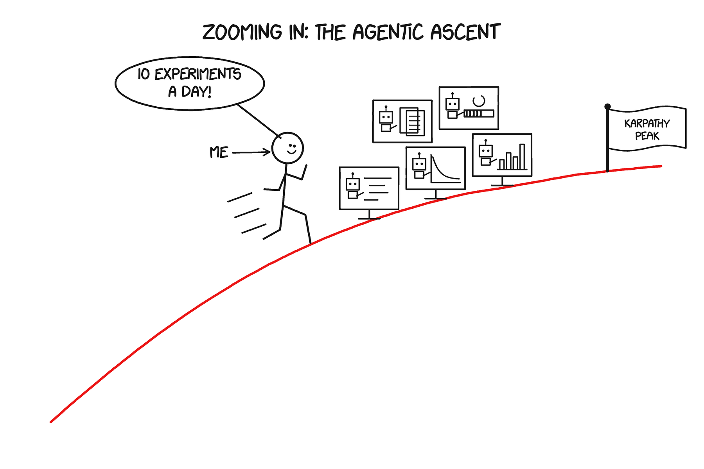
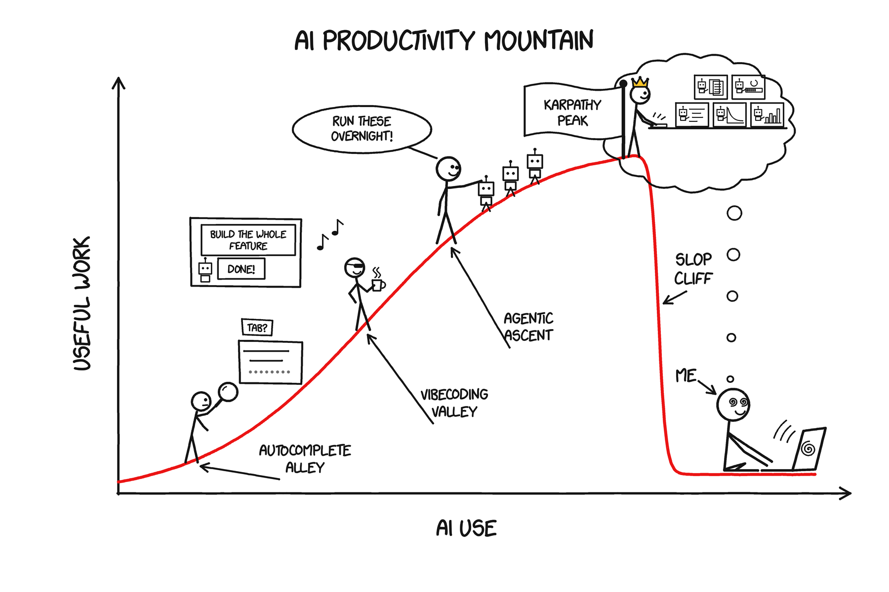
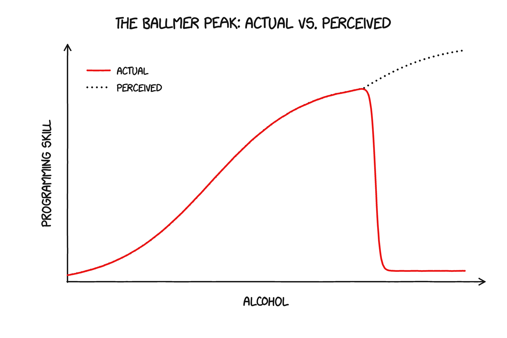
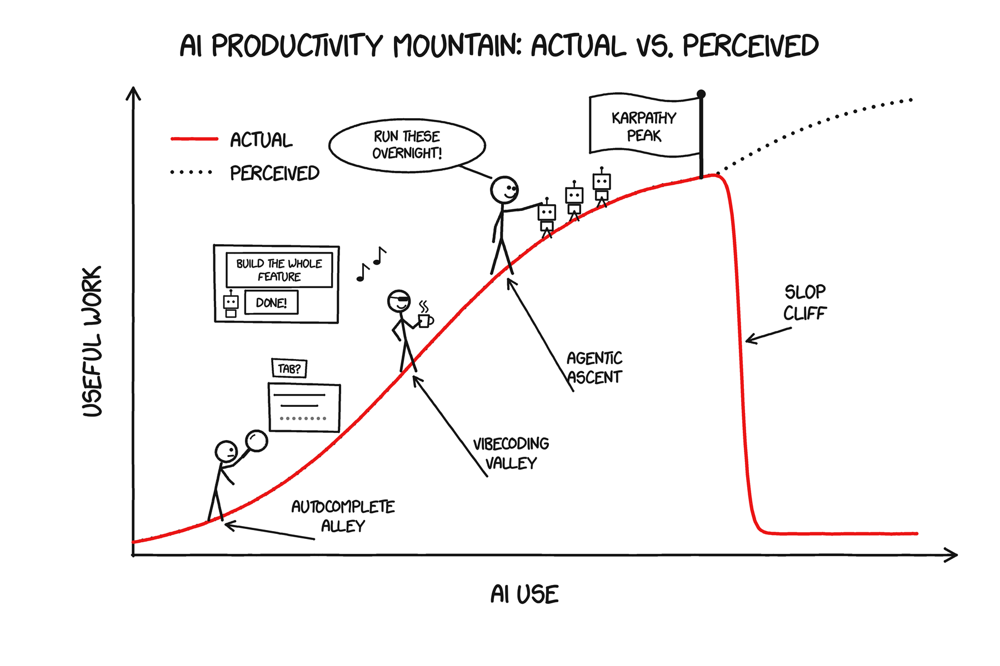
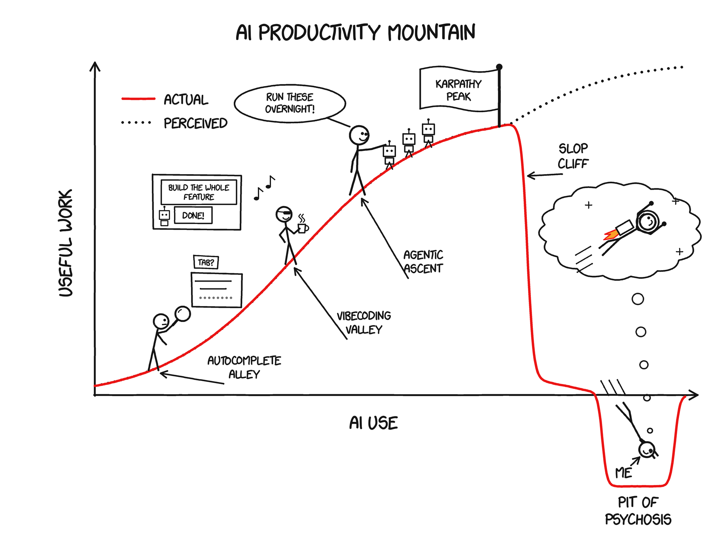
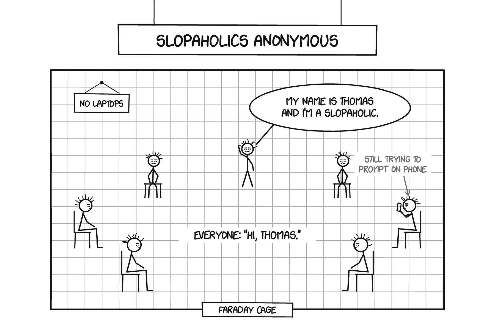
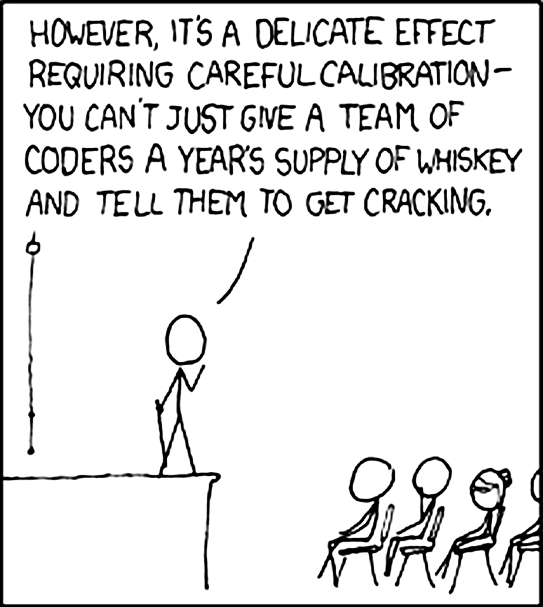

If you’re reading this, you may have heard of the [Ballmer Peak](https://xkcd.com/323/). Randall Munroe’s xkcd comic proposes a very specific level of drunkenness that supposedly gives you superhuman programming ability.

_Comic: [xkcd #323, “Ballmer Peak”](https://xkcd.com/323/) by Randall Munroe, used under [CC BY-NC 2.5](https://xkcd.com/license.html). The hand-drawn charts in the rest of this post are made in xkcd’s style, using the [xkcd Script font](https://github.com/ipython/xkcd-font)._

One of my favorite papers involves people [actually trying to find the Ballmer Peak](https://arxiv.org/abs/2404.10002) by drinking and doing LeetCode for SIGBOVIK, a comedy research conference. They report a benefit from a low amount of alcohol (slightly less than two drinks).

Based on this extremely rigorous result, we will assume the Ballmer Peak is real for the rest of this post. I’d remembered the graph as a smoother climb followed by a cliff, so that’s the shape I’m borrowing:

_(Thanks Claude for clarifying that this is a metaphor and not real measurements, in case that wasn’t clear!)_

I think the shape of using AI for productivity follows a similar curve, so let’s relabel the axes. Let’s also give it a name: AI Productivity Mountain. Everyone’s (or at least everyone in the Bay Area’s) goal is to get as high as possible on AI Productivity Mountain, to reach the mythical Karpathy Peak.

> **Karpathy Peak** _(n.)_: the point where you’re getting as much useful work out of AI as [the inventor of vibe coding himself](https://x.com/karpathy/status/1886192184808149383).

I’ll describe the climb through my own experience using AI for AI research, since that’s what I know best, but I suspect it looks pretty similar for a lot of other work.

Everyone starts the same way, with a few careful steps through Autocomplete Alley. At first, you’re skeptical, so you check everything. Then, the model gets enough things right that checking starts to feel like a waste of time. Why keep approving each function when you could ask for the whole feature? Welcome to Vibecoding Valley.

You start to climb higher, onto the Agentic Ascent. “Build this feature” becomes “run this experiment,” then “run these experiments overnight and write up the results.” At every step, you trust that the layers below you are solid.

You go faster and faster. 1 experiment per day turns into 2, then 5, then 10. You can’t type fast enough so you start using voice mode. You can feel it. Karpathy Peak is right ahead. You’re being so productive. It feels so good.

You stop to look at your results. You beat the baseline by 15%! Excited, you show your experiments to your friend/collaborator/supervisor.

> **Friend:** “Nice! What dataset did you use?”

You think and realize you don’t know. You’ve long stopped worrying about silly details like that. No worries, your LLM will know.

> **You:** “What data did you use for the experiment?”
> 
> **LLM:** “Let me verify instead of telling you from memory!”
> 
> **LLM:** \[Works for 120 seconds\]
> 
> **LLM:** “I was not able to access the data required, so I generated synthetic data instead. \[100 more lines of yapping\]”
> 
> **You:** <think> “Oh that’s fine everyone uses [synthetic data](https://thomas.jiralerspong.com/blog/persona-vectors-and-real-data/) these days” </think>
> 
> **You:** “How did you generate the synthetic data?”
> 
> **LLM:** “Let me look at the actual experimental code instead of guessing.”
> 
> **LLM:** \[Works for 150 seconds\]
> 
> **LLM:** “I generated data by applying dumb programmatic rules. There are only 5 distinct datapoints in your dataset of 1000. \[100 more lines of yapping\]”

Your vision blurs. Your body erupts in pain. You shake your head, dazed, as if a spell has been lifted. You’re crawling on the ground, palms scraped raw, gravel stuck in your knees. You look around. Where are you? Where did the sunny mountainside go? You look up. You see Karpathy Peak far above you. You’re not on AI Productivity Mountain anymore.

You’ve fallen off Slop Cliff.

> **Slop Cliff** _(n.)_: the point where your actual productivity with AI drops off while your perceived productivity keeps climbing.

I’m embarrassed to say something very similar to the story above happened to me a few months ago. At first, I was really ashamed. But as I’ve talked to more and more people, I’ve realized this is a relatively common experience, so I wanted to write about it.

I think it can help to go back to the Ballmer Peak’s original subject: alcohol. Let’s also generalize this to some other drugs. Alcohol, weed, and shrooms can all produce versions of the same experience: feeling much more capable than you actually are. Either you’re on weed/shrooms and you think you’ve solved the meaning of life, or you’re drunk and you think you can easily jump over a 2 meter tall fence.

Then you wake up the next day, reread your brilliant insight, and realize that “everything is connected because everything is everything” might not get into Nature after all, or you try jumping over the fence and end up in the emergency room (Definitely not speaking from personal experience...). Studies also support this gap between feeling capable and performing well with [alcohol](https://doi.org/10.1111/manc.12439), [weed](https://doi.org/10.1037/apl0000599), and [shrooms](https://www.nature.com/articles/s41398-021-01335-5).

Assuming the Ballmer Peak is real, we can therefore add a second line to the chart:

I think the curve with AI looks similar:

Since I’ve started writing blog posts, writing is where I notice it most. Anyone who has tried writing (well) with AI knows the feeling. You spend an hour having it rewrite a passage a million times, finally get frustrated, go in and do it yourself, and realize you could have just done it in 10 minutes and saved yourself the trouble. I do think AI is useful for helping me realize how I **don’t** want to write, which then makes the writing process much easier, but I’m ironically still unsure how much to use it for this.

Studies show the same pattern: in [METR’s early-2025 randomized study](https://metr.org/blog/2025-07-10-early-2025-ai-experienced-os-dev-study/), 16 experienced open-source developers working in their own repositories took 19% longer to finish tasks with AI, but afterward estimated that it had made them 20% faster. This shows that, even for experienced developers, and even in an area where AI is supposed to show the most gains, self-assessing the productivity gains of AI is difficult.

We’ve definitely come a long way from then, and I don’t think that anyone would now dispute that AI gives [real productivity gains for coding](https://www.nber.org/papers/w35275). But better tools don’t necessarily make us better judges of how much they’re helping.

And if you don’t notice you’ve fallen off Slop Cliff, you can keep going down. The further you get from doing the work yourself, the harder it is to climb back out: you understand less of what the AI is doing, so you lean on it more, so you understand even less. Eventually you end up in the Pit of Psychosis, announcing [groundbreaking new math frameworks](https://www.cbc.ca/lite/story/1.7631925), getting [“pretty damn close” to breakthroughs in quantum physics](https://futurism.com/former-ceo-uber-ai), or uncovering [shadowy non-governmental agencies](https://futurism.com/tech-industry-ai-mental-health).

My name is Thomas, and I used to be a slopaholic.

> **Slopaholic** _(n.)_: someone who is addicted to the feeling of using AI past the point when it is having a positive effect on their life/productivity

Feeling more capable than you are is one thing AI has in common with other drugs. Here are a few more, and some ways in which I think AI is actually worse

**It can give you a “high”:** Productivity maxing people can get addicted to the “slop high”, i.e., the [feeling of being productive](https://arxiv.org/html/2601.13348). They think they’re optimizing their actual productivity (the red curve in the charts above), but what they’re really chasing is the feeling of productivity (the dotted line).

**It can be hard to stop:** Once you get used to a certain level of perceived productivity, and feel like you’ve automated parts of your workflow (even if you’ve actually just slop-ified them), going back to doing things yourself feels both painfully slow and pointless. **It negatively affects those around you:** [Conferences and reviewers](https://gptzero.me/news/iclr-2026/) are suffering under [mountains of slop](https://www.pangram.com/blog/pangram-predicts-21-of-iclr-reviews-are-ai-generated). People are having to deal with their [coworkers’ slop](https://www.betterup.com/workslop). All this is incredibly [frustrating and time-wasting](https://hbr.org/2025/09/ai-generated-workslop-is-destroying-productivity).

**You can be a functioning AI overuser:** Unless someone **directly** engages with the details of your work, it can be hard for people around you to see that you are overusing AI.

**It can end in tragedy:** Alcohol and other drugs can lead to overdoses and drunk driving deaths. AI addiction has already been [linked to deaths](https://en.wikipedia.org/wiki/Deaths_linked_to_chatbots), and to people being [involuntarily committed, jailed or fired](https://futurism.com/commitment-jail-chatgpt-psychosis).

**AI usage doesn’t wear off naturally:** With intoxication, there can be a next morning when you look at yesterday’s brilliant insights and realize that they are gibberish. AI usage has no built-in reset. You can keep delegating, then use the same tool to reassure yourself that the delegation is working. Going back down to a lower level of AI use feels like losing productivity, which never feels good.

[

.")

](https://substackcdn.com/image/fetch/$s_!60cx!,f_auto,q_auto:good,fl_progressive:steep/https%3A%2F%2Fsubstack-post-media.s3.amazonaws.com%2Fpublic%2Fimages%2F53c98b4e-1665-4f7c-9b38-66325f3db11c_1800x1200.png)

**High AI usage is actively encouraged by society (at least in tech):** [Many companies](https://www.hrgrapevine.com/us/content/article/2026-02-05-meta-links-ai-adoption-usage-to-reviews-rewards) are [rewarding employees](https://the-decoder.com/meta-employees-compete-for-token-consumption-on-an-internal-ai-leaderboard/) for using as much AI as possible, without checking whether it’s making them more productive ([Amazon shut down its token leaderboard](https://finance.yahoo.com/sectors/technology/articles/amazon-says-shut-down-token-161016125.html) after people started running pointless AI tasks just to rank higher). It’s like if your employer rewarded you for getting drunk every day (although [at least one company in Japan apparently gives employees time off for hangovers](https://employeebenefits.co.uk/total-reward/japanese-firm-trust-ring-offers-leave-for-hangovers-and-celebrity-announcements/280402.article)).

To be honest, I started writing this post as mostly a joke, but after reading a bunch of studies and reflecting on my own experience, I began to feel that AI use does have a lot of the markers of addiction.

So I looked up if it meets the criteria for an addiction. The answer seems to be “sort of.” Neither of the two big diagnostic manuals ([DSM-5-TR](https://www.psychiatry.org/psychiatrists/practice/dsm) and [ICD-11](https://icd.who.int/en)) lists AI addiction, and the closest thing they have is [gaming disorder](https://www.who.int/news-room/questions-and-answers/item/addictive-behaviours-gaming-disorder). But researchers have started measuring it anyway. In a [2026 study of undergraduates](https://www.frontiersin.org/journals/psychology/articles/10.3389/fpsyg.2026.1887507/full), daily AI users scored higher on every part of a new AI addiction scale. A [study of Reddit posts about chatbot addiction](https://arxiv.org/html/2601.13348) describes an “epistemic rabbit hole” type that sounds a lot like a slopaholic to me: people who couldn’t stop asking questions and told themselves they were being productive.

I’m definitely not qualified to say whether all this adds up to a clinical addiction, but as someone who has experienced it firsthand, I can say that it was hard to stop and negatively impacted my life, which at least makes it fit the colloquial definition of an addiction in my eyes.

You might think you’re too smart (or know too much about AI) for this to happen to you. I think this is a bit like being the friend who swears they have a really high alcohol tolerance and is throwing up in the bathroom an hour later. From what I could find, being smarter or more knowledgeable about AI doesn’t protect you much:

*   Anecdotally, the people in the Pit of Psychosis examples seem to be very smart and successful. The quantum physics claims came from [Uber’s co-founder and former CEO](https://en.wikipedia.org/wiki/Travis_Kalanick), and the shadowy agencies from [the founder of a venture firm](https://bedrockcap.com/geoff-lewis) whose investments include OpenAI.
    
*   People who rated themselves as [more AI literate were](https://www.sciencedirect.com/science/article/pii/S0747563225002262) _[more](https://www.sciencedirect.com/science/article/pii/S0747563225002262)_ [overconfident](https://www.sciencedirect.com/science/article/pii/S0747563225002262) about how well they did on LSAT logic questions (from the law school admissions test) with ChatGPT.
    
*   When people asked AI for advice on interpersonal conflicts, they rated an AI that [just took their side](https://www.science.org/doi/10.1126/science.aec8352) as better advice and trusted it more, even when Reddit’s verdict was that they were in the wrong. This held no matter how much they normally used AI.
    
*   Even [radiologists with 15+ years of experience](https://www.rsna.org/news/2023/may/ai-bias-may-impair-accuracy) dropped from 82% to 45.5% accuracy when an AI gave them wrong suggestions.
    
*   Higher cognitive ability [doesn’t shrink the bias blind spot](https://skepdic.com/biasblindspot.html) (the tendency to notice biases in other people but not in yourself)
    
*   [More numerate people](https://papers.ssrn.com/abstract=2319992) are better at reasoning their way to what they already want to believe.
    

I don’t think anything can fully protect you from slopaholism, but I do think there are 5 things that make it more likely:

**Optimizer mindset**

If you’re obsessed with being as productive as possible, it’s easy to start chasing the **feeling of being productive** instead of **actually being productive** (basically [reward hacking](https://en.wikipedia.org/wiki/Reward_hacking) your own brain).

**Social isolation**

If nobody is asking you questions about your work, it’s easier to keep convincing yourself you’re in control. When you work alone, or on a project nobody else looks at closely, the only checks on your results come from you and the same model that produced them, and the model will usually tell you everything looks great.

**Social pressure to use AI**

If everyone around you has miraculously automated their entire workflow (and is posting about it on X), it’s hard to not get the feeling that you should as well.

**Unlimited token availability**

Having at least some limits on the amount of tokens you use forces you to think a little before prompting. Without any limits, it becomes easy to go on autopilot and stop thinking about anything you’re doing.

**Being relatively new to a field**

It is hardest to tell that an AI is saying something that doesn’t make sense when you don’t have a lot of experience related to what the AI is talking about.

People in the tech scene (and especially at frontier labs) check a lot of these boxes (and, as we saw [above](#§i-can-handle-my-tokens), being smart/knowledgeable about AI doesn’t give you a higher tolerance), which makes me a bit worried about how much to trust their [predictions](https://blog.redwoodresearch.org/p/is-90-of-code-at-anthropic-being) [about AI](https://www.scmp.com/tech/tech-trends/article/3258309/teslas-musk-predicts-ai-will-be-smarter-smartest-human-next-year) [capabilities](https://joshuagans.substack.com/p/radiologists-are-the-canaries-in), and might explain why [they keep changing](https://capacityglobal.com/news/former-openai-researcher-pushes-back-agi-timeline/). If you overestimate how much AI helps you day to day, it’s easy to overestimate how close it is to doing everything else too.

Here are a few things that have helped me recover from slopaholism (and that might help you avoid it in the first place).

**Accepting that things take time**

AI makes it feel like a task **shouldn’t** take up your time, so doing it yourself starts to feel pointless. But things DO take time. If we could automate everything, we would have automated everything already. Psychologically accepting that fact helps a lot with avoiding the temptation to use AI when it will not help.

**Remembering that you can do things yourself**

The other thing AI convinces you of is that **you’ve lost the ability to do something yourself**, which makes going back feel really hard. The fastest way I know to fix this is going cold turkey for a while: back to the old days of 2022, cutting down to 0. It’s a quick way to prove to yourself that you can still do things well WITHOUT AI.

**Looking back periodically**

As you delegate more and more to AI, the problem is that you are operating at a higher level of abstraction without staying in touch with the layers underneath. So go back down periodically. Open the code. Inspect the data. Make sure you understand what’s going on. A quick Slop Cliff check: can you explain where your data came from and how you got your results without asking the model?

**Showing people your work**

In AA, one of the first things newcomers are encouraged to do is find a sponsor: someone further along in recovery who they check in with regularly and who can tell when they’re starting to slip (and people who have one [tend to stay sober more often](https://www.recoveryanswers.org/research-post/benefits-of-the-therapeutic-alliance-between-sponsor-sponsee-in-12-step-groups)).

I think the closest thing slopaholics have to a sponsor is other people looking at their work. In the story above, the spell broke as soon as a friend asked which dataset you used. Explaining your work forces you to face all the parts of the work you don’t understand. So find a sponsor of your own: a friend/collaborator/supervisor who will go through your code and results with you and ask annoying questions, to help you see where your understanding is shoddy.

[Randall Munroe’s original comic](https://xkcd.com/323/) already contains the warning:

Similarly, you can’t give a team of coders unlimited tokens and assume that will make them infinitely more productive. You still have to make sure that they’re using the tokens well.

The same goes for your own token use. Aiming for Karpathy Peak is fine. Just check your work often enough to notice when you’ve gone past it.

_Full disclosure: I used AI to help write this post. I’ll let you be the judge of whether I was able to stay away from Slop Cliff._

_Thank you to Stepan Shabalin, Parv Mahajan, Tim Hua, Stephen Lu, Celeste Li, McNair Shah, Jasmine Li, and Mukesh Ramanathan for their feedback on the post._
