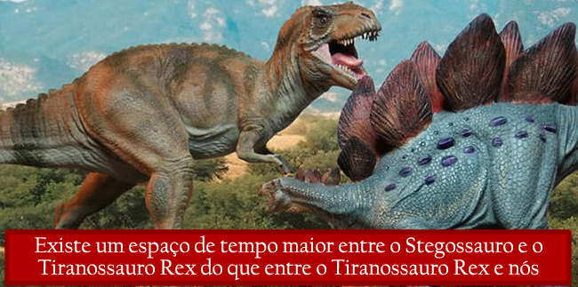
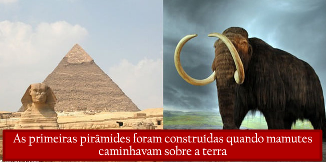
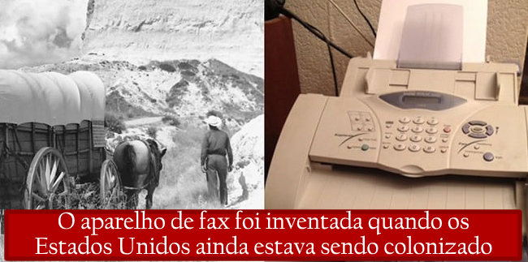
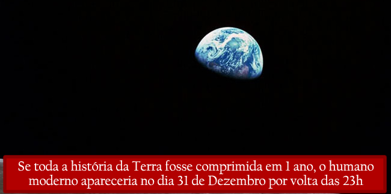

Post da coluna O Buteco da Net, do iG, com dez montagens que comparam datas históricas.

![1. À esquerda, uma guilhotina ao ar livre diante de montanhas; à direita, o capacete de Darth Vader. Legenda: "A França ainda executava pessoas usando a guilhotina quando Star Wars foi ao ar pela primeira vez". 2. Modelos de um tiranossauro e de um estegossauro frente a frente. Legenda: "Existe um espaço de tempo maior entre o Stegossauro e o Tiranossauro Rex do que entre o Tiranossauro Rex e nós". 3. À esquerda, cena de seriado com um homem de terno e um jovem de boné e jaqueta vermelhos; à direita, Will Smith rindo. Legenda: "Hoje, Will Smith é mais velho do que o Tio Phill nos primeiros episódios de “Um Maluco no Pedaço”". 4. À esquerda, a Esfinge e uma pirâmide de Gizé; à direita, ilustração de um mamute-lanoso. Legenda: "As primeiras pirâmides foram construídas quando mamutes caminhavam sobre a terra". 5. À esquerda, a atriz Betty White sorrindo; à direita, fatias de pão. Legenda: "A atriz Betty White é mais velha que o pão fatiado". 6. À esquerda, foto em preto e branco de um prédio de tijolos com árvores sem folhas e neve; à direita, um quadro-negro com exercícios de derivadas, parcialmente legíveis ("245 # 3, 5, 11, 15, 17, 19, 21, 23, 27, 31, 33", "(1) Dx ln√x²+4x+1 = ?", "(3) Dx ln|x e^-2x| = ?", "(6) Dx(ln x)^x = ?", demais termos (ilegível)). Legenda: "A Universidade de Harvard foi fundada antes da existência do cálculo". 7. À esquerda, foto em preto e branco de uma carroça coberta e um homem de chapéu num terreno montanhoso; à direita, um aparelho de fax. Legenda: "O aparelho de fax foi inventada quando os Estados Unidos ainda estava sendo colonizado". 8. À esquerda, um colar de pérolas e pedras sobre tecido azul; à direita, um canal de Veneza com uma ponte. Legenda: "A companhia de jóias “Tiffany & Co.” é mais antiga que a Itália". 9. À esquerda, o escudo "WB" com a inscrição "WARNER BROS."; à direita, mapa antigo do Império Otomano com o título "NOVA IMPERII TURCARUM TABULA, AD USUM SERENISSIMI BURGUNDIÆ DUCIS" e os rótulos "MER NOIRE" e "MEDITERRANEA" visíveis. Legenda: "Quando a Warner Brothers foi criada o império Otomano ainda reinava". 10. A Terra parcialmente iluminada sobre fundo negro. Legenda: "Se toda a história da Terra fosse comprimida em 1 ano, o humano moderno apareceria no dia 31 de Dezembro por volta das 23h".](10-fatos-interessantes-que-podem-mudar-completamente-a-sua-1.jpg)

