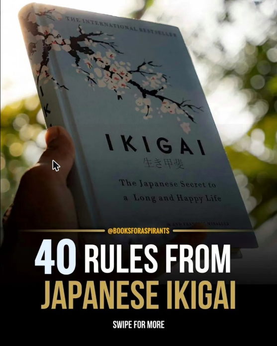
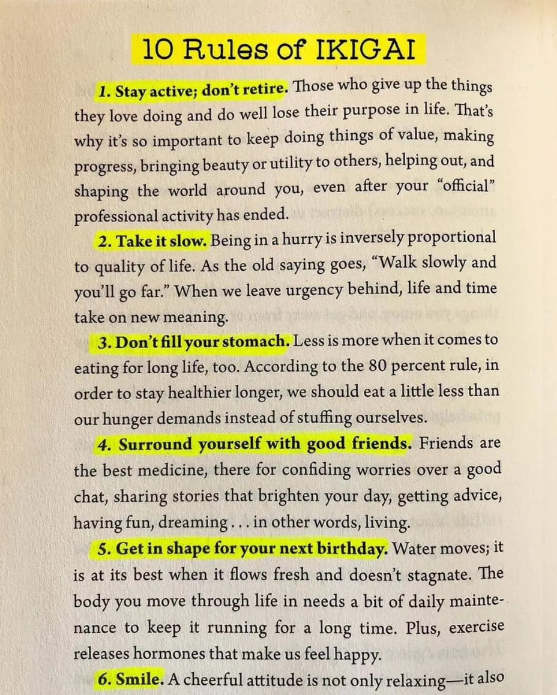
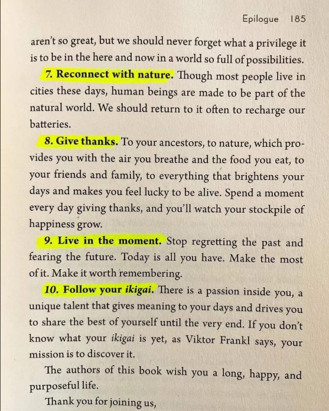
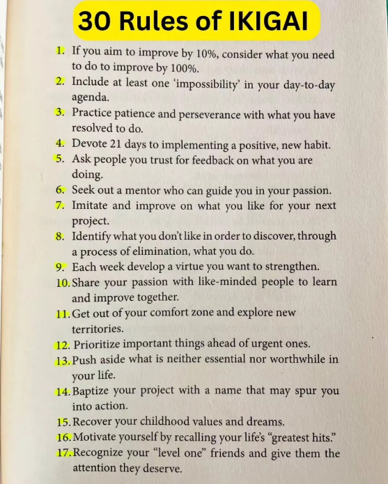
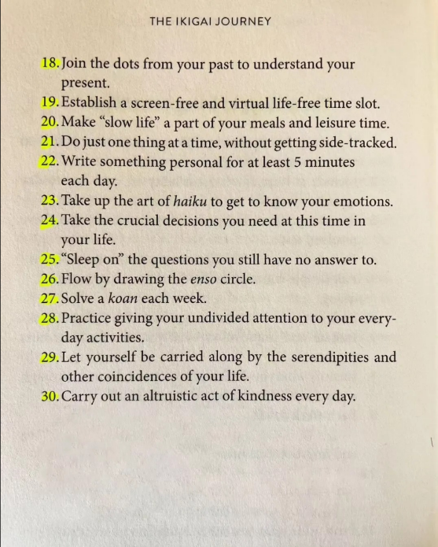

Posted by Nirmal Singh Rajput (@booksforaspirants) on Threads, 2023-11-27. [Post](https://www.threads.net/@booksforaspirants/post/C0KAk-VScJm).

> 40 Rules from Japanese IKIGAI.
> -
> Save and share with your friends.

