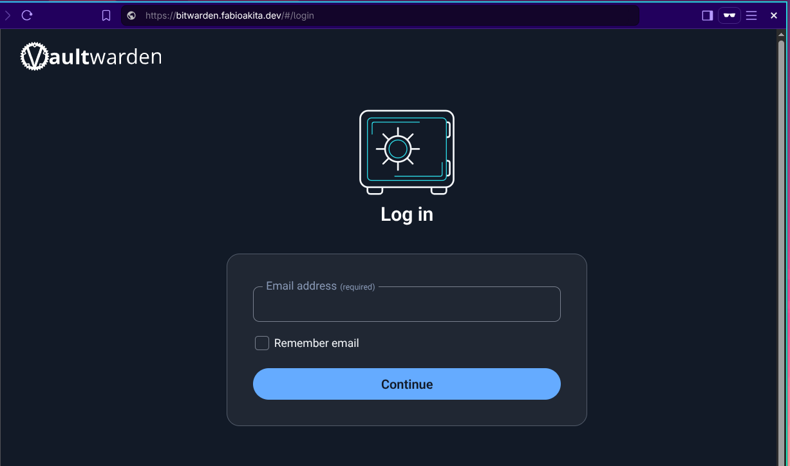
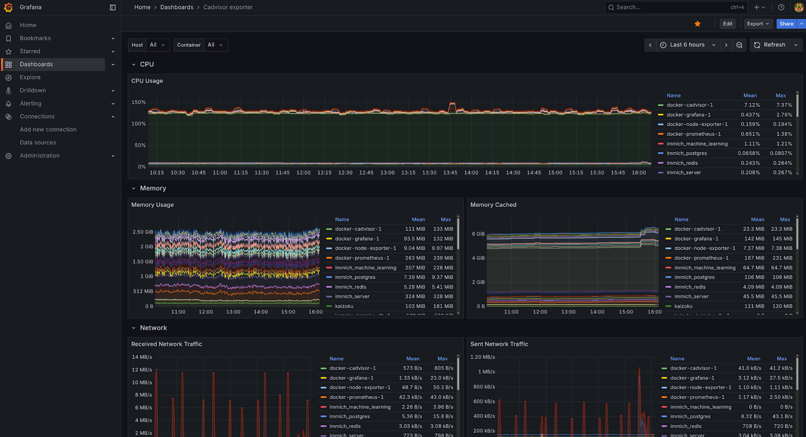
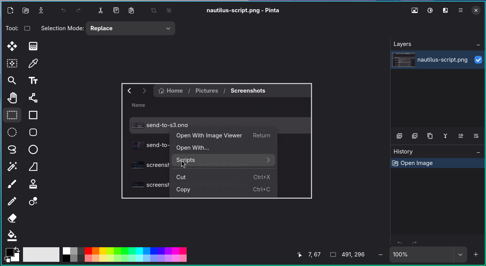

Post de Fabio Akita (@Akitando) na comunidade do YouTube. [Post](https://youtube.com/post/Ugkx9RnCpUarTn_u9yx3JC6Tab7lr4a5Mk7c).

> Esta semana fiz uma série de posts no meu blog sobre Omarchy e meu Home Server. Várias dicas sobre segurança, como criar túneis seguros pra poder acessar meu Home Server da rua (Cloudflared e Zero Trust), como monitorar meus serviços (Grafana), como hostear meu próprio servidor pra gerenciador de senhas (Vaultwarden), como eu fiz meu novo blog (Hugo/Hextra), como gerenciar chaves SSH com hardware tokens (Yubikeys), dicas sobre TUIs (Terminal User Interface Apps), dicas de LazyVim, configs de ZSH e mais!
>
> Está tudo organizado em tags #omarchy e #homeserver no meu blog através destes dois links:
>
> https://akitaonrails.com/tags/omarchy/
>
> https://akitaonrails.com/tags/homeserver/

