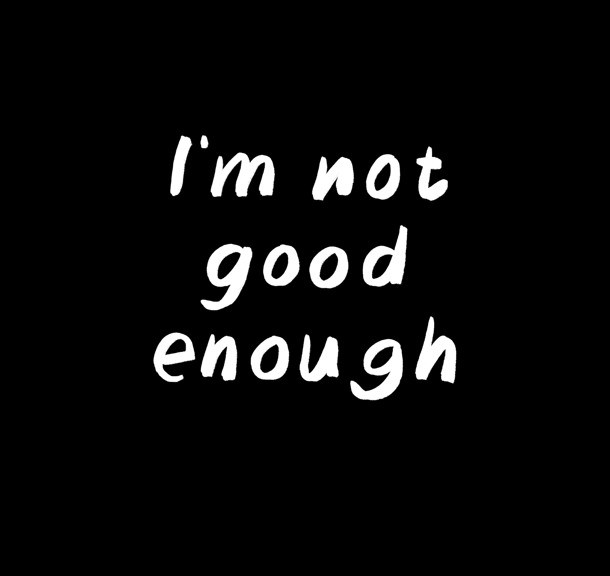
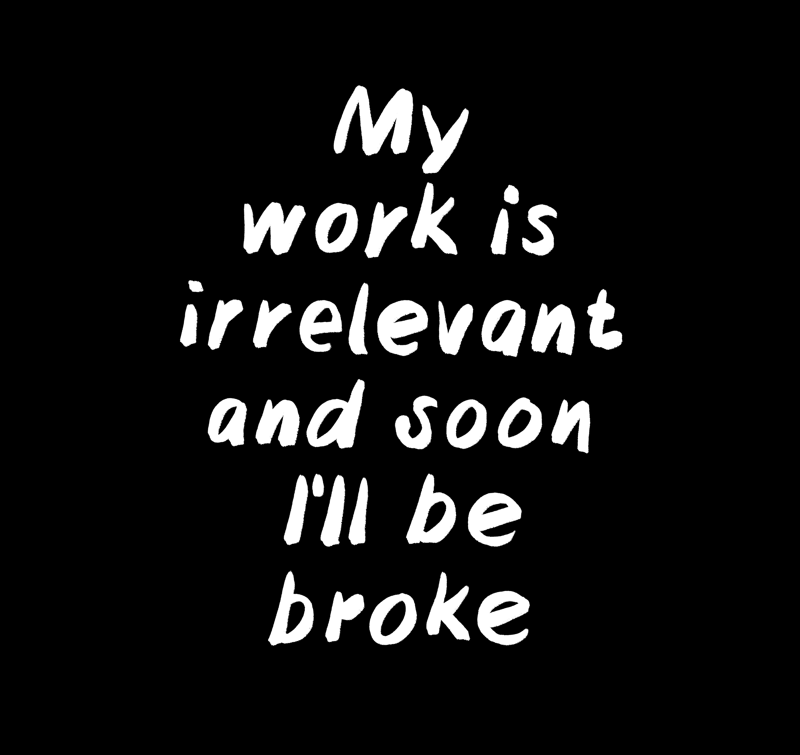
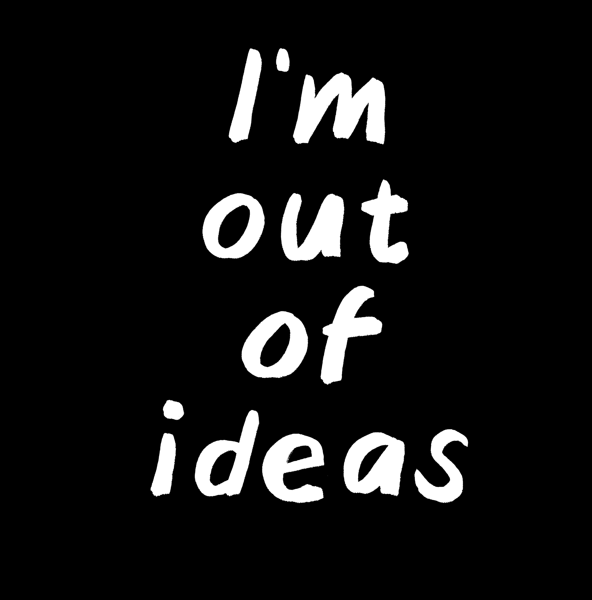

Posted by Christoph Niemann (@abstractsunday): "A few years ago, I was mostly miserable when I was working. Eventually I realized this agony came from fears that didn't even relate to the creative challenge in front of me. I used this talk as an opportunity to figure out how to deal with those fears." The tweet links to the talk: https://t.co/yqsWyPoXG4 [Tweet](https://x.com/abstractsunday/status/1256907122090160128).

