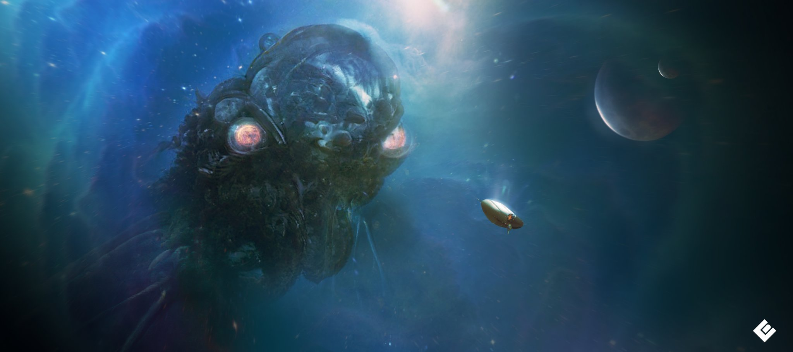
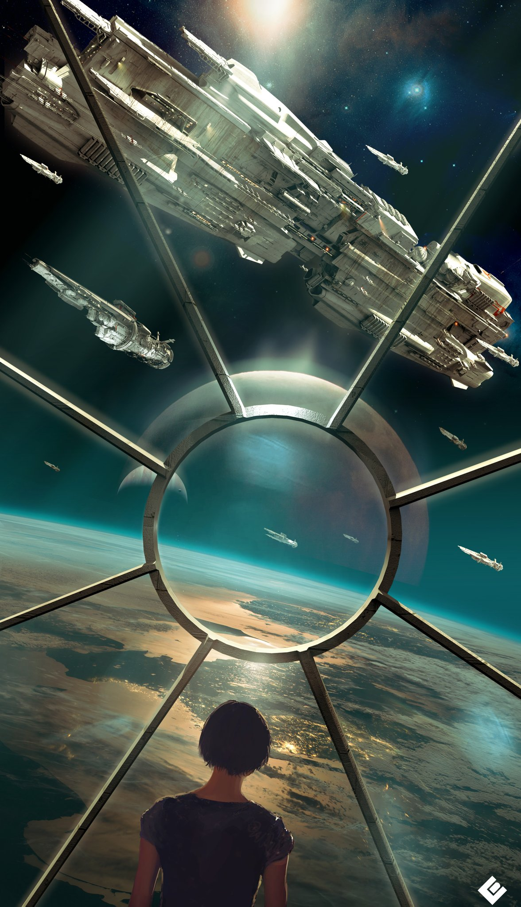
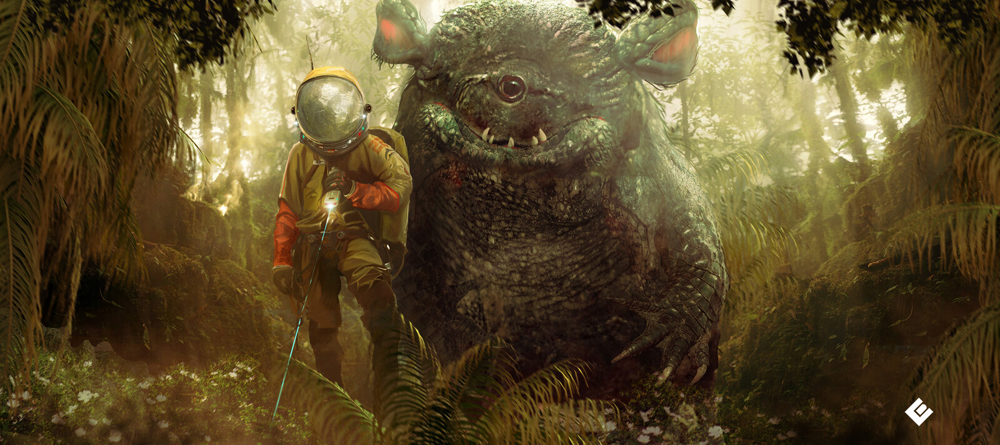
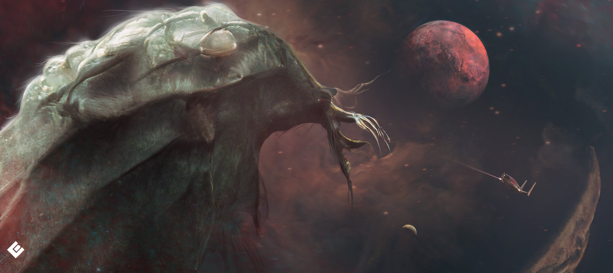

Posted by Col Price (@coldesign_ltd) on X, 2020-04-10. [Tweet](https://x.com/coldesign_ltd/status/1248516226697039873).

> Bank holiday here in the uk. Have an awesome weekend. Stay safe and stay at home!!!!! Here are some scifi pics to take you away from the madness! #conceptart  #conceptartist #gamedev #productionart #scifiart #SciFiFri #art #ArtistOnTwitter

Also by the author in the conversation:

- cheers ! thank you ! ([tweet](https://x.com/coldesign_ltd/status/1248540857013284866))

