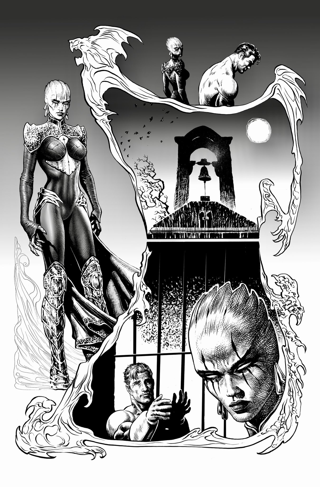
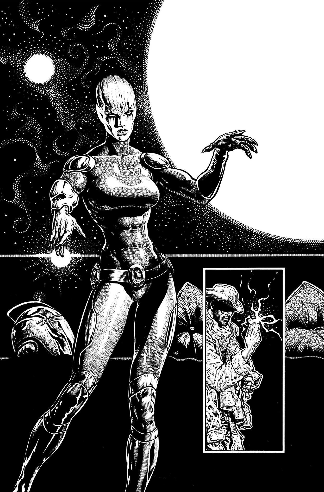
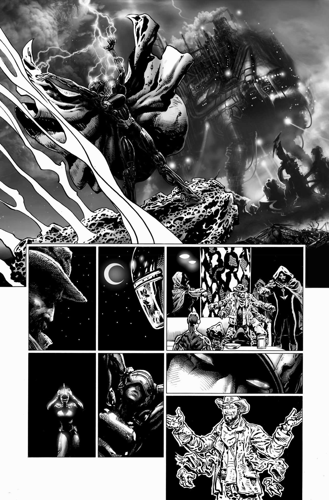
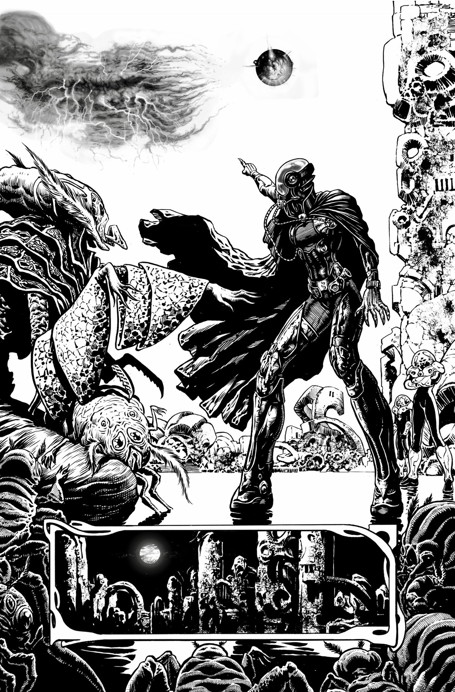

Art posted by Doc Sharpy (@LiamRSharp): "As far as cool villains go, the cosmic Vampire Belzebeth is right up there. She's always a lot of fun to draw..." [Tweet](https://x.com/LiamRSharp/status/1144231948002324480).

