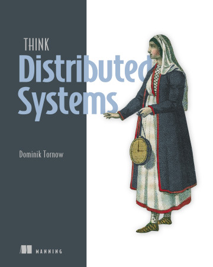
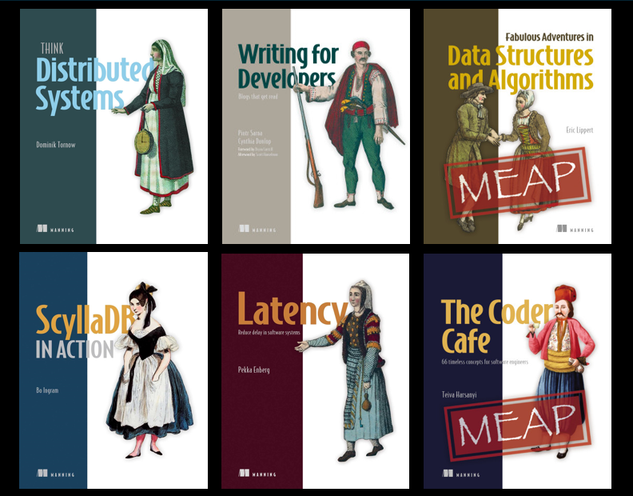

Posted by Dominik Tornow (@DominikTornow) on X, 2025-12-31. [Tweet](https://x.com/DominikTornow/status/2006334533759635678).

> New Year's Deal on 
> @ManningBooks
>  for my book Think Distributed Systems and many other titles to add to your 2026 reading list
>
> Happy New Year

