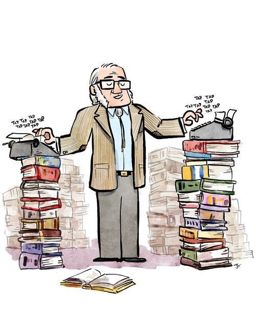

Posted by Prof. Feynman (@ProfFeynman) on X, 2019-12-28. [Tweet](https://x.com/ProfFeynman/status/1210963060589875200).

> "Education isn't something you can finish."
>
> -- Isaac Asimov (1920 - 1992)

