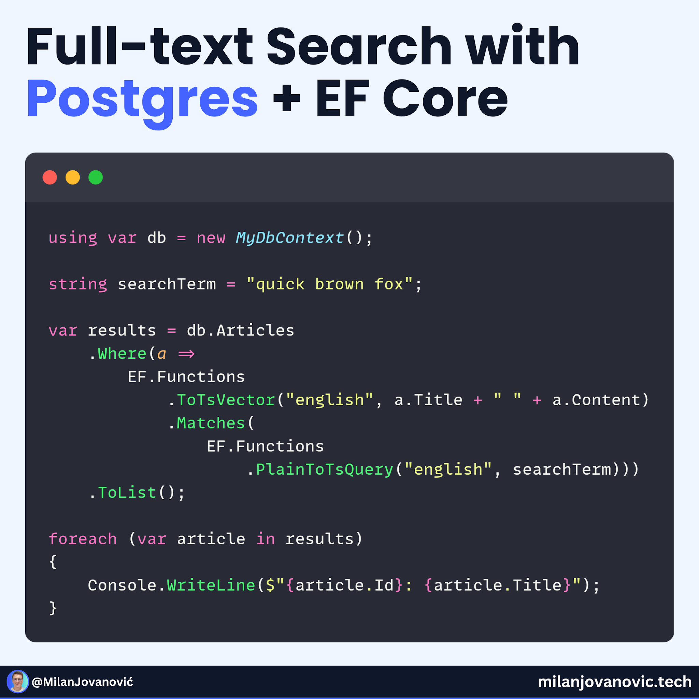

Community post by Milan Jovanović (@MilanJovanovicTech) on YouTube. [Post](https://youtube.com/post/Ugkx0OQyBeiUbOXSs3eJ-6NEmoYgpnN0E_QA).

> You can do full-text search in Postgres? 🐘
>
> Yes — and you can even wire it up with EF Core.
>
> With this, you can:
>
> - Set up full-text search indexes
> - Write efficient search queries
> - Rank and sort results by relevance
> - Integrate it smoothly inside your .NET apps
>
> Want a clean architecture foundation to plug these features into?
>
> P.S. Grab my Clean Architecture template here: https://www.milanjovanovic.tech/templates/clean-architecture
>
> What Postgres features have surprised you the most?

