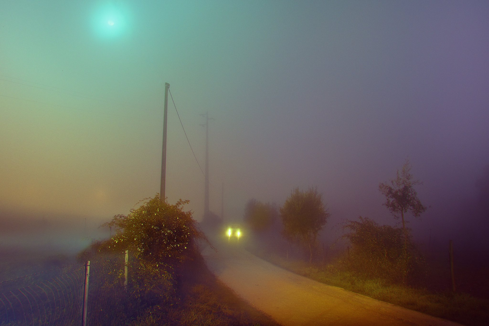
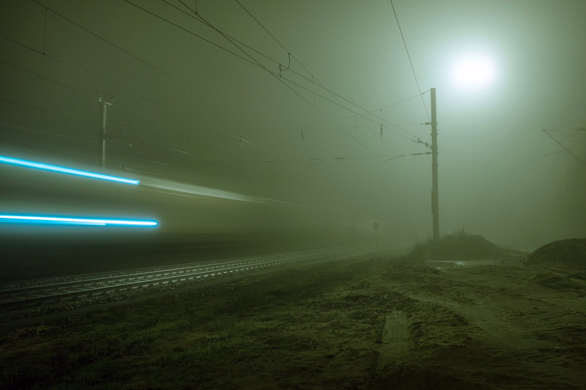
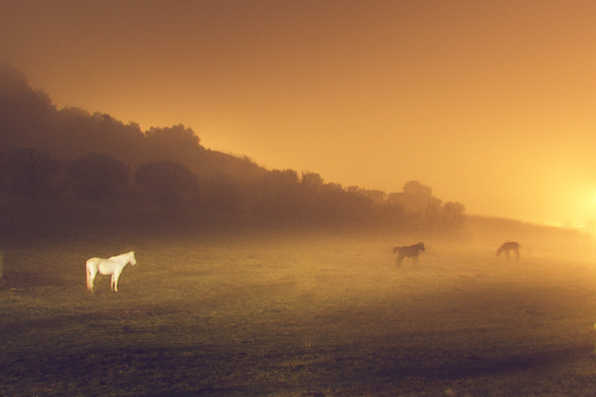
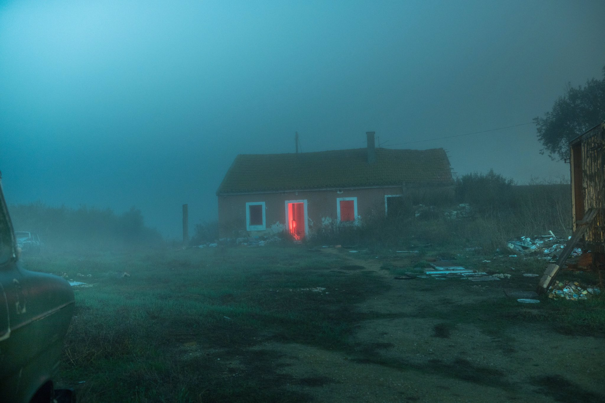

Posted by Henri Prestes (@HenriPrestes) on X, 2019-07-07. [Tweet](https://x.com/HenriPrestes/status/1147966516027121665).

> Roaming through portuguese villages at night.

Also by the author in the conversation:

- Thank you! ([tweet](https://x.com/HenriPrestes/status/1147987638986690560))
- Appreciate that Jake ([tweet](https://x.com/HenriPrestes/status/1147988184070070273))
- Thank you! Mostly involves a ton of waiting for the right weather conditions haha ([tweet](https://x.com/HenriPrestes/status/1147988331566960641))
- Thanks! ([tweet](https://x.com/HenriPrestes/status/1147988719800147968))
- Thank you! ([tweet](https://x.com/HenriPrestes/status/1148276194883919873))
- Really appreciate that! ([tweet](https://x.com/HenriPrestes/status/1148276264110821378))
- Currently a D850, but used a small fuji x100t for most of my past work. ([tweet](https://x.com/HenriPrestes/status/1148276627270488064))
- Definitely would love to shoot in Mexico someday! ([tweet](https://x.com/HenriPrestes/status/1148276749341515776))
- Thank you! That’s very kind of you to say. I’m currently using a D850, but used a fuji x100t for a lot of my images. ([tweet](https://x.com/HenriPrestes/status/1148277404571525121))
- Yes I have some limited editions prints at  http:// henriprestesp.com/prints thanks! ([tweet](https://x.com/HenriPrestes/status/1148278030785232896))

