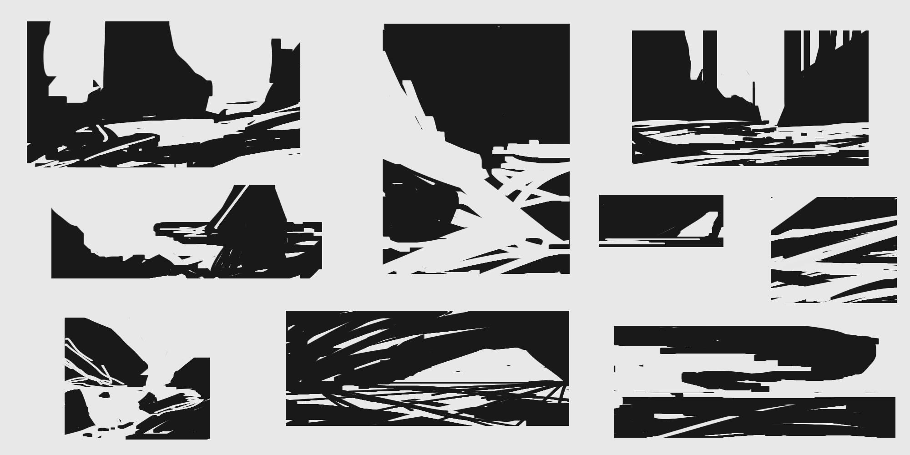
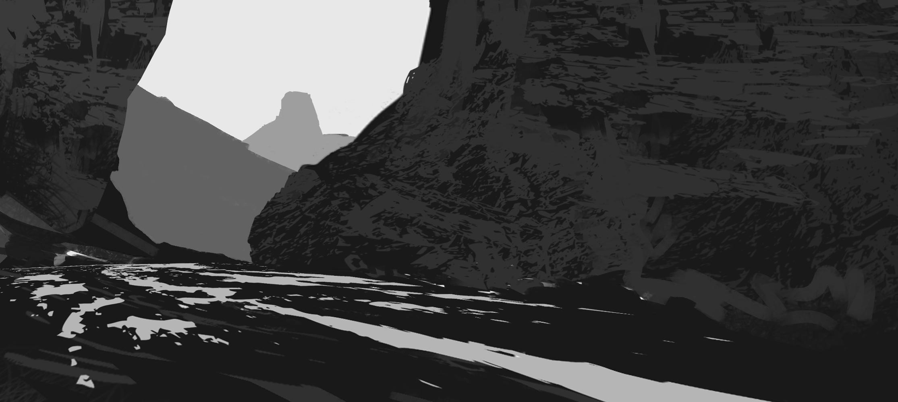
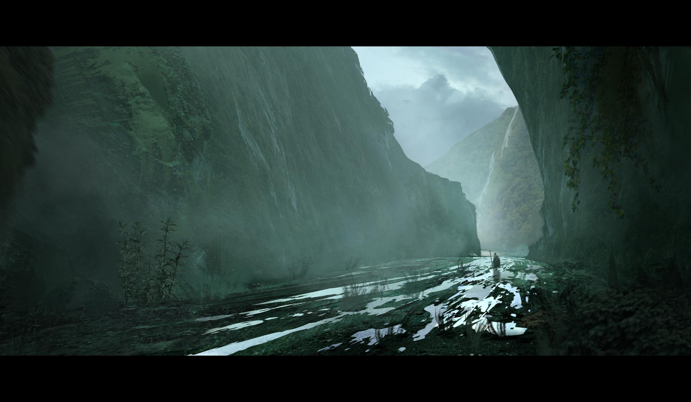

Posted by Muttino Breakspear (@muttconcept) on X, 2019-07-19. [Tweet](https://x.com/muttconcept/status/1152247978150846464).

> "Walk with caution on these grounds..."
>
> Mini tutorial.
>
> Step 1: composition thumbnails
> Step 2: Refine the choosen one
> Step 3: Sell your soul.

Also by the author in the conversation:

- No no no no! Check Marco Bucci and FZD school channels in youtube ([tweet](https://x.com/muttconcept/status/1152524757365080064))
- And also listen this masterpiece over and over again  https:// youtu.be/9h8o4HKV6gY ([tweet](https://x.com/muttconcept/status/1152525577863274496))
- Just think about shape, light and shadow, go in a graphic way. ([tweet](https://x.com/muttconcept/status/1152653572053639169))

