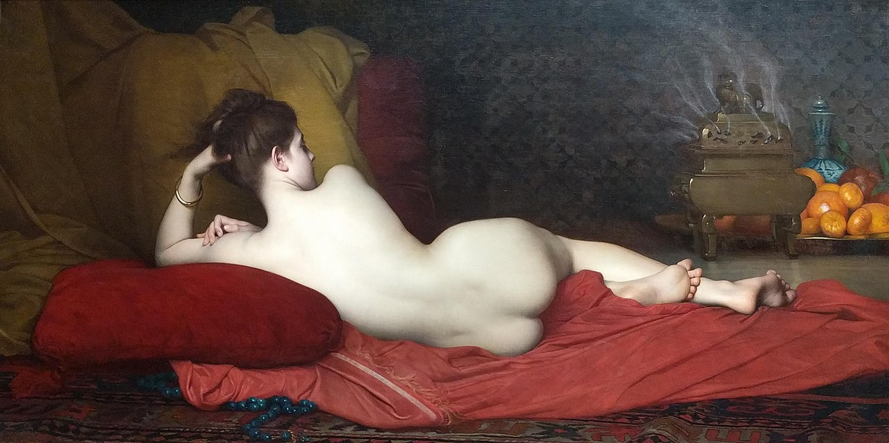

Shared by Eelco Kappe (@TripImprover): "For centuries, artists used mythological figures as an excuse to paint nudity. But in the 19th century, the odalisque (or concubine) became the inspiration for erotically-themed paintings. This Odalisque from 1874 is by Jules Joseph Lefebvre." The tweet tags the Art Institute of Chicago. [Tweet](https://x.com/TripImprover/status/1258362446344937472).

