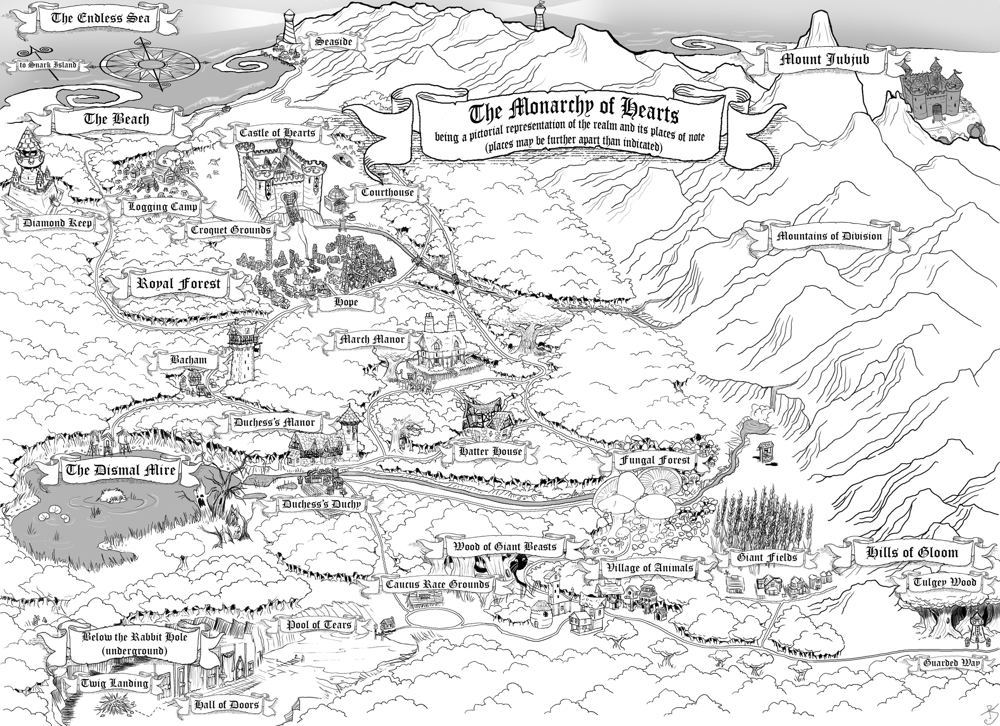
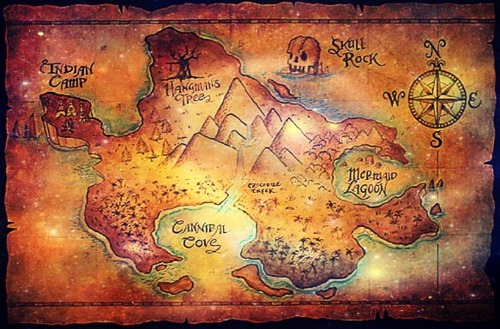
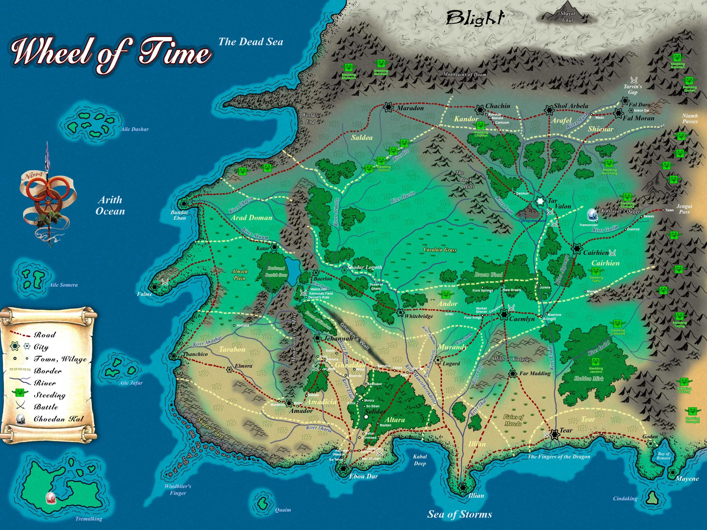
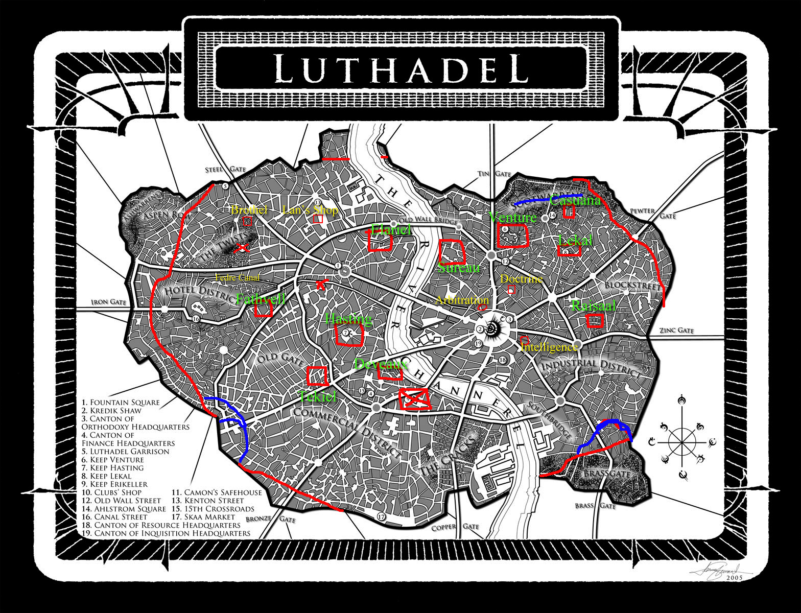

A página lista mundos literários marcados por mapas detalhados ou visualmente fortes e diz que esses mapas ajudam o leitor a se situar e a acompanhar universos complexos. O texto também observa que alguns desses mundos cresceram com material feito por fãs e com atlas e mapas interativos.

## Fichamento

- Em histórias de fantasia e ficção científica, o mapa facilita a imersão porque reduz a necessidade de lembrar geografia e geopolítica o tempo todo.
- Quanto mais complexo é um mundo, maior tende a ser a necessidade de um mapa.
- A Terra-Média é apresentada como um exemplo clássico de mundo muito detalhado, com atlas e mapa interativo produzidos depois dos livros.
- Westeros, Essos e Sothoryos são citados como um universo em expansão, acompanhado por atlas, mapa interativo e mapa geológico.
- Oz aparece como um mundo antigo e muito conhecido, publicado em 1900 e influente para autores posteriores.
- Nárnia é descrita como menos complexa que a Terra-Média, mas muito bem construída e bem explorada nas viagens da série.
- O País das Maravilhas é tratado como um mundo antigo e estruturado, embora o mapa tenha sido desenvolvido depois da publicação inicial.
- A Terra dos Sonhos, de Lovecraft, é apresentada como um plano de existência acessado pelos sonhos.
- Utopia é descrita como uma ilha no Atlântico e como um trabalho precursor da ficção científica.
- A Terra do Nunca é apontada como um mundo simples, mas importante pelo peso de Peter Pan.
- Terramar é apresentada com mapa simples em termos de arte, mas complexa pelo tamanho da obra e pela variedade de locais.
- As Terras do Oeste, de A Roda do Tempo, são descritas como um dos mundos mais complexos da fantasia, com forte participação de fãs.
- A Europa Alternativa de Leviatã é destacada pela geopolítica diferente da realidade.
- Luthadel é descrita como o cenário principal de Nascidos da Bruma: O Império Final, com foco inicial na cidade em vez do mundo ao redor.

## Mapas

### Arda – J.R.R. Tolkien

### Westeros, Essos e Sothoryos – G.R.R. Martin

### Oz – L. Frank Baum

### Nárnia – C.S. Lewis

### O País das Maravilhas – Lewis Carroll

### Terra dos Sonhos – H.P. Lovecraft

### Utopia – Thomas More

### Terra do Nunca – J.M. Barrie

### Terramar – Ursula K. Le Guin

### Terras do Oeste – Robert Jordan

### Europa Alternativa – Scott Westerfeld

### Cidade de Luthadel – Brandon Sanderson

