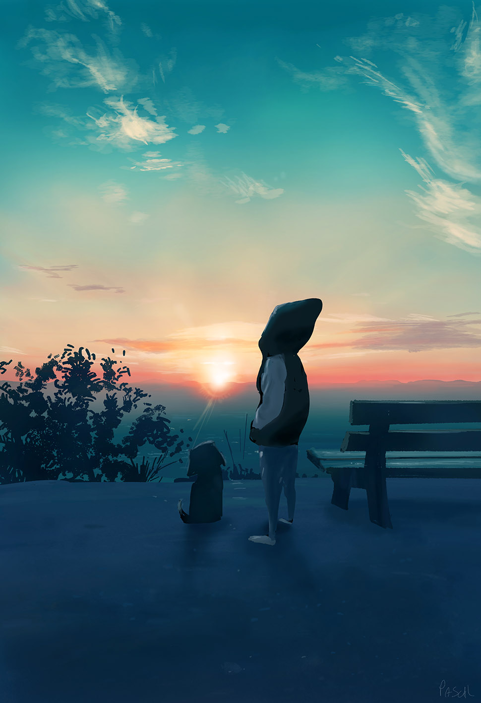

Posted by Pascal Campion (@pascalcampion) on X, 2019-12-29. [Tweet](https://x.com/pascalcampion/status/1211160108786307072).

> Max and the Mountain.
> I am also posting the process Gif In the comments!
> #pascalcampion

Also by the author in the conversation:

- Process gif [video/GIF in the tweet] ([tweet](https://x.com/pascalcampion/status/1211160186930352130))

