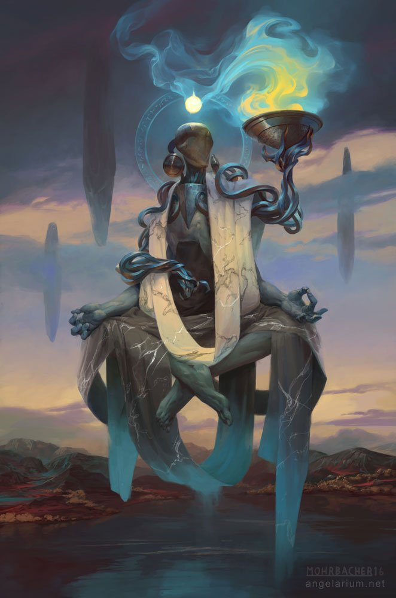

Posted by Peter Mohrbacher (@bugmeyer) on X, 2019-07-06. [Tweet](https://x.com/bugmeyer/status/1147544511444389892).

> Phanuel, Angel of Truth  You, with the faces of gods - I see your flaws for what they are.  Invoke me and I shall not falter.  I, the most patient attendant, guardian of the throne and seer of truth have witnessed your destruction numberless times.  Seek me.  I wait.

