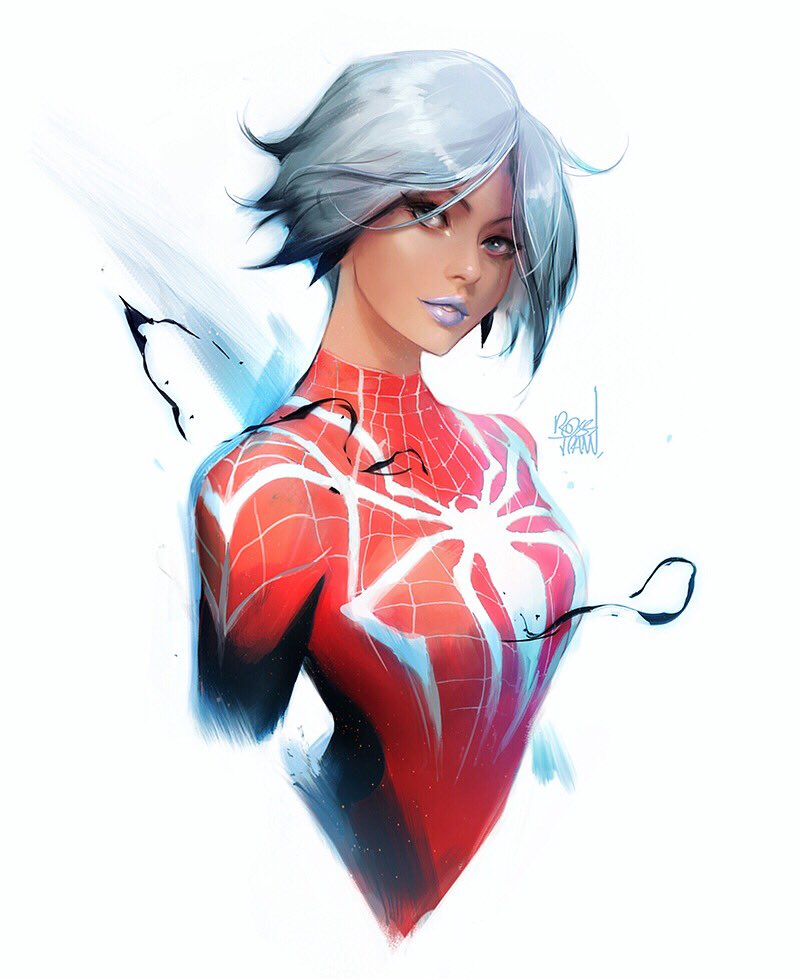

Posted by Rossdraws @ gallerynucleus nov 14-15 (@Rossdraws) on X, 2019-07-08. [Tweet](https://x.com/Rossdraws/status/1148288805620764672).

> Got inspired to finish this during the weekend! Thought Spider-Man was amazing, wanted to come up with my own version

