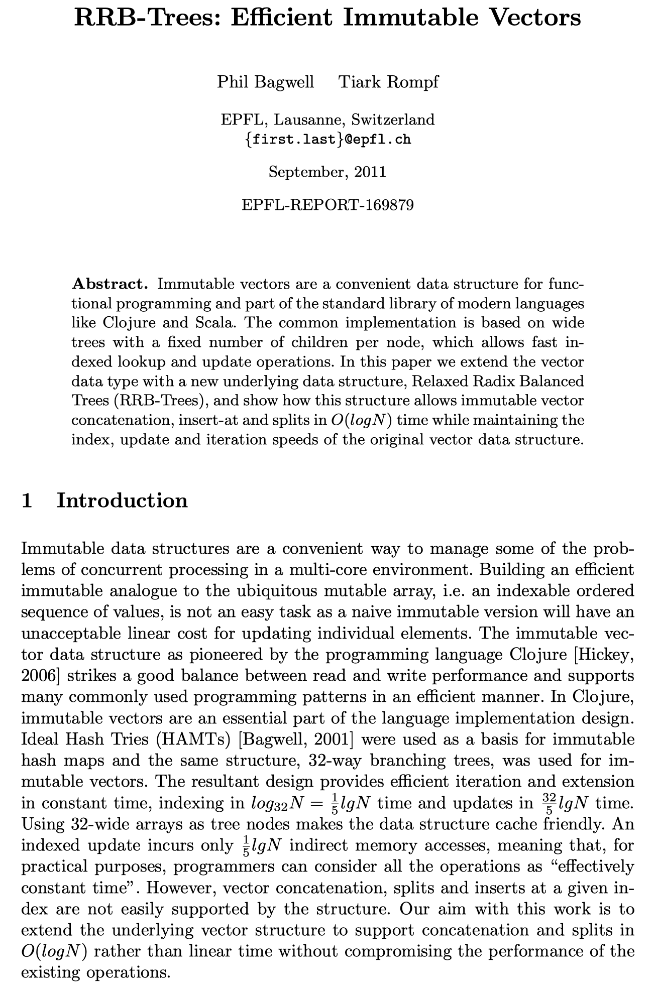

Posted by Debasish (দেবাশিস্) Ghosh (@debasishg) on X, 2023-12-04. [Tweet](https://x.com/debasishg/status/1731710820814651666).

> Scala's immutable vectors are implemented based on the data structure described in this paper. A very nice read if you love data structures and would like to learn the implementation of collection.immutable.Vector in Scala.
>
> RRB-Trees: Efficient Immutable Vectors by Phil Bagwell and Tiark Rompf (https://infoscience.epfl.ch/record/169879?
> ln=en
> )
>
> A brief summary ..
>
> Hash Array Mapped Tries (HAMT), also by Phil Bagwell started being the cornerstone of immutable vector implementation and was first used by Rich Hickey in Clojure. 
>
> The idea was to use wide trees (32-way branching trees) of short height that provides efficient iteration and extension in constant time, indexing in log (32) N time and updates in (32/5) lg N time. Also 32-wide arrays provided cache line efficiency. However vector concatenation, splits and inserts at a given index are not easily supported by this structure.
>
> In Scala, immutable vectors are implemented using this new data structure, Relaxed Radix Balanced Trees (RRB-Trees), that allows immutable vector concatenation, insert-at and splits in O(logN) time while maintaining the index, update and iteration speeds of the original vector data structure. RRBs seem to provide a viable extension to the existing 32-way immutable vector that Clojure uses.

