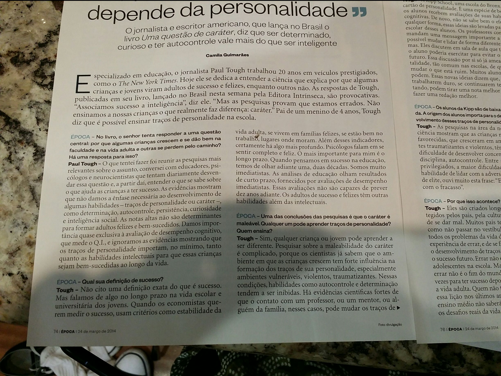
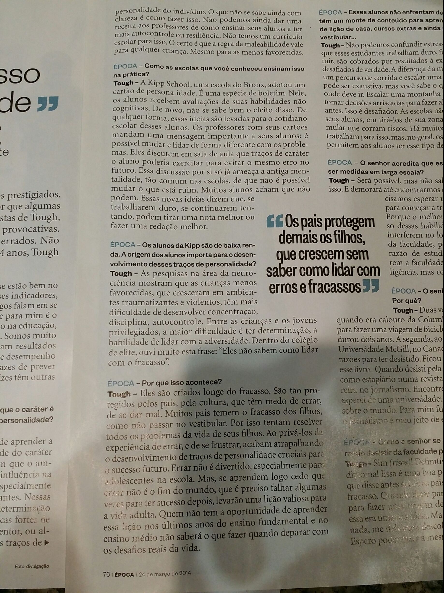
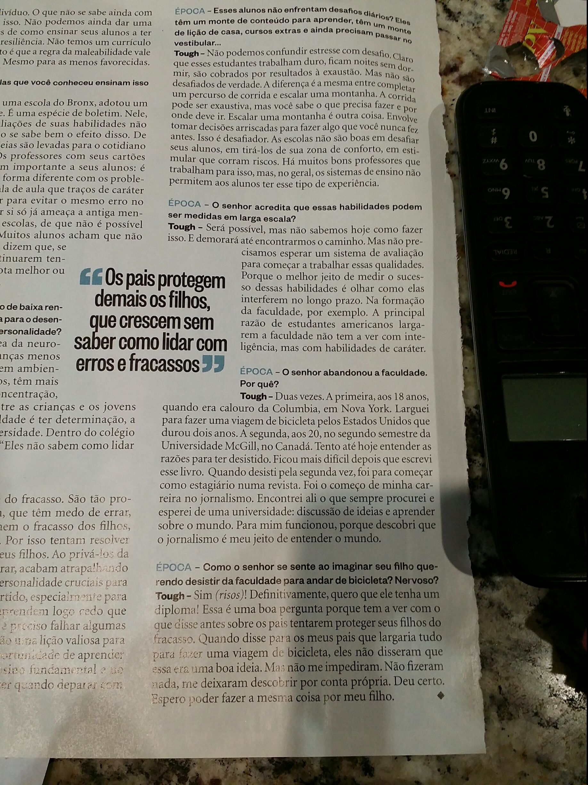

Entrevista de Camila Guimarães com o jornalista Paul Tough, publicada na revista Época de 24 de março de 2014 (pp. 74–76), no lançamento de *Uma questão de caráter* pela Intrínseca. Tough diz que determinação, autocontrole, persistência, curiosidade e inteligência social importam, no mínimo, tanto quanto as habilidades intelectuais para o sucesso de crianças e jovens, e que esses traços podem ser aprendidos. Cita o cartão de personalidade da Kipp School, no Bronx, diferencia estresse de desafio e diz que pais que protegem os filhos de todo fracasso atrapalham o desenvolvimento desses traços.

