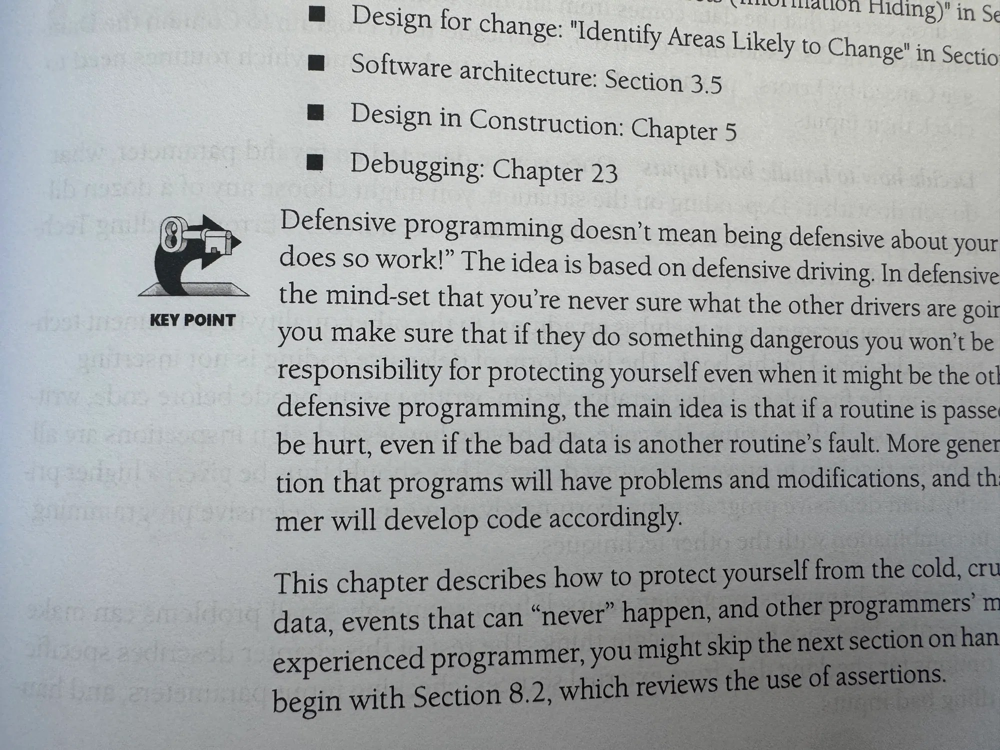
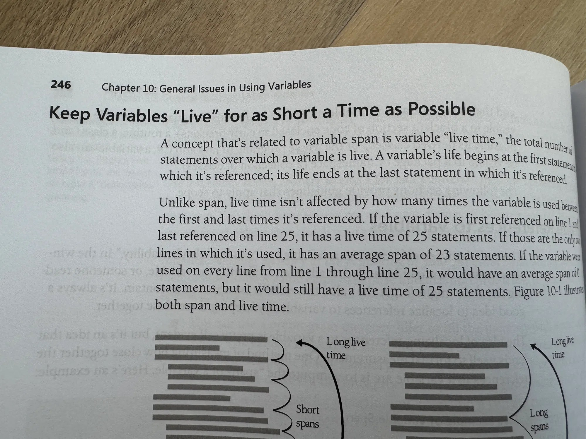

Posted by Gergely Orosz (@gergely.pragmaticengineer.com) on Bluesky, 2025-05-08. [Post](https://bsky.app/profile/gergely.pragmaticengineer.com/post/3lonmanjpec2g).

> So so many gems in this book.
>
> Plus… you now know where “Coding Horror” was coined (and indirectly led to Stack Overflow!)

